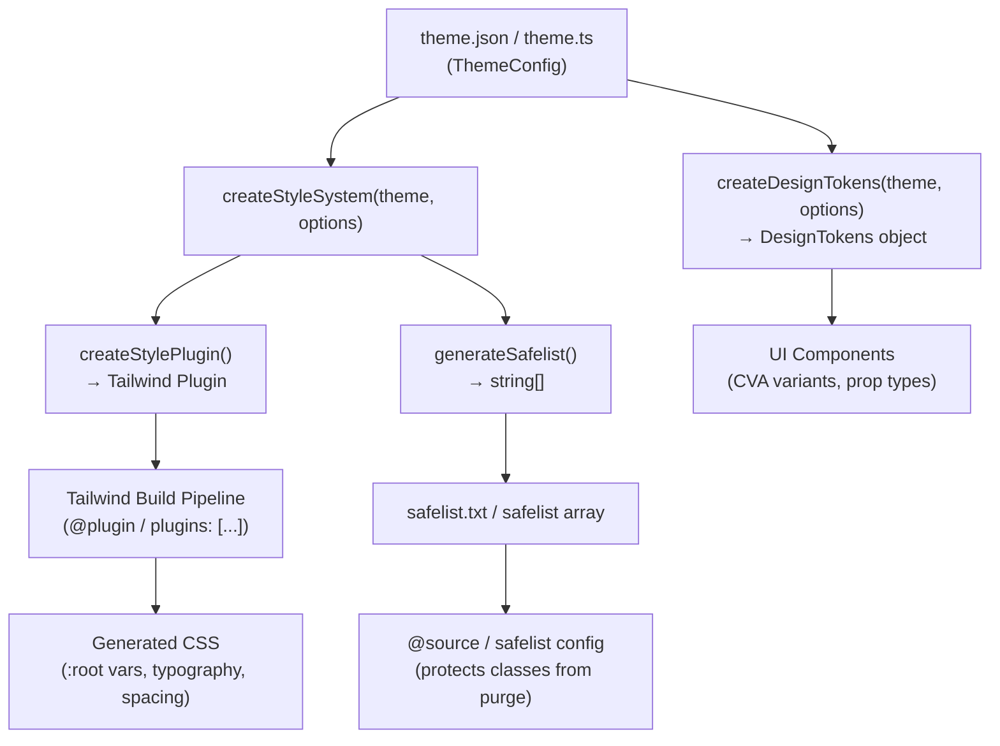
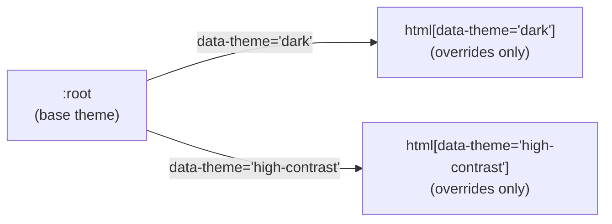

# Architecture

Tài liệu mô tả kiến trúc tổng thể của thư viện `fe-style-generator`.

## Mục lục

- [Architecture](#architecture)
  - [Mục lục](#mục-lục)
  - [Core Concepts](#core-concepts)
  - [Data Flow](#data-flow)
  - [Source Code Structure](#source-code-structure)
  - [Factory Functions](#factory-functions)
    - [`createStyleSystem` _(Khuyến nghị)_](#createstylesystem-khuyến-nghị)
    - [`createStylePlugin`](#createstyleplugin)
    - [`generateSafelist`](#generatesafelist)
    - [`createDesignTokens`](#createdesigntokens)
    - [Vite Plugin (emit-only)](#vite-plugin-emit-only)
  - [Multi-theme System](#multi-theme-system)
  - [Spacing System](#spacing-system)
    - [Plugin Output (tự động tạo)](#plugin-output-tự-động-tạo)
    - [Consumer Usage](#consumer-usage)
    - [Ưu điểm](#ưu-điểm)
  - [Exports API](#exports-api)

---

## Core Concepts

| Khái niệm         | Mô tả                                                                                                                |
| ----------------- | -------------------------------------------------------------------------------------------------------------------- |
| **Theme Config**  | Đầu vào duy nhất của hệ thống. Object/JSON định nghĩa `colors`, `typography`, `shadows`, `borderRadius`, `themes`... |
| **Factory**       | Các hàm nhận Theme Config → sinh ra artifact (Plugin, Safelist, Design Tokens)                                       |
| **Plugin**        | Tailwind CSS plugin object — inject CSS variables, typography utilities, spacing rules                               |
| **Safelist**      | Mảng class names được bảo vệ khỏi Tailwind purge                                                                     |
| **Design Tokens** | Object chứa các mảng token keys, dùng trong UI Component logic (CVA, styled-components...)                           |
| **Hybrid Theme**  | Cơ chế tổ chức màu sắc theo 3 buckets: `base`, `text`, `common`. Hỗ trợ Nested Colors và `DEFAULT` key.              |
| **Consumer**      | Project sử dụng thư viện — kết nối plugin vào Tailwind build pipeline                                                |

---

## Data Flow



---

## Source Code Structure

```text
src/
├── core/                       # Base config, Types, Options & Inference
│   ├── designTokensTypes.ts    # Semantic type aliases (ColorVariant, TextVariant, etc.)
│   └── ...
├── features/                   # Core style functionalities
│   ├── plugin/                 # Plugin logic & Variables
│   ├── safelist/               # Safelist generation
│   ├── spacing/                # Spacing constants & responsive rules
│   ├── tokens/                 # Design Token inference & generation
│   ├── cva/                    # CVA variant mapper utils
│   ├── vite/                   # Vite plugin for emit-only theme generation
│   ├── theme-css/              # Theme CSS (@theme inline) generation
│   └── ...
├── shared/                     # Utilities reused across features
├── types/                      # TypeScript type definitions
│   ├── ThemeConfig.ts          # ThemeConfig, ThemeOverride, TypographyConfig
│   ├── Options.ts              # StyleGeneratorOptions, Breakpoint enum, ModuleConfig
│   └── index.ts
│
├── utils/                      # Utilities
│   ├── helpers.ts              # toKebabCase, flattenToVars, mapToVarRefs, addDot...
│   ├── cssVariables.ts         # extractData, buildVarName
│   ├── spacingHelpers.ts       # resolveSpacing, resolveSpacingProps
│   └── index.ts
│
└── constants/                  # Default values
    ├── defaultOption.ts        # DEFAULT_SPACING_PROPERTIES, DEFAULT_LAYOUT_CLASSES...
    ├── safelistProperties.ts   # roundedProperties, borderProperties
    └── index.ts
```

---

## Factory Functions

### `createStyleSystem` _(Khuyến nghị)_

Entry point chính. Tính safelist một lần và truyền vào plugin (tránh tính hai lần).

```typescript
const { plugin, safelist, DesignTokens } = createStyleSystem(theme, options);
// plugin → dùng trong @plugin hoặc plugins: [...]
// safelist → string[] → ghi ra safelist.txt hoặc dùng @source
// DesignTokens → object token hoá để dùng cho tooling/docs/custom build khác
```

### `createStylePlugin`

Tạo Tailwind Plugin instance. Thực hiện:

1. Xây dựng CSS variables cho `:root` và từng `html[data-theme='<name>']`
2. Đăng ký typography utilities (`.text16Medium`, `.text32Bold`...)
3. Sinh spacing CSS custom property rules (`.sp-p`, `.sp-mx`...)
4. Extend Tailwind theme với colors, shadows, borderRadius...

```typescript
// Dùng trực tiếp nếu không cần safelist
const plugin = createStylePlugin(theme, options);
```

### `generateSafelist`

Sinh mảng class names cần safelist (KHÔNG bao gồm spacing — spacing dùng CSS custom props).

```text
Các module được safelist:
1. Layout     → hidden, flex, items-center, justify-between...
2. Rounded    → rounded-md, rounded-lg...
3. Border     → border-0, border-1, border-2...
4. Colors     → text-primary, bg-white, border-main...
5. Typography → text-16-medium, text-32-bold...
6. Shadows    → shadow-sm...
7. Backdrop   → backdrop-blur-sm...
8. Opacity    → opacity-0, opacity-25...
9. Z-Index    → z-0, z-10...
10. Dynamic   → các class user tự thêm
```

### `createDesignTokens`

Trả về object chứa các mảng key từ theme config. Dùng cho component logic, CVA variants, prop type definitions.

```typescript
const { DesignTokens } = createDesignTokens(theme, options);
// DesignTokens.Web.variantColor → ["primary", "white", "main", ...]
// DesignTokens.Web.variantText  → ["text16Medium", "text32Bold", ...]
```

Hỗ trợ **Hybrid Theme** mapping:

- `base.*` -> `--color-base-*`
- `text.*` -> `--color-text-*`
- `common.*` -> `--color-common-*`

Hỗ trợ **Nested Colors**:

- `primary.500` -> `primary-500` trong token array.
- `primary.DEFAULT` -> `primary` trong token array.

**Type inference:** Hàm dùng Generic `T extends ThemeConfig` kết hợp type utilities (`KebabCase`, `KeysOf`, `LiteralArray`) để preserve literal types thay vì widen sang `string`.

### Vite Plugin (emit-only)

Vite plugin tự động phát sinh `theme.css` và `safelist.txt` từ theme JSON, thay thế workflow manual predev/prebuild cho Tailwind v4.

```typescript
// vite.config.ts
import { styleGenVite } from "@duydpdev/style-generator/vite";

export default defineConfig({
  plugins: [
    react(),
    styleGenVite({
      themePath: "src/theme/theme.json",
      outDir: "src/theme",
      options: { tailwindVersion: 4 },
    }),
    tailwindcss(),
  ],
});
```

**Tùy chọn:**

- `themePath` — Đường dẫn theme JSON (tương đối từ project root)
- `outDir` — Thư mục output (mặc định: `dirname(themePath)`, PHẢI khớp với `@import` path)
- `options` — Forwarded đến `createStyleSystem` internals

**Lifecycle:**

- `configResolved` — Phát sinh file đồng bộ (trước `@source` scan)
- `configureServer` — HMR watcher (200ms debounce)
- `closeBundle` — Final write cho build command

**Bảo mật:** Path-traversal guard giữ themePath/outDir trong project root; module-scoped registry cảnh báo khi nhiều instance target cùng outDir (monorepo safe); SSR per-environment guarded.

---

## Multi-theme System

Theme config hỗ trợ nhiều theme thông qua key `themes`. Mỗi entry trong `themes` map với `html[data-theme='<name>']`.

**Theme hierarchy:**

- Base config → `:root` (theme mặc định)
- `themes.dark` → `html[data-theme='dark']`
- `themes.<name>` → `html[data-theme='<name>']`

**Cơ chế:** Mỗi theme chỉ cần khai báo values **khác** so với base. CSS variable cascade tự động xử lý fallback.



**Lưu ý quan trọng:** Không còn dùng key `dark` trực tiếp ở top-level. Phải dùng `themes.dark`.

---

## Spacing System

Spacing **không** dùng safelist manual. Plugin tạo các utility class cố định `.sp-*` với `var()` fallback chains — hỗ trợ responsive mà không cần generate hàng nghìn class.

Từ **v3.1+**, `generateSafelist()` tự động bao gồm `sp-<key>` cho mỗi spacing property (mặc định: `p`, `px`, `py`, `pt`, `pb`, `pl`, `pr`, `m`, `mx`, `my`, `mt`, `mb`, `ml`, `mr`, `gap`, `gapX`, `gapY`). Tắt với `options.spacing.enabled = false`; tùy chỉnh với `options.spacing.properties = {...}`.

### Plugin Output (tự động tạo)

```css
/* Base */
.sp-p {
  padding: var(--sp-p);
}
.sp-mx {
  margin-left: var(--sp-mx);
  margin-right: var(--sp-mx);
}

/* Responsive (mobile-first cascade) */
@media (min-width: 768px) {
  .sp-p {
    padding: var(--sp-p-md, var(--sp-p));
  }
}
@media (min-width: 1024px) {
  .sp-p {
    padding: var(--sp-p-lg, var(--sp-p-md, var(--sp-p)));
  }
}
```

### Consumer Usage

Component dùng `resolveSpacing` / `resolveSpacingProps` để map prop values → CSS variables:

```tsx
const spacing = resolveSpacingProps({ p: 4, mx: { base: 2, md: 4 } });
// classNames: ["sp-p", "sp-mx"]
// style: { "--sp-p": "1rem", "--sp-mx": "0.5rem", "--sp-mx-md": "1rem" }
```

### Ưu điểm

- **Safelist tự động** cho spacing — v3.1+ không cần thêm manual
- **Hỗ trợ giá trị tự do** — không bị giới hạn bởi predefined values
- **Responsive** — mobile-first cascade tự động

---

## Exports API

| Export                  | Loại      | Mô tả                                              |
| ----------------------- | --------- | -------------------------------------------------- |
| `createStyleSystem`     | Function  | Entry point → `{ plugin, safelist, DesignTokens }` |
| `createStylePlugin`     | Function  | Chỉ tạo plugin                                     |
| `generateSafelist`      | Function  | Chỉ sinh safelist array                            |
| `generateThemeCss`      | Function  | Sinh `@theme inline` CSS (v4 only)                 |
| `createDesignTokens`    | Function  | Sinh Design Tokens object                          |
| `createVariantMapper`   | Function  | Tự động map tokens + prefix từ feature cva         |
| `resolveSpacing`        | Function  | Resolve một spacing prop                           |
| `resolveSpacingProps`   | Function  | Resolve nhiều spacing props                        |
| `styleGenVite`          | Function  | Vite plugin (subpath `/vite`)                      |
| `Breakpoint`            | Enum      | `SM \| MD \| LG \| XL \| XXL`                      |
| `ColorVariant`          | Type      | Color keys union (semantic alias)                  |
| `TextVariant`           | Type      | Typography keys union (semantic alias)             |
| `ShadowVariant`         | Type      | Shadow keys union (semantic alias)                 |
| `BackdropBlurVariant`   | Type      | Backdrop blur keys union (semantic alias)          |
| `BorderVariant`         | Type      | Border keys union (semantic alias)                 |
| `RoundedVariant`        | Type      | Border-radius keys union (semantic alias)          |
| `ThemeConfig`           | Interface | Type cho theme config object                       |
| `StyleGeneratorOptions` | Interface | Type cho options                                   |
| `ModuleConfig`          | Interface | Type cho module config                             |
| `SpacingPropertyMap`    | Type      | Type cho spacing property mapping                  |

---

## Landing Site (`site/`)

Top-level `site/` là một marketing landing page riêng (React + Vite + Tailwind v4) dogfood thư viện qua yarn workspace `workspace:*`.

- **Path:** `site/`
- **Stack:** React 19, Vite 7, Tailwind v4, `@duydpdev/style-generator` (workspace), `styleGenVite()`
- **Theme:** Cobalt palette (`site/src/theme/theme.json`) — sinh ra `site/src/theme/theme.css` qua `styleGenVite` plugin
- **Cấu trúc:** 10 chapters editorial-scroll (Hero · Pros/Cons · Compare · Build · Features · Spacing · Theming · Types · Tooling · Start + CTA + Footer)
- **Effects:** sidebar TOC + scroll-spy, scroll progress bar, IntersectionObserver reveal/stagger, marquee, terminal typewriter lazy-trigger, single-pass JSON/CSS/TS syntax highlighter, theme toggle (`data-theme=light|dark`)
- **Scripts:** `yarn workspace site {dev,build,typecheck,lint}`. Dev port mặc định 5174 để không xung đột với examples.
- **Workspace setup:** root `package.json` khai báo `workspaces: ["site", "examples/*"]` + `resolutions.vite` để chỉ có một instance Vite duy nhất, tránh lỗi `Plugin<any>` không khớp giữa hai bản sao.

### Routes

- `/` — landing (10 chapters editorial scroll).
- `/docs` — auto-redirect tới doc đầu tiên.
- `/docs/:slug` — render `docs/*.md` qua `react-markdown` + `remark-gfm` + `rehype-highlight`. Sidebar liệt kê toàn bộ doc.
- `/examples/v3` và `/examples/v4` — iframe embed các app trong `examples/react-v{3,4}/dist`. Tab switcher giữa v3/v4 + nút open-in-new-tab.

### Examples integration

`site/scripts/build-examples.mjs` chạy trước Vite build site (qua `yarn build:examples`):

1. Đặt env `EXAMPLE_BASE=${VITE_BASE}examples/<v3|v4>/` cho từng example.
2. Gọi `yarn workspace react-v{3,4}-example build`.
3. Copy `examples/react-v{3,4}/dist` vào `site/public/examples/{v3,v4}` (gitignored).

Khi Vite build site, content của `public/` được copy thẳng sang `dist/`, tạo path `dist/examples/v{3,4}/index.html`.

Iframe trong `examples-page.tsx` load `${BASE}/examples/v4/index.html` với `sandbox="allow-scripts allow-same-origin allow-forms"`.

### Examples catalog (`examples/*`)

`examples/` hiện có 4 consumer app (tất cả link lib qua `workspace:*`, full-parity cùng `theme.json` + palettes + cva configs + 10 demo section):

| Example    | Stack                           | Theme wiring                                                                                                                                                                                     |
| ---------- | ------------------------------- | ------------------------------------------------------------------------------------------------------------------------------------------------------------------------------------------------ |
| `react-v3` | Vite + React + Tailwind v3      | `createStyleSystem()` → `tailwind.config.ts` (plugin + safelist)                                                                                                                                 |
| `react-v4` | Vite + React + Tailwind v4      | `styleGenVite` → `@plugin` + `@theme inline`                                                                                                                                                     |
| `next-v4`  | Next.js 15 (App Router) + TW v4 | Không Vite → prebuild Node script `scripts/generate-theme.mjs` (`generateThemeCss`/`generateSafelist`), chain `yarn generate:theme && next build` (Yarn Berry bỏ qua `pre`/`post` hooks)         |
| `nuxt-v4`  | Nuxt 3 (Vue 3) + TW v4          | Nuxt chạy trên Vite → tái dùng `styleGenVite` trong `nuxt.config.ts → vite.plugins`; component rewrite thành Vue SFC, state qua `useState` composables (SSR-safe `<html data-*>` bằng `useHead`) |

`build-examples.mjs` của site chỉ embed `react-v3`/`react-v4` (iframe). `next-v4`/`nuxt-v4` là standalone, không nhúng vào landing site.

### Deploy pipelines

| Target              | Workflow                     | See                                                          |
| ------------------- | ---------------------------- | ------------------------------------------------------------ |
| npm package         | `release.yml` + `deploy.yml` | [`docs/deploy.md`](./deploy.md)                              |
| GitHub Pages (site) | `deploy-site.yml`            | [`docs/deploy.md`](./deploy.md#site-deployment-github-pages) |
