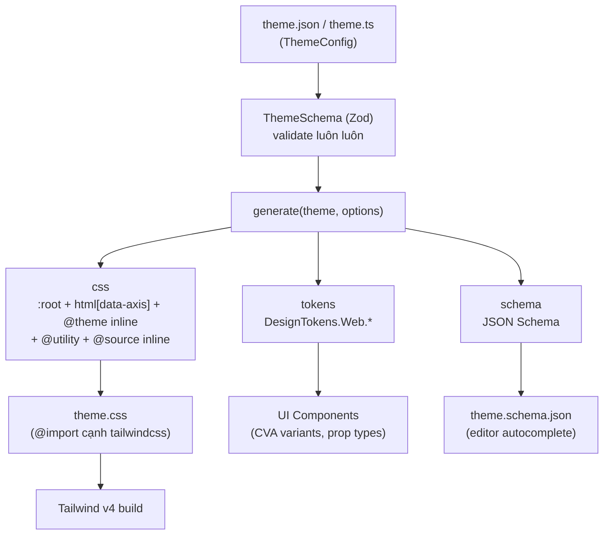
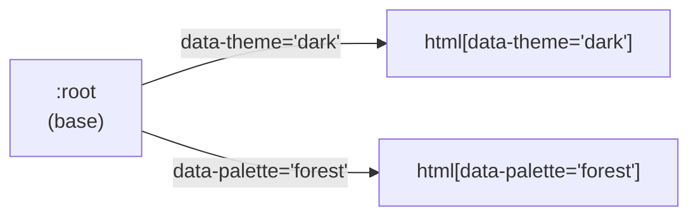

# Architecture

Tài liệu mô tả kiến trúc tổng thể của `@duydpdev/style-generator` 4.0.0 (Tailwind CSS v4 only). Code là nguồn sự thật cho _cách_ hoạt động; tài liệu này chỉ giữ _vì sao_ và _ở đâu_.

## Mục lục

- [Architecture](#architecture)
  - [Mục lục](#mục-lục)
  - [Core Concepts](#core-concepts)
  - [Data Flow](#data-flow)
  - [Source Code Structure](#source-code-structure)
  - [Entry Points](#entry-points)
    - [`generate`](#generate)
    - [`createDesignTokens`](#createdesigntokens)
    - [Vite Plugin (emit-only)](#vite-plugin-emit-only)
    - [Next.js Plugin (emit-only)](#nextjs-plugin-emit-only)
    - [CLI](#cli)
  - [Registry \& `@source inline`](#registry--source-inline)
  - [Multi-axis Theming (`themeAxes`)](#multi-axis-theming-themeaxes)
  - [Spacing System](#spacing-system)
  - [Exports API](#exports-api)
  - [Landing Site (`site/`)](#landing-site-site)

---

## Core Concepts

| Khái niệm         | Mô tả                                                                                                                                                           |
| ----------------- | --------------------------------------------------------------------------------------------------------------------------------------------------------------- |
| **Theme Config**  | Đầu vào duy nhất: JSON/object khai báo `colors` (bắt buộc), `typography`, `shadows`, `backDropBlurs`, `borderRadius`, `fontFamily`, `borderWidth`, `themeAxes`. |
| **ThemeSchema**   | Zod `strictObject` là nguồn sự thật cho cả JSON lẫn TypeScript: key lạ, giá trị không an toàn, alias hỏng đều bị từ chối trước khi sinh CSS.                    |
| **Registry**      | Mỗi category (colors, typography, …) là một descriptor trong `builtInCategories`; mọi bước sinh CSS/`@source inline` đi qua registry thay vì lặp danh sách key. |
| **`generate()`**  | Hàm duy nhất sinh artifact: `{ css, tokens, schema }`. CLI, `styleGenVite`, `styleGenNext` đều gọi lại hàm này.                                                 |
| **Design Tokens** | Object chứa các mảng token key (`DesignTokens.Web.*`), dùng trong UI component (CVA, prop types).                                                               |
| **Consumer**      | Project dùng thư viện: `@import` file CSS đã sinh cạnh `@import "tailwindcss"`. Không có `@plugin`, không có safelist.                                          |

---

## Data Flow



---

## Source Code Structure

```text
src/
├── core/                       # generate(), ThemeSchema, options schema (internal, optionsSchema.ts), Options, defineTheme, type inference
├── features/
│   ├── registry/               # builtInCategories, flattenByCategory, generateSourceInline
│   ├── theme-css/              # :root / html[data-axis] / @theme inline, border-width, screens
│   ├── typography/             # theme.typography → @utility
│   ├── spacing/                # .sp-* utilities + resolveSpacing helpers
│   ├── tokens/                 # createDesignTokens
│   ├── cva/                    # createVariantMapper
│   ├── vite/                   # styleGenVite
│   └── next/                   # styleGenNext
├── shared/                     # helpers (kebab/camel), defaults, COLOR_STATES, resolveSafePath, writeFileAtomic
├── cli/                        # commands: init, generate, doctor, schema
├── exports/                    # một file cho mỗi public subpath
├── __integration__/            # test compile CSS qua engine Tailwind thật
└── index.ts                    # root barrel
```

`src/exports/*` xác định subpath nào an toàn cho browser (không kéo Zod / Node built-in): `./tokens`, `./cva`, `./spacing`, `./types`. Ràng buộc này được kiểm bằng `scripts/check-browser-safe.mjs`.

---

## Entry Points

### `generate`

```typescript
const { css, tokens, schema } = generate(theme, options);
// css    → ghi ra file, @import cạnh tailwindcss
// tokens → DesignTokens (cùng kết quả với createDesignTokens)
// schema → z.toJSONSchema(ThemeSchema)
```

`generate()` luôn validate `theme` với `ThemeSchema` trước (kể cả khi caller đã gọi `defineTheme()`), rồi ghép các khối theo thứ tự: `@theme` breakpoints → `:root` + `html[data-<axis>="<variant>"]` + `@theme inline` → border-width `@utility` → typography `@utility` → spacing `@utility` → `@source inline`.

### `createDesignTokens`

Trả về object chứa các mảng key từ theme; dùng cho component logic, CVA variants, prop types.

```typescript
const { DesignTokens } = createDesignTokens(theme, options);
// DesignTokens.Web.variantColor      → ["primary", "primaryHover", ...]
// DesignTokens.Web.variantText       → ["text16Medium", ...]
// DesignTokens.Web.variantFontFamily → ["sans", ...]
// DesignTokens.Web.borderWidthOption → keys của borderWidth (mặc định 0, 1, 2, 4)
// DesignTokens.Web.breakpoints       → mặc định ["md", "lg"]
```

**Type inference:** generic `T extends ThemeConfig` kết hợp `KebabCase`, `CamelCase` để giữ literal type thay vì widen sang `string`.

### Vite Plugin (emit-only)

`styleGenVite` phát sinh `theme.css` từ theme JSON, thay workflow predev/prebuild thủ công.

```typescript
// vite.config.ts
import { styleGenVite } from "@duydpdev/style-generator/vite";

export default defineConfig({
  plugins: [
    styleGenVite({ themePath: "src/theme/theme.json", outDir: "src/theme" }),
    tailwindcss(),
  ],
});
```

- `themePath` — đường dẫn theme JSON (tương đối từ project root)
- `outDir` — thư mục output (mặc định `dirname(themePath)`, PHẢI khớp với đường dẫn `@import`)
- `options` — chuyển tiếp tới `generate()`

**Lifecycle:** `configResolved` (ghi đồng bộ, trước khi Tailwind scan) → `configureServer` (watcher, debounce 200ms) → `closeBundle` (ghi lần cuối cho build). Mọi lần ghi đi qua `writeFileAtomic` (file tạm cùng thư mục + `rename`) để bundler không bao giờ đọc file ghi dở. Các example đặt `styleGenVite` trước `tailwindcss()`.

**Bảo mật:** path-traversal guard giữ `themePath`/`outDir` trong project root (so sánh đường dẫn logic, không `realpath`); cảnh báo khi nhiều instance cùng target một `outDir` (monorepo).

### Next.js Plugin (emit-only)

`styleGenNext` là wrapper cho `next.config.*`, dành cho Next không dùng Vite. Không import `next` nên chạy y hệt dưới webpack và Turbopack, không thêm peer dependency.

```typescript
export default styleGenNext({
  themePath: "app/theme/theme.json",
  outDir: "app/theme",
})(nextConfig);
```

- `styleGenNext(opts)(nextConfig)` trả về hàm `(phase) => config` mà Next chấp nhận cho `next.config.*`. Ghi `theme.css` (nguyên tử) mỗi lần Next gọi hàm đó; trong `phase-development-server` có thêm watcher (debounce 200ms, `persistent: false`).
- **Giới hạn:** `nextConfig` phải là object thường (dạng hàm `(phase, { defaultConfig })` không được hỗ trợ); guard đường dẫn không `realpath` (symlink trỏ ra ngoài root không bị phát hiện).

### CLI

`style-gen` (build riêng bằng `tsdown` → `dist/cli/index.mjs`): `init`, `generate [--watch]`, `schema`, `doctor`. Thứ tự resolve config: flags → `style-gen.config.json` → `package.json["style-gen"]` → mặc định; `readConfigFile` validate file config bằng `StyleGenConfigSchema` (`src/cli/config.ts`; Shape và refinement dùng chung với `generate()` từ `src/core/optionsSchema.ts`), trả `issues` khi sai schema (không merge gì) và `error` khi file hỏng JSON (`generate` cảnh báo rồi dùng mặc định, `doctor` báo lỗi); issue của config làm `generate` và `doctor` dừng với mã 1. `generate` ghi CSS bằng `writeFileAtomic`; theme/option không hợp lệ hoặc lỗi ghi file đặt `process.exitCode = 1` (ở `--watch` chỉ log rồi tiếp tục theo dõi). `--version` đọc `package.json` qua `import.meta.url` (`src/cli/version.ts`), vì `__dirname` không tồn tại trong bundle ESM. `init` ghi theme, `theme.schema.json` cạnh theme, một script nhỏ (cờ `--plugin` đặt đường dẫn) gọi `generate()` và ghi đúng `output` của config — cùng file với `style-gen generate`, chạy thẳng bằng Node 24 — không còn là Tailwind plugin. `doctor` validate theme bằng `ThemeSchema`, chỉ kiểm tra script khi config có `plugin`, và in cảnh báo (không đổi exit code) khi key trùng utility của Tailwind (`src/cli/commands/utilityCollisions.ts`, danh sách được kiểm bằng compiler thật trong `src/__integration__/utility-collisions.test.ts`).

---

## Registry & `@source inline`

**Vì sao registry:** trước 4.0.0 mỗi category có danh sách key/prefix lặp ở plugin, safelist và tokens. Giờ một `TokenCategoryDescriptor` (`src/features/registry/builtInCategories.ts`) khai báo `cssVarPrefix`, `themeNamespace`, `classPrefixes`, `responsive`, `states`, giá trị mặc định; thêm một category = 1 dòng trong `ThemeSchema` + 1 descriptor + 1 test.

**Vì sao `@source inline` thay safelist:** Tailwind v4 không quét class được dựng lúc runtime. `generateSourceInline` phát một dòng `@source inline("…")` cho mỗi category (và mỗi state có sibling, ví dụ `hover:bg-primary-hover`), nên class luôn tồn tại dù source không tham chiếu chúng; class dựng runtime khai báo qua `options.extraSources`. Đánh đổi: mọi màu luôn có `bg-/text-/border-*`, CSS lớn hơn một chút.

**Alias `$key`:** `flattenByCategory` đổi `"$blue500"` thành `var(--sg-blue-500)` (theo `cssVarPrefix` của chính category). `ThemeSchema` đã chứng minh target tồn tại và đồ thị không có chu trình trước khi emit.

**Vì sao cấm `_` trong key:** `toKebabCase` giữ nguyên `_` (`primary_active` → `bg-primary_active`) trong khi `createDesignTokens` camelCase bỏ `_` (`primaryActive`), nên `createVariantMapper` sẽ sinh `bg-primary-active` — một class không tồn tại. Schema từ chối `_` ở mọi vị trí tên token (color/typography/…, tên axis và variant); nới lỏng sau này không breaking, siết chặt sau này thì có. `formatZodError` mở lớp `invalid_key` của Zod nên CLI/plugin in thẳng gợi ý camelCase/kebab trên đúng path.

**State kebab-case:** tên state được kebab-case ở cả `createVariantMapper` lẫn `generateSourceInline` (`focusVisible` → `focus-visible:`) vì Tailwind chỉ nhận tên variant dạng kebab; việc tìm sibling vẫn dùng dạng Pascal (`primary` + `primaryFocusVisible`).

---

## Multi-axis Theming (`themeAxes`)

`themeAxes` là `Record<axis, Record<variant, ThemeOverride>>`. Mỗi variant sinh `html[data-<axis-kebab>="<variant-kebab>"]` sau khối `:root`, theo đúng thứ tự khai báo (axis, rồi variant). Mỗi variant chỉ cần khai báo giá trị **khác** base.



Các quyết định thiết kế:

- **Selector ghim vào `html`:** alias `var()` được tính tại phần tử _khai báo_ custom property (`:root`), nên override trên phần tử con không bao giờ tới được giá trị của alias.
- **Precedence = thứ tự khai báo:** hai trục cùng override một token có specificity ngang nhau; trục khai báo sau thắng. Vì vậy tên trục/variant là số nguyên chuẩn bị từ chối (JS liệt kê key kiểu số lên đầu, phá thứ tự).
- **Override phải có key ở base:** key chỉ có ở override không map vào `@theme inline`/`@utility` nên không tạo utility; bị từ chối lúc parse.
- **Override ghép giữa các trục** (`[data-theme="dark"][data-palette="forest"]`) và biến ngoài `--sg-*` vẫn là CSS viết tay (xem bảng trong `examples/nuxt-v4/README.md`).

---

## Spacing System

Spacing **không** dùng safelist theo từng giá trị. `generateSpacingCss` phát mỗi `sp-<key>` đúng một `@utility` với chuỗi fallback breakpoint nằm trong chính utility, kèm `@property --sg-sp-<key>[-<bp>] { syntax: "*"; inherits: false }` (không có `initial-value`). Component chỉ set biến inline.

```css
@utility sp-p {
  padding: var(--sg-sp-p);
  @media (width >= 768px) {
    padding: var(--sg-sp-p-md, var(--sg-sp-p));
  }
  @media (width >= 1024px) {
    padding: var(--sg-sp-p-lg, var(--sg-sp-p-md, var(--sg-sp-p)));
  }
}
```

**Vì sao `inherits: false`:** biến không kế thừa nên class `sp-*` chỉ đọc biến khai báo trên **cùng phần tử**; nếu không, giá trị responsive của cha rò xuống con chưa tự set biến (lỗi ở 3.x). Namespace `--sg-sp-*` cũng tránh chiếm namespace nội bộ `--tw-*` của Tailwind. Hồi quy được test trên Chromium và WebKit (`e2e/spacing-inheritance.spec.ts`).

```tsx
const spacing = resolveSpacingProps({ p: 4, mx: { base: 2, md: 4 } });
// classNames: "sp-p sp-mx"                       (string, không phải mảng)
// style: { "--sg-sp-p": "1rem", "--sg-sp-mx": "0.5rem", "--sg-sp-mx-md": "1rem" }
```

Tắt bằng `options.spacing.enabled = false`; tuỳ chỉnh bằng `options.spacing.properties`. Chỉ breakpoint trong `options.breakpoints` (mặc định `["md","lg"]`) mới có chuỗi fallback.

---

## Exports API

| Export                                                                                               | Subpath                                     | Mô tả                                                                                        |
| ---------------------------------------------------------------------------------------------------- | ------------------------------------------- | -------------------------------------------------------------------------------------------- |
| `generate`                                                                                           | `.`                                         | Entry chính → `{ css, tokens, schema }`                                                      |
| `defineTheme`, `defineOptions`                                                                       | `.`                                         | Helper type-safe; `defineTheme` validate runtime (chỉ ở root)                                |
| `generateThemeCss`                                                                                   | `.`                                         | Chỉ `:root` + axis + `@theme inline`                                                         |
| `createDesignTokens`                                                                                 | `.`, `./tokens`                             | Sinh Design Tokens                                                                           |
| `createVariantMapper`, `COLOR_STATES`                                                                | `.`, `./cva` (`COLOR_STATES` cả `./tokens`) | Map token → class (kebab), `{ states }` cho hover/active                                     |
| `resolveSpacing`, `resolveSpacingProps`                                                              | `.`, `./spacing`                            | Resolve spacing props → `{ className(s), style }`                                            |
| `styleGenVite`                                                                                       | `./vite`                                    | Vite plugin                                                                                  |
| `styleGenNext`                                                                                       | `./next`                                    | Next.js config wrapper                                                                       |
| `Breakpoint`, `defaultScreens`                                                                       | `.`, `./tokens`                             | Enum `SM \| MD \| LG \| XL \| XXL` và bề rộng mặc định                                       |
| `ColorVariant` … `RoundedVariant`                                                                    | `./types` (và `.`)                          | Union key theo theme: color, text, shadow, backdrop blur, font family, border width, rounded |
| `ThemeConfig`, `ThemeOverride`, `TypographyConfig`, `StyleGeneratorOptions`, `ResponsiveValueStrict` | `./types` (và `.`)                          | Kiểu công khai                                                                               |
| `SpacingKey`, `DefaultBreakpointKeys`                                                                | `./spacing`                                 | Kiểu spacing                                                                                 |

Danh sách đầy đủ nằm trong `src/index.ts` và `src/exports/*`; những gì bị xoá ở 4.0.0 nằm trong [`migration/3.x-to-4.0.md`](./migration/3.x-to-4.0.md).

---

## Landing Site (`site/`)

Top-level `site/` là landing page riêng (React + Vite + Tailwind v4) dogfood thư viện qua dependency `link:..` (xem [`deploy.md`](./deploy.md#vì-sao-link-thay-vì-workspace)).

- **Path:** `site/`
- **Stack:** React 19, Vite 7, Tailwind v4, `@duydpdev/style-generator` (`link:..`), `styleGenVite()`
- **Theme:** Cobalt palette (`site/src/theme/theme.json`) — `site/src/theme/theme.css` được sinh bởi `styleGenVite`; `site/src/theme/theme.schema.json` là bản schema commit sẵn
- **Scripts:** `yarn workspace site {dev,build,typecheck,lint}`; dev port mặc định 5174 để không xung đột với examples
- **Workspace setup:** root `package.json` khai báo `workspaces: ["site", "examples/*"]` + `resolutions.vite` để chỉ có một instance Vite

### Routes

- `/` — landing (editorial scroll).
- `/docs` — tự redirect tới doc đầu tiên.
- `/docs/:slug` — render các file `documents/*.md` (chỉ cấp cao nhất, trừ `documents/README.md`, không gồm `documents/migration/`) qua `react-markdown`.
- `/examples/v4` — iframe embed `examples/react-v4/dist`.

### Examples integration

`site/scripts/build-examples.mjs` chạy trước Vite build site (qua `yarn build:examples`): build `react-v4-example` với base tương đối, copy `examples/react-v4/dist` vào `site/public/examples/v4` (gitignored). Iframe trong `examples-page.tsx` load `${BASE}/examples/v4/index.html`.

### Examples catalog (`examples/*`)

3 consumer app (link lib qua `link:../..`, cùng `theme.json` + palettes + cva configs + demo section):

| Example    | Stack                           | Theme wiring                                                                                                                                       |
| ---------- | ------------------------------- | -------------------------------------------------------------------------------------------------------------------------------------------------- |
| `react-v4` | Vite + React + Tailwind v4      | `styleGenVite` → `@import "./theme/theme.css"`                                                                                                     |
| `next-v4`  | Next.js 15 (App Router) + TW v4 | `styleGenNext` trong `next.config.ts` (webpack và Turbopack)                                                                                       |
| `nuxt-v4`  | Nuxt 3 (Vue 3) + TW v4          | Nuxt chạy trên Vite → tái dùng `styleGenVite` trong `nuxt.config.ts → vite.plugins`; component là Vue SFC, SSR-safe `<html data-*>` bằng `useHead` |

Chỉ `react-v4` được nhúng vào landing site; `next-v4`/`nuxt-v4` là standalone. Xem [`examples/README.md`](../examples/README.md).

### Deploy pipelines

| Target                    | Workflow                     | See                                  |
| ------------------------- | ---------------------------- | ------------------------------------ |
| Package → GitHub Packages | `release.yml` + `deploy.yml` | [`documents/deploy.md`](./deploy.md) |
