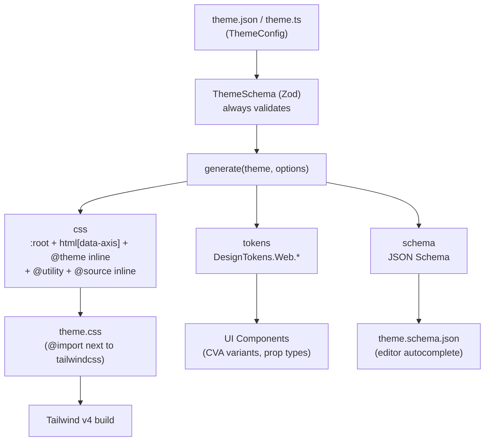
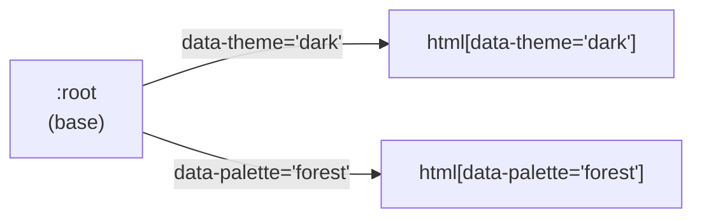

# Architecture

This document describes the overall architecture of `@duydpdev/style-generator` 4.0.0 (Tailwind CSS v4 only). The code is the source of truth for _how_ things work; this document only keeps _why_ and _where_.

## Table of contents

- [Architecture](#architecture)
  - [Table of contents](#table-of-contents)
  - [Core Concepts](#core-concepts)
  - [Data Flow](#data-flow)
  - [Source Code Structure](#source-code-structure)
  - [Entry Points](#entry-points)
    - [`generate`](#generate)
    - [`createDesignTokens`](#createdesigntokens)
    - [Vite Plugin (emit-only)](#vite-plugin-emit-only)
    - [Next.js Plugin (emit-only)](#nextjs-plugin-emit-only)
    - [CLI](#cli)
  - [Registry \& `@source inline`](#registry--source-inline)
  - [Multi-axis Theming (`themeAxes`)](#multi-axis-theming-themeaxes)
  - [Spacing System](#spacing-system)
  - [Exports API](#exports-api)
  - [Landing Site (`site/`)](#landing-site-site)

---

## Core Concepts

| Concept           | Description                                                                                                                                                                        |
| ----------------- | ---------------------------------------------------------------------------------------------------------------------------------------------------------------------------------- |
| **Theme Config**  | The only input: a JSON/object declaring `colors` (required), `typography`, `shadows`, `backDropBlurs`, `borderRadius`, `fontFamily`, `borderWidth`, `themeAxes`.                   |
| **ThemeSchema**   | A Zod `strictObject` that is the source of truth for both JSON and TypeScript: unknown keys, unsafe values and broken aliases are all rejected before any CSS is generated.        |
| **Registry**      | Each category (colors, typography, …) is a descriptor in `builtInCategories`; every CSS/`@source inline` generation step goes through the registry instead of repeating key lists. |
| **`generate()`**  | The single function that generates artifacts: `{ css, tokens, schema }`. The CLI, `styleGenVite` and `styleGenNext` all call it.                                                   |
| **Design Tokens** | An object holding arrays of token keys (`DesignTokens.Web.*`), used in UI components (CVA, prop types).                                                                            |
| **Consumer**      | A project that uses the library: it `@import`s the generated CSS file next to `@import "tailwindcss"`. No `@plugin`, no safelist.                                                  |

---

## Data Flow



---

## Source Code Structure

```text
src/
├── core/                       # generate(), ThemeSchema (+ tokenGrammar, aliasGraph, crossFieldChecks), options schema (internal, optionsSchema.ts), resolveOptions, Options, defineTheme, type inference
├── features/
│   ├── registry/               # builtInCategories, flattenByCategory, generateSourceInline
│   ├── theme-css/              # :root / html[data-axis] / @theme inline, border-width, screens
│   ├── typography/             # theme.typography → @utility
│   ├── spacing/                # .sp-* utilities + resolveSpacing helpers
│   ├── tokens/                 # createDesignTokens / buildDesignTokens
│   ├── cva/                    # createVariantMapper
│   ├── vite/                   # styleGenVite
│   └── next/                   # styleGenNext
├── shared/                     # helpers (kebab/camel), defaults, COLOR_STATES, resolveSafePath, writeFileAtomic
├── cli/                        # commands: init, generate, doctor, schema
├── exports/                    # one file per public subpath
├── __integration__/            # tests that compile CSS through the real Tailwind engine
└── index.ts                    # root barrel
```

`src/exports/*` determines which subpaths are browser-safe (they pull in neither Zod nor Node built-ins): `./tokens`, `./cva`, `./spacing`, `./types`. This constraint is checked by `scripts/check-browser-safe.mjs`.

---

## Entry Points

### `generate`

```typescript
const { css, tokens, schema } = generate(theme, options);
// css    → written to a file, @import next to tailwindcss
// tokens → DesignTokens (same result as createDesignTokens)
// schema → z.toJSONSchema(ThemeSchema)
```

`generate()` always validates `theme` against `ThemeSchema` first (even if the caller already called `defineTheme()`), then assembles the blocks in this order: `@theme` breakpoints → `:root` + `html[data-<axis>="<variant>"]` + `@theme inline` → border-width `@utility` → typography `@utility` → spacing `@utility` → `@source inline`.

### `createDesignTokens`

Returns an object holding arrays of keys from the theme; used for component logic, CVA variants and prop types.

```typescript
const { DesignTokens } = createDesignTokens(theme, options);
// DesignTokens.Web.variantColor      → ["primary", "primaryHover", ...]
// DesignTokens.Web.variantText       → ["text16Medium", ...]
// DesignTokens.Web.variantFontFamily → ["sans", ...]
// DesignTokens.Web.borderWidthOption → keys of borderWidth (default 0, 1, 2, 4)
// DesignTokens.Web.breakpoints   → default ["md", "lg"]
```

**Type inference:** the generic `T extends ThemeConfig`, combined with `KebabCase` and `CamelCase`, keeps literal types instead of widening to `string`.

### Vite Plugin (emit-only)

`styleGenVite` emits `theme.css` from the theme JSON, replacing the manual predev/prebuild workflow.

```typescript
// vite.config.ts
import { styleGenVite } from "@duydpdev/style-generator/vite";

export default defineConfig({
  plugins: [
    styleGenVite({ themePath: "src/theme/theme.json", outDir: "src/theme" }),
    tailwindcss(),
  ],
});
```

- `themePath` — path to the theme JSON (relative to the project root)
- `outDir` — output directory (defaults to `dirname(themePath)`, and MUST match the `@import` path)
- `options` — forwarded to `generate()`

**Lifecycle:** `configResolved` (synchronous write, before Tailwind scans) → `configureServer` (watcher, 200ms debounce) → `closeBundle` (final write for builds). Every write goes through `writeFileAtomic` (a temp file in the same directory + `rename`) so the bundler never reads a half-written file. The examples place `styleGenVite` before `tailwindcss()`. Vite 5/6 calls `configResolved` without binding `this`, so a theme error in this hook is a `throw new Error(…, { cause })` instead of `this.error`; `closeBundle` (a Rollup hook) still uses `this.error`.

**Security:** a path-traversal guard keeps `themePath`/`outDir` inside the project root (it compares logical paths, with no `realpath`); it warns when several instances target the same `outDir` (monorepo).

### Next.js Plugin (emit-only)

`styleGenNext` is a wrapper for `next.config.*`, aimed at Next without Vite. It does not import `next`, so it behaves identically under webpack and Turbopack and adds no peer dependency.

```typescript
export default styleGenNext({
  themePath: "app/theme/theme.json",
  outDir: "app/theme",
})(nextConfig);
```

- `styleGenNext(opts)(nextConfig)` returns a `(phase, ctx) => config` function, which Next accepts for `next.config.*`. Only `phase-development-server` and `phase-production-build` read the theme and write `theme.css` (atomically); `phase-development-server` also adds a watcher (200ms debounce, `persistent: false`). The other phases (`next start`, export, info, test) return the config without touching the disk, so a production image does not need the theme JSON. A function-form `nextConfig` `(phase, { defaultConfig })` is called with exactly the arguments Next passes.
- **Limitation:** the path guard does not use `realpath` (a symlink pointing outside the root is not detected).

### CLI

`style-gen` (built separately with `tsdown` → `dist/cli/index.mjs`): `init`, `generate [--watch]`, `schema`, `doctor`. Config resolution order: flags → `style-gen.config.json` → `package.json["style-gen"]` → defaults; `readConfigFile` validates the config file with `StyleGenConfigSchema` (`src/cli/config.ts`; its Shape and refinements are shared with `generate()` from `src/core/optionsSchema.ts`), returns `issues` when the schema is violated (nothing is merged) and `error` when the file is broken JSON (`generate` warns and then uses defaults, `doctor` reports an error); config issues make `generate` and `doctor` stop with exit code 1. `generate` writes the CSS with `writeFileAtomic`; an invalid theme/option or a file write error sets `process.exitCode = 1` (under `--watch` it only logs and keeps watching). `--version` reads `package.json` via `import.meta.url` (`src/cli/version.ts`), because `__dirname` does not exist in an ESM bundle. `init` writes the theme, `theme.schema.json` next to the theme, and a small script (the `--plugin` flag sets its path) that calls `generate()` and writes exactly the config's `output` — the same file as `style-gen generate`, runnable directly with Node >= 22.18 — it is no longer a Tailwind plugin; `init` merges `theme`/`plugin`/`output` into an existing `style-gen.config.json`, or into a copy of `package.json["style-gen"]` when that file does not exist (a new file takes precedence over that section), keeps the other keys and reads the config before writing anything; an existing `theme.schema.json` is treated as an existing file (it asks before overwriting; non-interactive exits with code 1). `schema` without `--out` reads the config like `generate` (a config that violates the schema → exit code 1, nothing written) and then writes `theme.schema.json` into the directory of the resolved `theme` (via `normalizePath`). `doctor` validates the theme with `ThemeSchema`, checks the script only when the config has `plugin`, and prints warnings (without changing the exit code) when a key collides with a Tailwind utility (`src/cli/commands/utilityCollisions.ts`, the list is verified against the real compiler in `src/__integration__/utility-collisions.test.ts`).

---

## Registry & `@source inline`

**Why a registry:** before 4.0.0 each category had key/prefix lists repeated in the plugin, the safelist and the tokens. Now a single `TokenCategoryDescriptor` (`src/features/registry/builtInCategories.ts`) declares `cssVarPrefix`, `themeNamespace`, `classPrefixes`, `responsive`, `states` and default values; adding a category = 1 line in `ThemeSchema` + 1 descriptor + 1 test. Category data is read with `theme[descriptor.key]`; the unions `CategoryKey`/`CssVarCategoryKey`/`RegistryPrefix` and `CategoryTokenKey<T, K>` (the token key type) are inferred from the `builtInCategories` array itself. Default values (`defaultValues` of `borderRadius`/`borderWidth`) live in `categoryTokenMeta.ts` — a separate, small file that does not drag in the descriptor's CSS part; the descriptor spreads it in, while `createDesignTokens` imports only this file, so the `./tokens` entry (browser-safe, with a gzip budget) does not have to carry the whole registry. A guard in `builtInCategories.test.ts` keeps the two in sync.

**Resolve options once:** `generate()` calls `resolveOptions()` (`src/core/resolveOptions.ts`) right after parsing; `generateScreensCss`, `generateSpacingCss`, `generateSourceInline` and `buildDesignTokens` read `ResolvedOptions` (breakpoints, screens merged with `defaultScreens`, breakpoints sorted by width via `parseFloat`, spacing, `coverage`) instead of each repeating `options.x ?? DEFAULT_X`. The part tokens need (`breakpoints`, `screens`, `spacing`) lives in `resolveTokenOptions()` (`src/core/resolveTokenOptions.ts`), which `resolveOptions` spreads; `createDesignTokens(theme, options)` = `buildDesignTokens(theme, resolveTokenOptions(options))`. These two files are separate because Rollup groups modules by the set of entries that use them: merging this into `resolveOptions` would drag all of `coverage` into `./tokens`. A category declared as `{}` is treated as absent in both `@source inline` and `DesignTokens` (the default keys are used).

**`./tokens` entry and the gzip budget:** `vite.config.ts` sets `preserveEntrySignatures: "allow-extension"`. With the default `strict`, Rollup has to split out a facade containing only the public exports when the `./tokens` chunk shares internal code (`buildDesignTokens`, `resolveTokenOptions`, `categoryTokenMeta`) with `generate`, and that facade (~290 B gzip) pushes `./tokens` over budget. Consequence: `dist/tokens.js` and `dist/tokens.cjs` export a few extra single-letter aliases at runtime (`minifyInternalExports: true` applies to CJS too); `dist/tokens.d.ts` is unchanged and is the only contract, these aliases are not API. The `./tokens` budget is raised only when the tokens surface itself grows (for example `aliasedColors` in phase 09), never to absorb accidental coupling.

**Why `@source inline` instead of a safelist:** Tailwind v4 does not scan classes built at runtime. `generateSourceInline` emits one `@source inline("…")` line per category (and per state that has a sibling, for example `hover:bg-primary-hover`), so the classes always exist even if no source references them; classes built at runtime are declared through `options.extraSources`. Trade-off: every color always has `bg-/text-/border-*`, so the CSS is slightly larger — `options.coverage` narrows these lines per category (`false`, `prefixes`, `keys: "aliased"`; see README §8).

**`$key` aliases:** `flattenByCategory` turns `"$blue500"` into `var(--sg-blue-500)` (using the category's own `cssVarPrefix`). `ThemeSchema` has already proven that the target exists and the graph has no cycles before emitting.

**Why `_` is forbidden in keys:** `toKebabCase` keeps `_` as is (`primary_active` → `bg-primary_active`) while the camelCase in `createDesignTokens` drops `_` (`primaryActive`), so `createVariantMapper` would generate `bg-primary-active` — a class that does not exist. The schema rejects `_` in every token-name position (color/typography/…, axis and variant names); loosening later is not breaking, tightening later is. `formatZodError` opens up Zod's `invalid_key` layer so the CLI/plugin prints the camelCase/kebab hint right on the correct path.

**Kebab-case states:** state names are kebab-cased in both `createVariantMapper` and `generateSourceInline` (`focusVisible` → `focus-visible:`) because Tailwind only accepts kebab-form variant names; sibling lookup still uses the Pascal form (`primary` + `primaryFocusVisible`).

---

## Multi-axis Theming (`themeAxes`)

`themeAxes` is a `Record<axis, Record<variant, ThemeOverride>>`. Each variant emits `html[data-<axis-kebab>="<variant-kebab>"]` after the `:root` block, in declaration order (axis, then variant). Each variant only needs to declare the values that **differ** from the base.



Design decisions:

- **The selector is pinned to `html`:** an alias `var()` is resolved at the element that _declares_ the custom property (`:root`), so an override on a child element never reaches the alias's value.
- **Precedence = declaration order:** two axes overriding the same token have equal specificity; the axis declared later wins. That is why axis/variant names that are integers are rejected (JS enumerates numeric-like keys first, breaking the order).
- **An override must have a key in the base:** a key present only in an override does not map into `@theme inline`/`@utility` and so creates no utility; it is rejected at parse time.
- **Overrides combined across axes** (`[data-theme="dark"][data-palette="forest"]`) and variables outside `--sg-*` are still hand-written CSS (see the table in `examples/nuxt-v4/README.md`).

---

## Spacing System

Spacing does **not** use a per-value safelist. `generateSpacingCss` emits each `sp-<key>` as exactly one `@utility`, with the breakpoint fallback chain inside the utility itself, together with `@property --sg-sp-<key>[-<bp>] { syntax: "*"; inherits: false }` (no `initial-value`). Components only set the variables inline.

```css
@utility sp-p {
  padding: var(--sg-sp-p);
  @media (width >= 768px) {
    padding: var(--sg-sp-p-md, var(--sg-sp-p));
  }
  @media (width >= 1024px) {
    padding: var(--sg-sp-p-lg, var(--sg-sp-p-md, var(--sg-sp-p)));
  }
}
```

**Why `inherits: false`:** variables do not inherit, so an `sp-*` class only reads variables declared on the **same element**; otherwise a parent's responsive value leaks down to a child that has not set the variable itself (a bug in 3.x). The `--sg-sp-*` namespace also avoids occupying Tailwind's internal `--tw-*` namespace. The regression is tested on Chromium and WebKit (`e2e/spacing-inheritance.spec.ts`).

```tsx
const spacing = resolveSpacingProps({ p: 4, mx: { base: 2, md: 4 } });
// classNames: "sp-p sp-mx"                       (a string, not an array)
// style: { "--sg-sp-p": "1rem", "--sg-sp-mx": "0.5rem", "--sg-sp-mx-md": "1rem" }
```

Turn it off with `options.spacing.enabled = false`; customize it with `options.spacing.properties`. Only breakpoints in `options.breakpoints` (default `["md","lg"]`) get a fallback chain.

---

## Exports API

| Export                                                                                                                                                  | Subpath                                       | Description                                                                                  |
| ------------------------------------------------------------------------------------------------------------------------------------------------------- | --------------------------------------------- | -------------------------------------------------------------------------------------------- |
| `generate`                                                                                                                                              | `.`                                           | Main entry → `{ css, tokens, schema }`                                                       |
| `defineTheme`, `defineOptions`                                                                                                                          | `.`                                           | Type-safe helpers; `defineTheme` validates at runtime (root only)                            |
| `generateThemeCss`                                                                                                                                      | `.`                                           | Only `:root` + axes + `@theme inline`                                                        |
| `createDesignTokens`                                                                                                                                    | `.`, `./tokens`                               | Generates Design Tokens                                                                      |
| `createVariantMapper`, `COLOR_STATES`                                                                                                                   | `.`, `./cva` (`COLOR_STATES` also `./tokens`) | Maps token → class (kebab), `{ states }` for hover/active                                    |
| `resolveSpacing`, `resolveSpacingProps`                                                                                                                 | `.`, `./spacing`                              | Resolves spacing props → `{ className(s), style }`                                           |
| `styleGenVite`                                                                                                                                          | `./vite`                                      | Vite plugin                                                                                  |
| `styleGenNext`                                                                                                                                          | `./next`                                      | Next.js config wrapper                                                                       |
| `Breakpoint`, `defaultScreens`                                                                                                                          | `.`, `./tokens`                               | Enum `SM \| MD \| LG \| XL \| XXL` and default widths                                        |
| `ColorVariant` … `RoundedVariant`                                                                                                                       | `./types` (and `.`)                           | Per-theme key unions: color, text, shadow, backdrop blur, font family, border width, rounded |
| `ThemeConfig`, `ThemeOverride`, `TypographyConfig`, `StyleGeneratorOptions`, `CoverageRule`, `CategoryKey`, `CategoryTokenKey`, `ResponsiveValueStrict` | `./types` (and `.`)                           | Public types                                                                                 |
| `SpacingKey`, `DefaultBreakpointKeys`                                                                                                                   | `./spacing`                                   | Spacing types                                                                                |

The full list is in `src/index.ts` and `src/exports/*`; what was removed in 4.0.0 is in [`migration/3.x-to-4.0.md`](./migration/3.x-to-4.0.md).

---

## Landing Site (`site/`)

The top-level `site/` is a separate landing page (React + Vite + Tailwind v4) that dogfoods the library through the `link:..` dependency (see [`deploy.md`](./deploy.md#why-link-instead-of-workspace)).

- **Path:** `site/`
- **Stack:** React 19, Vite 7, Tailwind v4, `@duydpdev/style-generator` (`link:..`), `styleGenVite()`
- **Theme:** Cobalt palette (`site/src/theme/theme.json`) — `site/src/theme/theme.css` is generated by `styleGenVite`; `site/src/theme/theme.schema.json` is a committed copy of the schema
- **Scripts:** `yarn workspace site {dev,build,typecheck,lint}`; the dev port defaults to 5174 to avoid conflicting with the examples
- **Workspace setup:** the root `package.json` declares `workspaces: ["site", "examples/*"]` + `resolutions.vite` so there is only one Vite instance

### Routes

- `/` — landing (editorial scroll).
- `/docs` — automatically redirects to the first doc.
- `/docs/:slug` — renders the `documents/*.md` files (top level only, except `documents/README.md`, excluding `documents/migration/`) via `react-markdown`.
- `/examples/v4` — an iframe embedding `examples/react-v4/dist`.

### Examples integration

`site/scripts/build-examples.mjs` runs before the site's Vite build (via `yarn build:examples`): it builds `react-v4-example` with a relative base and copies `examples/react-v4/dist` into `site/public/examples/v4` (gitignored). The iframe in `examples-page.tsx` loads `${BASE}/examples/v4/index.html`.

### Examples catalog (`examples/*`)

3 consumer apps (they link the lib via `link:../..`, with the same `theme.json` + palettes + cva configs + demo section):

| Example    | Stack                           | Theme wiring                                                                                                                                  |
| ---------- | ------------------------------- | --------------------------------------------------------------------------------------------------------------------------------------------- |
| `react-v4` | Vite + React + Tailwind v4      | `styleGenVite` → `@import "./theme/theme.css"`                                                                                                |
| `next-v4`  | Next.js 15 (App Router) + TW v4 | `styleGenNext` in `next.config.ts` (webpack and Turbopack)                                                                                    |
| `nuxt-v4`  | Nuxt 3 (Vue 3) + TW v4          | Nuxt runs on Vite → reuses `styleGenVite` in `nuxt.config.ts → vite.plugins`; components are Vue SFCs, SSR-safe `<html data-*>` via `useHead` |

Only `react-v4` is embedded in the landing site; `next-v4`/`nuxt-v4` are standalone. See [`examples/README.md`](../examples/README.md).

### Deploy pipelines

| Target                    | Workflow                     | See                                  |
| ------------------------- | ---------------------------- | ------------------------------------ |
| Package → GitHub Packages | `release.yml` + `deploy.yml` | [`documents/deploy.md`](./deploy.md) |
