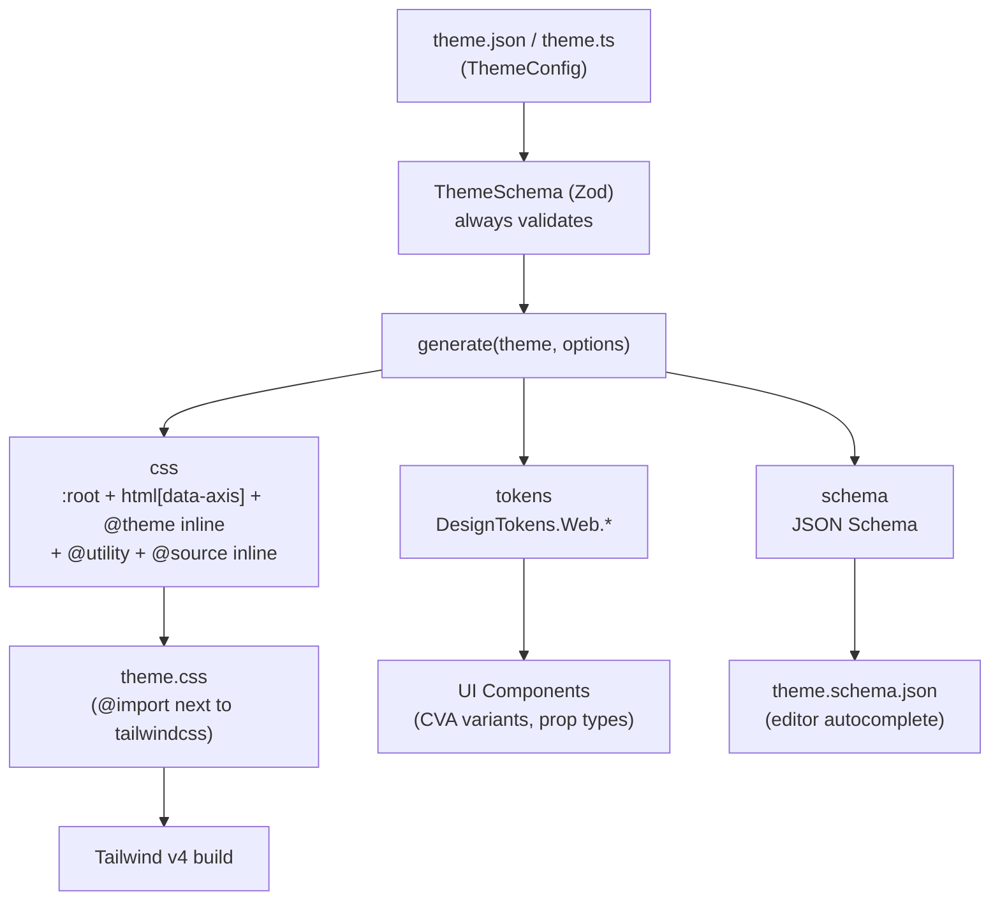
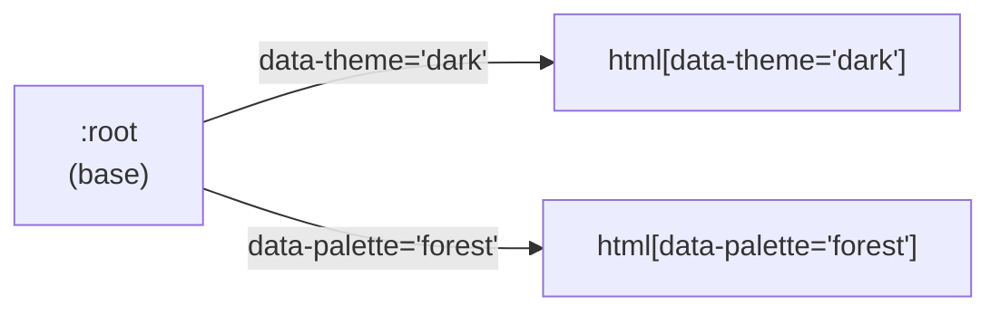

# Architecture

This document describes the overall architecture of `@duydpdev/style-generator` 4.0.0 (Tailwind CSS v4 only). The code is the source of truth for _how_ things work; this document only keeps _why_ and _where_.

## Table of contents

- [Architecture](#architecture)
  - [Table of contents](#table-of-contents)
  - [Core Concepts](#core-concepts)
  - [Data Flow](#data-flow)
  - [Source Code Structure](#source-code-structure)
  - [Entry Points](#entry-points)
    - [`generate`](#generate)
    - [`createDesignTokens`](#createdesigntokens)
    - [Vite Plugin (emit-only)](#vite-plugin-emit-only)
    - [Next.js Plugin (emit-only)](#nextjs-plugin-emit-only)
    - [CLI](#cli)
  - [Registry \& `@source inline`](#registry--source-inline)
  - [Multi-axis Theming (`themeAxes`)](#multi-axis-theming-themeaxes)
  - [Spacing System](#spacing-system)
  - [Exports API](#exports-api)
  - [Landing Site (`site/`)](#landing-site-site)

---

## Core Concepts

| Concept           | Description                                                                                                                                                                        |
| ----------------- | ---------------------------------------------------------------------------------------------------------------------------------------------------------------------------------- |
| **Theme Config**  | The only input: a JSON/object declaring `colors` (required), `typography`, `shadows`, `backDropBlurs`, `borderRadius`, `fontFamily`, `borderWidth`, `themeAxes`.                   |
| **ThemeSchema**   | A Zod `strictObject` that is the source of truth for both JSON and TypeScript: unknown keys, unsafe values and broken aliases are all rejected before any CSS is generated.        |
| **Registry**      | Each category (colors, typography, …) is a descriptor in `builtInCategories`; every CSS/`@source inline` generation step goes through the registry instead of repeating key lists. |
| **`generate()`**  | The single function that generates artifacts: `{ css, tokens, schema }`. The CLI, `styleGenVite` and `styleGenNext` all call it.                                                   |
| **Design Tokens** | An object holding arrays of token keys (`DesignTokens.Web.*`), used in UI components (CVA, prop types).                                                                            |
| **Consumer**      | A project that uses the library: it `@import`s the generated CSS file next to `@import "tailwindcss"`. No `@plugin`, no safelist.                                                  |

---

## Data Flow



---

## Source Code Structure

```text
src/
├── core/                       # generate(), ThemeSchema (+ tokenGrammar, aliasGraph, crossFieldChecks), options schema (internal, optionsSchema.ts), resolveOptions, Options, defineTheme, type inference
├── features/
│   ├── registry/               # builtInCategories, flattenByCategory, generateSourceInline
│   ├── theme-css/              # :root / html[data-axis] / @theme inline (incl. --border-width-*), screens
│   ├── typography/             # theme.typography → @utility
│   ├── spacing/                # .sp-* utilities + resolveSpacing helpers
│   ├── tokens/                 # createDesignTokens / buildDesignTokens
│   ├── cva/                    # createVariantMapper
│   ├── recipes/                # ./recipes: createTailwindMergeExtension, splitSpacingProps, themeAxisAttributes
│   ├── vite/                   # styleGenVite
│   └── next/                   # styleGenNext
├── shared/                     # helpers (kebab/camel), defaults, COLOR_STATES, writeFileAtomic
├── node/                       # shared Node-only runner: loadStyleGenConfig, resolveProjectPath, themeEmitter, watchThemeFile, resolvePluginTarget
├── cli/                        # commands: init, generate, doctor, schema, tokens, budget
├── exports/                    # one file per public subpath
├── __integration__/            # tests that compile CSS through the real Tailwind engine
└── index.ts                    # root barrel
```

`src/exports/*` determines which subpaths are browser-safe (they pull in neither Zod nor Node built-ins): `./tokens`, `./cva`, `./spacing`, `./recipes`, `./types`. This constraint is checked by `scripts/check-browser-safe.mjs`. `./recipes` exists only as a subpath (it is not re-exported from `.`), like `./vite`/`./next`, so the `index` budget does not carry component-side helpers.

**Where Node code goes:** everything that touches `node:fs`/`node:path`/chokidar lives in `src/node/` and may only be imported from `src/cli/**`, `src/features/vite/**`, `src/features/next/**` — never from `src/core`, `src/exports/{tokens,cva,spacing,recipes,types}` or the root barrel; otherwise `dist/index.js` and the browser-safe subpaths would pull Node into the bundle (`check:browser-safe` and the `check:sizes` budget catch this).

---

## Entry Points

### `generate`

```typescript
const { css, tokens, schema } = generate(theme, options);
// css    → written to a file, @import next to tailwindcss
// tokens → DesignTokens (same result as createDesignTokens)
// schema → z.toJSONSchema(ThemeSchema)
```

`generate()` validates `options` first (`StyleGeneratorOptionsSchema.parse` → `resolveOptions`), then always re-validates `theme` against `ThemeSchema` (even if the caller already called `defineTheme()`); `assertThemeOptions` (`src/core/crossFieldChecks.ts`) checks the theme × options pair: for every `axes.scope`, an `axes.attribute` that points to a nonexistent axis, or two axes with the same attribute name, is rejected; `axes.scope: "element"` adds `checkElementScopeAliases`; `resetTailwindDefaults: ["colors"|"radius"|"shadow"]` requires the theme to have a matching `colors` (non-empty; `ThemeSchema` still accepts `colors: {}`), `borderRadius` or `shadows`. It then assembles the blocks in this order: `@theme` breakpoints → `:root` + `html[data-<axis>="<variant>"]` + `@theme inline` (the `--color-*: initial;`… lines of `resetTailwindDefaults` come first in this block) → typography `@utility` → spacing `@utility` → `@source inline`. Validation lives in `prepareGenerate(theme, options)` (`src/core/prepareGenerate.ts`, returns `{ parsed, resolved }`) and **CSS** assembly in `generateFromParsed(parsed, resolved)`; `generate()` calls these two in turn and then builds `tokens` (`buildDesignTokens`) and `schema` itself. The Node runner (`src/node/themeEmitter.ts`) calls them step by step to label errors (stage `read` → `parse` → `options` → `theme` → `cross` (theme × options errors only) → `generate` (an unexpected throw while building CSS: `Failed to generate CSS: …`) → `write`; `config` and `watch` belong to the watcher).

### `createDesignTokens`

Returns an object holding arrays of keys from the theme; used for component logic, CVA variants and prop types.

```typescript
const { DesignTokens } = createDesignTokens(theme, options);
// Each array is named after the matching ThemeConfig field (since 5.0):
// DesignTokens.Web.colors        → ["primary", "primaryHover", ...]
// DesignTokens.Web.typography    → ["text16Medium", ...]
// DesignTokens.Web.fontFamily    → ["sans", ...]
// DesignTokens.Web.borderWidth   → keys of borderWidth (default 0, 1, 2, 4)
// DesignTokens.Web.breakpoints   → default ["md", "lg"]
// DesignTokens.Web.aliasedColors → color keys whose value is an "$alias" (base record or themeAxes override)
```

**Type inference:** the generics `const T extends ThemeConfig` and `const O extends StyleGeneratorOptions`, combined with `KebabCase` and `CamelCase`, keep literal types instead of widening to `string`. Every array is `readonly`; `breakpoints`, `spacingProperties` and `screens` take their literals from `options` (`BreakpointKeys<O>`, `SpacingKeys<O>`, `ScreenKeys<O>`). An optional category that the theme type declares as optional (a theme typed as `ThemeConfig`) yields `string`, because at runtime it can be either a declared key or a default. `ThemeSchema.parse(theme) as T` appears only in `src/core/parseTheme.ts`, shared by `defineTheme` and `generate`.

### Vite Plugin (emit-only)

`styleGenVite` emits `theme.css` from the theme JSON, replacing the manual predev/prebuild workflow.

```typescript
// vite.config.ts
import { styleGenVite } from "@duydpdev/style-generator/vite";

export default defineConfig({
  plugins: [
    styleGenVite({ themePath: "src/theme/theme.json", outDir: "src/theme" }),
    tailwindcss(),
  ],
});
```

- `themePath` — path to the theme JSON, relative to the project root; it may be absolute or outside the root (a theme shared across a monorepo)
- `outDir` — output directory; it MUST be inside the project root (defaults to `dirname(themePath)`, and MUST match the `@import` path)
- `options` — forwarded to `generate()`
- calling `styleGenVite()` with no arguments: reads `style-gen.config.json` (or `package.json["style-gen"]`) at the Vite root via `loadStyleGenConfig` — `theme`, `output` and every option; a broken config throws `[style-gen-vite] Invalid config (<source>):` instead of falling back to defaults (`src/node/resolvePluginTarget.ts`, shared with Next)

**Lifecycle:** `configResolved` only resolves paths/config (it needs `config.root`) and registers `outFile` to warn about duplicate targets (this registration is released when the dev server closes — `server.close` is wrapped; `closeBundle`/`buildEnd` are not used); `buildStart` emits `theme.css` through `emitThemeCss` (Vite runs `buildStart` on `listen()`, in middleware mode and for SSR environments; the plugin sets `perEnvironmentStartEndDuringDev: true`, so since Vite 6 `buildStart` also runs with `createServer()` without `listen()` + `ssrLoadModule`) and calls `this.addWatchFile(theme)` so `vite build --watch` rebuilds; `configureServer` adds the theme to `server.watcher`, debounces re-emission and triggers `full-reload` only when the CSS actually changed. `closeBundle` is gone. Every write goes through `writeFileAtomic` (a temp file in the same directory + `rename`), and only when the content changed, so the bundler never reads a half-written file and the watcher is not woken needlessly. An error in `buildStart` is a `this.error` with a stage label (`Invalid JSON in …`, `Invalid options:`, `Invalid theme (<path>):`, `Invalid theme/options:`, `Failed to generate CSS: …`, `Cannot write …`); an error in `configResolved` (Vite 5/6 calls this hook without binding `this`) is still a `throw new Error(…, { cause })`; a default `outDir` (`dirname(themePath)`) outside the root reports `outDir (defaults to dirname(themePath); set outDir inside the project root) escapes project root: <dir>`. The examples place `styleGenVite` before `tailwindcss()`.

**Security:** `resolveProjectPath(root, input, label, { allowOutsideRoot })` (`src/node/resolveProjectPath.ts`) normalizes every path with `resolve(root, input)` (absolute paths too: `..`, `.` and doubled separators are collapsed; no trimming) and then keeps `outDir`/`output` inside the project root (it compares the normalized paths, with no `realpath`; error `<label> escapes project root: <input>`); `themePath` may be outside the root. A leading `/` is no longer rewritten into a relative path. It warns when several instances write the same **output file** (`outFile`, not merely the same `outDir`) within one process (monorepo).

### Next.js Plugin (emit-only)

`styleGenNext` is a wrapper for `next.config.*`, aimed at Next without Vite. It does not import `next`, so it behaves identically under webpack and Turbopack and adds no peer dependency.

```typescript
export default styleGenNext({
  themePath: "app/theme/theme.json",
  outDir: "app/theme",
})(nextConfig);
```

- `styleGenNext(opts)(nextConfig)` returns a `(phase, ctx) => config` function, which Next accepts for `next.config.*`; `opts` may be omitted (it reads `style-gen.config.json` at `process.cwd()`, like Vite). Only `phase-development-server` and `phase-production-build` read the theme and write `theme.css` (atomically); `phase-development-server` also adds a watcher via `watchThemeFile` (200ms debounce, `persistent: false`) — the watcher logs errors and keeps running when the theme is invalid, and is closed when the config is reloaded with a different theme/output. The other phases (`next start`, export, info, test) return the config without touching the disk, so a production image does not need the theme JSON. A function-form `nextConfig` `(phase, { defaultConfig })` is called with exactly the arguments Next passes.
- **Limitation:** the path guard does not use `realpath` (a symlink pointing outside the root is not detected).

### CLI

`style-gen` (built separately with `tsdown` → `dist/cli/index.mjs`, JSDoc stripped from the bundle via `outputOptions.comments.jsdoc = false`; 22 496 B gzip, budget 24 750 B in `scripts/check-sizes.mjs`): `init`, `generate [--watch]`, `doctor`, `schema`, `tokens`, `budget`. `src/cli/run.ts` holds one **registry** of `CliCommand` (`name`, `description`, `usage`, `options`, `run`); `runCli(args, cwd)` parses in two passes (the global pass looks for `--help`/`--version` and the command name, the command pass parses that command's flags in strict mode, so an unknown flag is an error) and then returns an **exit code** instead of calling `process.exit` — `src/cli/index.ts` only assigns `process.exitCode`, so any command can be tested directly without stubbing `process`. Codes: `0` success / `--help` / `--version` / prompt cancelled, `1` failure (`budget`: `2` for a usage error). Config resolution order: flags → `style-gen.config.json` → `package.json["style-gen"]` → defaults; `loadStyleGenConfig`/`readConfigFile` (`src/node/loadStyleGenConfig.ts`, shared with Vite/Next) validate the config file with `StyleGenConfigSchema` (its Shape and refinements are shared with `generate()` from `src/core/optionsSchema.ts`), return `issues` when the schema is violated (nothing is merged) and `error` when the file is broken JSON (`generate` warns and then uses defaults, `doctor` reports an error); config issues make `generate` and `doctor` stop with exit code 1 (`src/cli/loadCliConfig.ts` bundles reading and error printing). `generate` calls `emitThemeCss` (`writeFileAtomic`, writes only when the content changed); an invalid theme/option or a file write error returns exit code 1. `generate --watch` uses `watchThemeFile` to watch the theme **and** the config file: every time the config changes it calls `reloadTarget` to re-read it, and an invalid config is only reported (stage `config`) while **the last valid config stays in use**; theme/write errors after watching has started are only logged. `--version` reads `package.json` via `import.meta.url` (`src/cli/version.ts`), because `__dirname` does not exist in an ESM bundle. `init` writes the theme, `theme.schema.json` next to the theme, and a small script (the `--plugin` flag sets its path) that calls `generate()` and writes exactly the config's `output` — the same file as `style-gen generate`, runnable directly with Node >= 22.18 — it is no longer a Tailwind plugin; `init` merges `theme`/`plugin`/`output` into an existing `style-gen.config.json`, or into a copy of `package.json["style-gen"]` when that file does not exist (a new file takes precedence over that section), keeps the other keys and reads the config before writing anything; an existing `theme.schema.json` is treated as an existing file (it asks before overwriting; non-interactive exits with code 1). `schema` without `--out` reads the config like `generate` (a config that violates the schema → exit code 1, nothing written) and then writes `theme.schema.json` into the directory of the resolved `theme` (via `resolveProjectPath`; the theme may be outside the project, the written file may not). `tokens` (`src/cli/commands/tokens.ts`) runs `readAndPrepareTheme` and then serializes exactly the `DesignTokens.Web` object from `buildDesignTokens` into `export const tokens = {…} as const` — keys only, so a client bundle does not need to ship the `./tokens` runtime (1688 B gzip) and the theme JSON. `budget` (`src/cli/commands/budget.ts`) sums the gzip size (`node:zlib` defaults) of every `.css` under the target file/directory and compares it with `--max-gzip`; the two summary lines `OK: …`/`OVER BUDGET: …` are a stable contract for consumers' CI, replacing the `check-css-budget.mjs` script that used to be copied by hand. `doctor` reads the config (invalid → stop, exit code 1), validates the theme with `ThemeSchema`, then runs `prepareGenerate` with the config's options to catch theme × options errors (`❌ Invalid theme/options`), checks the script only when the config has `plugin`, treats an `output`/`plugin` that escapes the root as an error, and prints warnings (without changing the exit code) when a key collides with a Tailwind utility (`src/cli/commands/utilityCollisions.ts`, the list is verified against the real compiler in `src/__integration__/utility-collisions.test.ts`) or when a `themeAxes` override repeats the literal of another key in the base (suggesting `$alias`, `src/cli/commands/aliasHints.ts`).

Besides checking the config/theme, `doctor` also scans source files (`.css/.scss/.ts/.tsx/.vue/.svelte/.astro/.html`, …) under the current directory to warn with `file:line` about leftover 4.x-style `--sg-<color>` variables (`src/cli/commands/legacyColorVars.ts`): it skips `node_modules`, `.git`, build directories (`dist`, `build`, `out`, `.next`, `.nuxt`, `.output`, …), the config's output file and files > 1 MiB; it does not follow symlinks; it does not change the exit code.

### Recipes (`./recipes`)

Three component-side helpers, browser-safe, with no `tailwind-merge` import (the dist `.d.ts` does not mention it; the app declares `tailwind-merge` 3.x itself — the extension uses v3 group ids and the theme key `radius`):

- `createTailwindMergeExtension(tokens)` → `{ extend: { classGroups, conflictingClassGroups, theme } }` for `extendTailwindMerge`. Tokens are camelCase keys, so they go through `toKebabCase` before becoming classes. `borderRadius` goes into `theme.radius` (the scale that every `rounded-*` group of tailwind-merge reads, so `rounded-tl-pill` and `rounded-s-pill` merge correctly too); `shadows`, `backDropBlurs` and `borderWidth` are class groups. The prefix table for `border`/`divide-*` (→ id `border-w*`), `shadow` and `backdrop-blur` is local to the module so the registry is not pulled into the `./tokens` chunk; `extendTailwindMerge.test.ts` pins this table to the registry's `classPrefixes`. `colors` and `fontFamily` are not listed because tailwind-merge's default groups already accept any value.
- `splitSpacingProps(props, keys, unit)` + `SpacingProps<BKeys, K>` → `{ spacing: { className, style }, rest }`; it calls `resolveSpacing` once per key (so import `./spacing` through the shared chunk) and removes every spacing key from `rest`, even when the value is `undefined`.
- `themeAxisAttributes(state, { attribute })` → the DOM attributes of the active axes, using the same `axisAttributeName` formula as the selectors that `generate()` emits; an axis that is `"base"`/`undefined` emits no attribute.

---

## Registry & `@source inline`

**Why a registry:** before 4.0.0 each category had key/prefix lists repeated in the plugin, the safelist and the tokens. Now a single `TokenCategoryDescriptor` (`src/features/registry/builtInCategories.ts`) declares `cssVarPrefix`, `themeNamespace`, `classPrefixes`, `responsive`, `states` and default values; adding a category = 1 line in `ThemeSchema` + 1 descriptor + 1 test. Category data is read with `theme[descriptor.key]`; the unions `CategoryKey`/`CssVarCategoryKey`/`RegistryPrefix` and `CategoryTokenKey<T, K>` (the token key type) are inferred from the `builtInCategories` array itself. Default values (`defaultValues` of `borderRadius`/`borderWidth`) live in `categoryTokenMeta.ts` — a separate, small file that does not drag in the descriptor's CSS part; the descriptor spreads it in, while `createDesignTokens` imports only this file, so the `./tokens` entry (browser-safe, with a gzip budget) does not have to carry the whole registry. A guard in `builtInCategories.test.ts` keeps the two in sync.

**Resolve options once:** `generate()` calls `resolveOptions()` (`src/core/resolveOptions.ts`) right after parsing; `generateScreensCss`, `generateSpacingCss`, `generateSourceInline` and `buildDesignTokens` read `ResolvedOptions` (breakpoints, screens merged with `defaultScreens`, breakpoints sorted by width via `parseFloat`, spacing, `coverage`) instead of each repeating `options.x ?? DEFAULT_X`. The part tokens need (`breakpoints`, `screens`, `spacing`) lives in `resolveTokenOptions()` (`src/core/resolveTokenOptions.ts`), which `resolveOptions` spreads; `createDesignTokens(theme, options)` = `buildDesignTokens(theme, resolveTokenOptions(options))`. These two files are separate because Rollup groups modules by the set of entries that use them: merging this into `resolveOptions` would drag all of `coverage` into `./tokens`. A category declared as `{}` is treated as absent in both `@source inline` and `DesignTokens` (the default keys are used).

**`./tokens` entry and the gzip budget:** `vite.config.ts` sets `preserveEntrySignatures: "allow-extension"`. With the default `strict`, Rollup has to split out a facade containing only the public exports when the `./tokens` chunk shares internal code (`buildDesignTokens`, `resolveTokenOptions`, `categoryTokenMeta`) with `generate`, and that facade (~290 B gzip) pushes `./tokens` over budget. Consequence: `dist/tokens.js` and `dist/tokens.cjs` export a few extra single-letter aliases at runtime (`minifyInternalExports: true` applies to CJS too); `dist/tokens.d.ts` is unchanged and is the only contract, these aliases are not API. The `./tokens` budget is raised only when the tokens surface itself grows (for example `aliasedColors` in phase 09), never to absorb accidental coupling.

**Shared chunks and `manualChunks`:** adding an entry (such as `./recipes`, which uses `helpers` + `spacingHelpers` but not `colorStates`) changes the set of entries that depend on each module, so Rollup splits `helpers`/`colorStates` and splits `spacingHelpers` out of the `spacing` entry, pushing the cost of importing a chunk onto `./tokens`, `./cva`, `./spacing`. `vite.config.ts` pins those modules into stable chunks with `manualChunks`: `helpers` + `colorStates` → `helpers`, `exports/spacing` + `spacingHelpers` → `spacing` (the chunk name `spacing` MUST equal the entry name, otherwise they cannot be merged), `defaultOption` → `defaultOption`. When adding a shared module or a new entry, re-run `yarn build:all && yarn check:sizes`; `tokens`/`cva`/`spacing`/`index` must not creep up — pin the module or restructure the imports, do not raise the budget. Vite 8 / Rolldown marks `manualChunks` as deprecated in favor of `advancedChunks`: revisit when upgrading.

**Why `@source inline` instead of a safelist:** Tailwind v4 does not scan classes built at runtime. `generateSourceInline` emits one `@source inline("…")` line per category (and per state that has a sibling, for example `hover:bg-primary-hover`), so the classes always exist even if no source references them; classes built at runtime are declared through `options.extraSources`. Trade-off: every color always has `bg-/text-/border-*`, so the CSS is slightly larger — `options.coverage` narrows these lines per category (`false`, `prefixes`, `keys: "aliased"`; see README §8).

**`$key` aliases:** `flattenByCategory` turns `"$blue500"` into `var(--sg-color-blue-500)` (using the category's own `cssVarPrefix`). `ThemeSchema` has already proven that the target exists and the graph has no cycles before emitting.

**Why `_` is forbidden in keys:** `toKebabCase` keeps `_` as is (`primary_active` → `bg-primary_active`) while the camelCase in `createDesignTokens` drops `_` (`primaryActive`), so `createVariantMapper` would generate `bg-primary-active` — a class that does not exist. The schema rejects `_` in every token-name position (color/typography/…, axis and variant names); loosening later is not breaking, tightening later is. `formatZodError` opens up Zod's `invalid_key` layer so the CLI/plugin prints the camelCase/kebab hint right on the correct path.

**Kebab-case states:** state names are kebab-cased in both `createVariantMapper` and `generateSourceInline` (`focusVisible` → `focus-visible:`) because Tailwind only accepts kebab-form variant names; sibling lookup still uses the Pascal form (`primary` + `primaryFocusVisible`).

---

## Multi-axis Theming (`themeAxes`)

`themeAxes` is a `Record<axis, Record<variant, ThemeOverride>>`. Each variant emits `html[data-<axis-kebab>="<variant-kebab>"]` after the `:root` block, in declaration order (axis, then variant). Each variant only needs to declare the values that **differ** from the base.



Design decisions:

- **The selector is pinned to `html`:** an alias `var()` is resolved at the element that _declares_ the custom property (`:root`), so an override on a child element never reaches the alias's value.
- **Precedence = declaration order:** two axes overriding the same token have equal specificity; the axis declared later wins. That is why axis/variant names that are integers are rejected (JS enumerates numeric-like keys first, breaking the order).
- **An override must have a key in the base:** a key present only in an override does not map into `@theme inline`/`@utility` and so creates no utility; it is rejected at parse time.
- **Overrides combined across axes** (`[data-theme="dark"][data-palette="forest"]`) and variables outside `--sg-*` are still hand-written CSS (see the table in [`examples/design-system/README.md`](../examples/design-system/README.md)).

---

## Spacing System

Spacing does **not** use a per-value safelist. `generateSpacingCss` emits each `sp-<key>` as exactly one `@utility`, with the breakpoint fallback chain inside the utility itself, together with `@property --sg-sp-<key>[-<bp>] { syntax: "*"; inherits: false }` (no `initial-value`). Components only set the variables inline.

```css
@utility sp-p {
  padding: var(--sg-sp-p);
  @media (width >= 768px) {
    padding: var(--sg-sp-p-md, var(--sg-sp-p));
  }
  @media (width >= 1024px) {
    padding: var(--sg-sp-p-lg, var(--sg-sp-p-md, var(--sg-sp-p)));
  }
}
```

**Why `inherits: false`:** variables do not inherit, so an `sp-*` class only reads variables declared on the **same element**; otherwise a parent's responsive value leaks down to a child that has not set the variable itself (a bug in 3.x). The `--sg-sp-*` namespace also avoids occupying Tailwind's internal `--tw-*` namespace. The regression is tested on Chromium and WebKit (`e2e/spacing-inheritance.spec.ts`).

```tsx
const spacing = resolveSpacingProps({ p: 4, mx: { base: 2, md: 4 } });
// classNames: "sp-p sp-mx"                       (a string, not an array)
// style: { "--sg-sp-p": "1rem", "--sg-sp-mx": "0.5rem", "--sg-sp-mx-md": "1rem" }
```

Turn it off with `options.spacing.enabled = false`; customize it with `options.spacing.properties` (spacing key → array of CSS properties, for example `{ inset: ["top", "bottom"] }`; the value is always `var(--sg-sp-<key>)`). Only breakpoints in `options.breakpoints` (default `["md","lg"]`) get a fallback chain.

---

## Exports API

| Export                                                                                                                                               | Subpath                                       | Description                                                                                                |
| ---------------------------------------------------------------------------------------------------------------------------------------------------- | --------------------------------------------- | ---------------------------------------------------------------------------------------------------------- |
| `generate`                                                                                                                                           | `.`                                           | Main entry → `{ css, tokens, schema }`                                                                     |
| `defineTheme`, `defineOptions`                                                                                                                       | `.`                                           | Type-safe helpers; `defineTheme` validates at runtime (root only)                                          |
| `generateThemeCss`                                                                                                                                   | `.`                                           | Only `:root` + axes + `@theme inline`                                                                      |
| `createDesignTokens`                                                                                                                                 | `.`, `./tokens`                               | Generates Design Tokens                                                                                    |
| `createVariantMapper`, `COLOR_STATES`, `toKebabCase`                                                                                                 | `.`, `./cva` (`COLOR_STATES` also `./tokens`) | Maps token → class (kebab), `{ states }` for hover/active; `toKebabCase` is the function the registry uses |
| `resolveSpacing`, `resolveSpacingProps`                                                                                                              | `.`, `./spacing`                              | Resolves spacing props → `{ className(s), style }`                                                         |
| `createTailwindMergeExtension`, `splitSpacingProps`, `themeAxisAttributes` (+ types `SpacingProps`, `TailwindMergeExtension`, `TailwindMergeTokens`) | `./recipes` (not available from `.`)          | Component-side recipes: tailwind-merge extension, typed spacing props, theme axis attributes               |
| `styleGenVite`                                                                                                                                       | `./vite`                                      | Vite plugin                                                                                                |
| `styleGenNext`                                                                                                                                       | `./next`                                      | Next.js config wrapper                                                                                     |
| `Breakpoint`, `defaultScreens`                                                                                                                       | `.`, `./tokens`                               | Const `SM \| MD \| LG \| XL \| XXL` (+ type of the same name) and default widths                           |
| `DesignTokenKeys`, `ColorVariant` … `RoundedVariant`                                                                                                 | `./types` (and `.`)                           | Per-theme key unions: color, text, shadow, backdrop blur, font family, border width, rounded               |
| `ThemeAxisName`, `ThemeAxisVariant`, `ThemeAxesState`                                                                                                | `./types` (and `.`)                           | Axis name, axis variant and the state `{ axis: variant \| "base" }`                                        |
| `ThemeConfig`, `ThemeOverride`, `TypographyConfig`, `StyleGeneratorOptions`, `ExactOptions`, `CoverageRule`, `SpacingPropertyMap`, `CategoryKey`     | `./types` (and `.`)                           | Theme and options types                                                                                    |
| `DesignTokensResult`, `DesignTokensWeb`, `CategoryTokenKey`, `InferBorderWidthOptions`, `InferRoundedOptions`, `InferSpacingKeys`                    | `./types` (and `.`)                           | Inferred token types                                                                                       |
| `BreakpointKeys`, `SpacingKeys`, `ScreenKeys`, `CamelCase`, `KebabCase`                                                                              | `./types` (and `.`)                           | Keys inferred from options; key string type conversions                                                    |
| `ResponsiveValueStrict`, `DefaultBreakpointKeys`                                                                                                     | `./types`, `./spacing` (and `.`)              | Responsive spacing types                                                                                   |
| `SpacingKey`, `DefaultBorderValue`, `DefaultRoundedValue`                                                                                            | `./types` (`SpacingKey` also `./spacing`)     | Default keys/values                                                                                        |
| `GenerateResult`                                                                                                                                     | `.` (not available from `./types`)            | Return type of `generate()`                                                                                |

The full list is in `src/index.ts` and `src/exports/*`; what was removed in 4.0.0 is in [`migration/3.x-to-4.0.md`](./migration/3.x-to-4.0.md), and in 5.0.0 in [`migration/4.x-to-5.0.md`](./migration/4.x-to-5.0.md).

---

## Landing Site (`site/`)

The top-level `site/` is a separate landing page (React + Vite + Tailwind v4) that dogfoods the library through the `link:..` dependency (see [`deploy.md`](./deploy.md#why-link-instead-of-workspace)).

- **Path:** `site/`
- **Stack:** React 19, Vite 7, Tailwind v4, `@duydpdev/style-generator` (`link:..`), `styleGenVite()`
- **Theme:** Cobalt palette (`site/src/theme/theme.json`) — `site/src/theme/theme.css` is generated by `styleGenVite`; `site/src/theme/theme.schema.json` is a committed copy of the schema
- **Scripts:** `yarn workspace site {dev,build,typecheck,lint}`; the dev port defaults to 5174 to avoid conflicting with the examples
- **Workspace setup:** the root `package.json` declares `workspaces: ["site", "examples/*", "packages/*"]` + `resolutions.vite` so there is only one Vite instance

### Routes

- `/` — landing (editorial scroll).
- `/docs` — automatically redirects to the first doc.
- `/docs/:slug` — renders the `documents/*.md` files (top level only, except `documents/README.md`, excluding `documents/migration/`) via `react-markdown`.
- `/examples/v4` — an iframe embedding `examples/react-v4/dist`.

### Examples integration

`site/scripts/build-examples.mjs` runs before the site's Vite build (via `yarn build:examples`): it builds `react-v4-example` with a relative base and copies `examples/react-v4/dist` into `site/public/examples/v4` (gitignored). The iframe in `examples-page.tsx` loads `${BASE}/examples/v4/index.html`.

### Examples catalog (`examples/*`)

4 workspaces in `examples/*` (they link the lib via `link:../..`; `design-system-example` is referenced by the three apps via `workspace:*`). **`examples/design-system`** holds everything shared — `theme.json` (+ schema), `style-gen.options.ts`, `tokens`, `cn`, 8 headless recipes (`button`, `input`, `card`, `badge`, `stack`, `dialog`, `text`, `box`), the shared CSS (`palettes.css`, `style-guide.css`) and the DX test — so each app is left with only its wiring plus one framework-specific component. `style-gen.options.ts` is `as const satisfies StyleGeneratorOptions` (types imported from `./types`, not `defineOptions`, because that exists only in `.` and would pull Zod into the browser bundle); all three apps import `options` from `design-system-example/style-gen.options`.

| Example         | Stack                           | Role / theme wiring                                                                                                                                                               |
| --------------- | ------------------------------- | --------------------------------------------------------------------------------------------------------------------------------------------------------------------------------- |
| `design-system` | Plain TypeScript (no app)       | Theme, options, tokens, `cn`, headless recipes, shared CSS, DX test (`yarn workspace design-system-example test`); CLI-only flow (`style-gen.config.json` → `style-gen generate`) |
| `react-v4`      | Vite + React + Tailwind v4      | `styleGenVite({ themePath, outDir, options })` → `@import "./theme/theme.css"`; `Box`/`Button`/`Text` wrap recipes                                                                |
| `next-v4`       | Next.js 16 (App Router) + TW v4 | `styleGenNext({ themePath, outDir, options })` in `next.config.ts` (webpack and Turbopack), `transpilePackages: ["design-system-example", "@duydpdev/ui-react"]`                  |
| `nuxt-v4`       | Nuxt 4 (Vue 3) + TW v4          | Nuxt runs on Vite → `styleGenVite` in `nuxt.config.ts → vite.plugins` with absolute `themePath`/`outDir` (Vite `root` is `app/`); SSR-safe `<html data-*>` via `useHead`          |

Each app emits `theme.css` into its own gitignored file and `@import`s the shared CSS through `design-system-example/styles/*`; `@source` points back to `design-system/src` and `packages/ui-react/src` (relative to the CSS file). Running the examples requires Node >= 22.18 (the bundler configs import `.ts` modules through Node's type stripping). Only `react-v4` is embedded in the landing site; `next-v4`/`nuxt-v4` are standalone. See [`examples/README.md`](../examples/README.md).

### Internal packages (`packages/*`)

`packages/*` holds **private, never-published** workspace packages, always named under the `@duydpdev/` scope (an unscoped name such as `ui-react` is already taken on npmjs). Apps consume their TypeScript source directly (`exports: { ".": "./src/index.ts" }`, no build step) through a `"<name>": "workspace:*"` dependency; the library is still linked through `link:../..`, like the examples.

- **`packages/ui-react`** (`@duydpdev/ui-react`): `createUi(tokens, presets)` takes the app's own `DesignTokens.Web` (`createDesignTokens(theme, options).DesignTokens.Web`) and the app's per-role preset map, and returns React components whose props are typed by that theme. Every role in `presets` is optional; an omitted role means that component is not returned. Layout components such as `Box` need tokens only, so an app with no preset-driven component passes `{}`. Each app calls `createUi` exactly once, in its own `ui.ts` (`site/src/ui.ts`, `examples/react-v4/src/ui.ts`, `examples/next-v4/app/ui.ts`). The package depends on no theme; `react` is a peer dependency, so the whole workspace resolves a single React (`yarn why react`). Every role in `presets` is optional: an omitted role (`button`, `badge`, `card`, `input`, `select`, `dialog`) means `createUi` does not return that component, while `Box`/`Flex`/`Stack`/`Grid`/`Container`/`Text` are always returned. Recipes are theme-free factories in `design-system-example/recipes` (`create<Name>Recipe`, `<name>Tables`, `createCn`).
- **What an app needs to consume a source package:** its CSS entry declares `@source` to `packages/ui-react/src` (Tailwind scans only the app's own directory by default); Next lists `"@duydpdev/ui-react"` in `transpilePackages`; Vite (`site`, `react-v4`) compiles workspace source directly.
- **Checks:** `yarn workspace @duydpdev/ui-react typecheck` (CI: the "Typecheck examples" step); type-aware ESLint covers `packages/**` through `packages/ui-react/tsconfig.json`.

### Deploy pipelines

| Target                    | Workflow                     | See                                  |
| ------------------------- | ---------------------------- | ------------------------------------ |
| Package → GitHub Packages | `release.yml` + `deploy.yml` | [`documents/deploy.md`](./deploy.md) |
