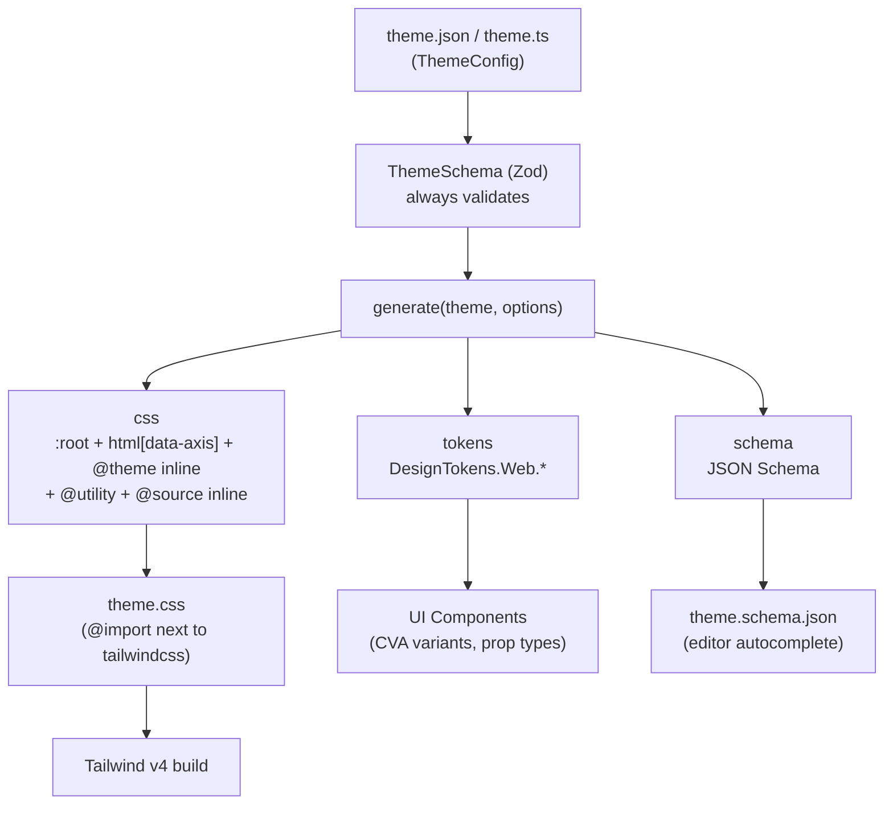
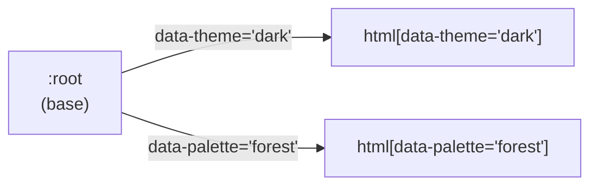

# Architecture

This document describes the overall architecture of `@duydpdev/style-generator` (Tailwind CSS v4 only).
The code is the source of truth for _how_ things work; this document only keeps _why_ and _where_.

## Table of contents

- [Architecture](#architecture)
  - [Table of contents](#table-of-contents)
  - [Core Concepts](#core-concepts)
  - [Data Flow](#data-flow)
  - [Source Code Structure](#source-code-structure)
  - [Entry Points](#entry-points)
    - [`generate`](#generate)
    - [`createDesignTokens`](#createdesigntokens)
    - [Vite Plugin (emit-only)](#vite-plugin-emit-only)
    - [Next.js Plugin (emit-only)](#nextjs-plugin-emit-only)
    - [CLI](#cli)
  - [Registry \& `@source inline`](#registry--source-inline)
  - [Multi-axis Theming (`themeAxes`)](#multi-axis-theming-themeaxes)
  - [Spacing System](#spacing-system)
  - [Exports API](#exports-api)
  - [Design rationale](#design-rationale)
  - [Landing Site (`site/`)](#landing-site-site)

---

## Core Concepts

| Concept           | Description                                                                                                                                                                                                                                                               |
| ----------------- | ------------------------------------------------------------------------------------------------------------------------------------------------------------------------------------------------------------------------------------------------------------------------- |
| **Theme Config**  | The only input: a JSON/object declaring `colors` (required), `typography`, `shadows`, `backdropBlurs`, `borderRadius`, `fontFamily`, `borderWidth`, the scale groups `motionDuration`, `motionEasing`, `controlHeight`, `iconSize`, `opacity`, `zIndex`, and `themeAxes`. |
| **ThemeSchema**   | A Zod `strictObject` that is the source of truth for both JSON and TypeScript: unknown keys, unsafe values and broken aliases are all rejected before any CSS is generated.                                                                                               |
| **Registry**      | Each category (colors, typography, …) is a descriptor in `builtInCategories`; every CSS/`@source inline` generation step goes through the registry instead of repeating key lists.                                                                                        |
| **`generate()`**  | The single function that generates artifacts: `{ css, tokens, schema }`. The CLI, `styleGenVite` and `styleGenNext` all call it.                                                                                                                                          |
| **Design Tokens** | An object holding arrays of token keys (`DesignTokens.Web.*`), used in UI components (CVA, prop types).                                                                                                                                                                   |
| **Consumer**      | A project that uses the library: it `@import`s the generated CSS file next to `@import "tailwindcss"`. No `@plugin`, no safelist.                                                                                                                                         |

---

## Data Flow



---

## Source Code Structure

```text
src/
├── core/                       # generate(), ThemeSchema (+ tokenGrammar, aliasGraph, themeCollisionChecks), options schema (internal, optionsSchema.ts), resolveOptions, Options, defineTheme, type inference
├── features/
│   ├── registry/               # builtInCategories, flattenByCategory, generateSourceInline
│   ├── theme-css/              # :root / html[data-axis] / @theme inline (incl. --border-width-*), screens
│   ├── typography/             # theme.typography → @utility
│   ├── spacing/                # .sp-* utilities + resolveSpacing helpers
│   ├── tokens/                 # createDesignTokens / buildDesignTokens
│   ├── cva/                    # createVariantMapper
│   ├── recipes/                # ./recipes: createTailwindMergeExtension, splitSpacingProps, themeAxisAttributes
│   ├── ui/                     # ./ui + ./ui-react: recipeFromTables, createCn, splitLayout, mergeStyle, Polymorphic
│   ├── vite/                   # styleGenVite
│   └── next/                   # styleGenNext
├── shared/                     # helpers (kebab/camel), defaults, COLOR_STATES, class prefixes, cssBlock
├── node/                       # shared Node-only runner: loadStyleGenConfig, resolveProjectPath, sameFile, configSource, resolveEmitTarget, themeEmitter, watchThemeFile, resolvePluginTarget, writeFileAtomic, errorMessage, isPlainObject
├── cli/                        # commands: init, generate, doctor, schema, tokens, budget, canvas
├── exports/                    # one file per public subpath
├── __integration__/            # tests that compile CSS through the real Tailwind engine
└── index.ts                    # root barrel
```

`src/exports/*` determines which subpaths are browser-safe (they pull in neither Zod nor Node built-ins): `./tokens`, `./cva`, `./spacing`, `./recipes`, `./types`, `./ui`,
`./ui-react`. This constraint is checked by `scripts/check-browser-safe.mjs`. `./recipes` exists only as a subpath (it is not re-exported from `.`), like `./vite`/`./next`,
so the `index` budget does not carry component-side helpers. `./ui` imports `class-variance-authority`, `clsx` and `tailwind-merge` (optional peers);
`check:externals` fails if any other entry, or any chunk they share, imports them.

**Where Node code goes:** everything that touches `node:fs`/`node:path`/chokidar lives in `src/node/` and may only be imported from `src/cli/**`, `src/features/vite/**`,
`src/features/next/**` — never from `src/core`, `src/exports/{tokens,cva,spacing,recipes,types,ui,ui-react}` or the root barrel;
otherwise `dist/index.js` and the browser-safe subpaths would pull Node into the bundle (`check:browser-safe` and the `check:sizes` budget catch this).

---

## Entry Points

### `generate`

```typescript
import { generate } from "@duydpdev/style-generator";
import theme from "./theme.json";

const { css, tokens, schema } = generate(theme);
// css    → written to a file, @import next to tailwindcss
// tokens → DesignTokens (same result as createDesignTokens)
// schema → z.toJSONSchema(ThemeSchema)
```

`generate()` validates `options` first (`StyleGeneratorOptionsSchema.parse` → `resolveOptions`), then always re-validates `theme` against `ThemeSchema` (even if the caller already
called `defineTheme()`); `assertThemeOptions` (`src/core/themeOptionsChecks.ts`) checks the theme × options pair:
`resetTailwindDefaults: ["colors"|"radius"|"shadow"]` requires the theme to have a matching `colors` (non-empty; `ThemeSchema` still accepts `colors: {}`),
`borderRadius` or `shadows`. It then assembles the blocks in this order: `@theme` breakpoints → `:root` + `html[data-<axis>="<variant>"]` + `@theme inline` (the
`--color-*: initial;`… lines of `resetTailwindDefaults` come first in this block) → typography `@utility` → spacing `@utility` → `@source inline`.
Validation lives in `prepareGenerate(theme, options)` (`src/core/prepareGenerate.ts`, returns `{ parsed, resolved }`) and **CSS** assembly in
`generateFromParsed(parsed, resolved)`; `generate()` calls these two in turn and then builds `tokens` (`buildDesignTokens`) and `schema` itself.
The Node runner (`src/node/themeEmitter.ts`) calls them step by step to label errors (stage `read` → `parse` → `options` → `theme` → `cross` (theme × options errors only) →
`generate` (an unexpected throw while building CSS: `Failed to generate CSS: …`) → `write`; `config` and `watch` belong to the watcher).

### `createDesignTokens`

Returns an object holding arrays of keys from the theme; used for component logic, CVA variants and prop types.

```typescript
import { createDesignTokens } from "@duydpdev/style-generator/tokens";
import theme from "./theme.json";

const { DesignTokens } = createDesignTokens(theme);
// Each array is named after the matching ThemeConfig field:
// DesignTokens.Web.colors        → ["primary", "primaryHover", ...]
// DesignTokens.Web.typography    → ["text16Medium", ...]
// DesignTokens.Web.fontFamily    → ["sans", ...]
// DesignTokens.Web.borderWidth   → keys of borderWidth (default 0, 1, 2, 4)
// DesignTokens.Web.breakpoints   → default ["md", "lg"]
// DesignTokens.Web.aliasedColors → color keys whose value is an "$alias" (base record or themeAxes override)
```

**Type inference:** the generics `const T extends ThemeConfig` and `const O extends StyleGeneratorOptions`, combined with `KebabCase` and `CamelCase`,
keep literal types instead of widening to `string`. Every array is `readonly`; `breakpoints`, `spacingProperties` and `screens` take their literals from `options`
(`BreakpointKeys<O>`, `SpacingKeys<O>`, `ScreenKeys<O>`). An optional category that the theme type declares as optional (a theme typed as `ThemeConfig`) yields `string`,
because at runtime it can be either a declared key or a default. `ThemeSchema.parse(theme) as T` appears only in `src/core/themeSchema.ts` (`parseTheme`),
shared by `defineTheme` and `generate`.

### Vite Plugin (emit-only)

`styleGenVite` emits `theme.css` and `theme.tokens.ts` from the theme JSON, replacing the manual predev/prebuild workflow.

```typescript
// vite.config.ts
import { defineConfig } from "vite";
import tailwindcss from "@tailwindcss/vite";
import { styleGenVite } from "@duydpdev/style-generator/vite";

export default defineConfig({
  plugins: [styleGenVite(), tailwindcss()],
});
```

- every generator option lives in `style-gen.config.json` (or `package.json["style-gen"]`) at the Vite root, the file `style-gen generate` reads: `theme`, `output`, `tokensOutput` and each `generate()` option; the plugin loads it through `loadStyleGenConfig` (`resolvePluginTarget`, `src/node/resolvePluginTarget.ts`, shared with Next). A broken config throws `[style-gen-vite] Invalid config (<source>):` instead of falling back to defaults
- the only plugin option is `root` (`StyleGenViteOptions`): the directory that holds the config, relative to Vite's root. Nuxt 4 sets Vite's root to `app/`, so `nuxt.config.ts` passes the project folder. Any other key throws at call time and names the migration guide (`parsePluginRootOptions`)

**Lifecycle:** `configResolved` only resolves paths/config (it needs `config.root`) and registers `outFile` to warn about duplicate targets (this registration is released when the
dev server closes — `server.close` is wrapped; `closeBundle`/`buildEnd` are not used); `buildStart` emits `theme.css` and `theme.tokens.ts` through `emitTheme` (Vite runs `buildStart` on `listen()`,
in middleware mode and for SSR environments; the plugin sets `perEnvironmentStartEndDuringDev: true`,
so since Vite 6 `buildStart` also runs with `createServer()` without `listen()` + `ssrLoadModule`) and calls `this.addWatchFile(theme)` so `vite build --watch` rebuilds;
`configureServer` adds the theme and the config file to `server.watcher`. A theme edit debounces re-emission and triggers `full-reload` only when the CSS actually changed. A config edit **reloads the config in place** (never `server.restart()`, because hosts such as Nuxt and Storybook own the server):
the target is resolved again, the new theme file is watched, the `outFile` registration moves, the files are re-emitted and the page reloads; an invalid edit logs `Cannot reload config, keeping the previous one` and the last valid config stays in force, like `style-gen generate --watch`.
Every write goes through `writeFileAtomic` (a temp file in the same directory + `rename`), and only when the content changed,
so the bundler never reads a half-written file and the watcher is not woken needlessly. An error in `buildStart` is a `this.error` with a stage label (`Invalid JSON in …`,
`Invalid options:`, `Invalid theme (<path>):`, `Invalid theme/options:`, `Failed to generate CSS: …`, `Cannot write …`);
an error in `configResolved` (Vite 5/6 calls this hook without binding `this`) is still a `throw new Error(…, { cause })`.
The examples place `styleGenVite` before `tailwindcss()`.

**Security:** `resolveProjectPath(root, input, label, { allowOutsideRoot })` (`src/node/resolveProjectPath.ts`) normalizes every path with `resolve(root, input)` (absolute paths
too: `..`, `.` and doubled separators are collapsed; no trimming) and then keeps `output`/`tokensOutput` inside the project root (it compares the normalized paths, with no `realpath`;
error `<label> escapes project root: <input>`); `theme` may be outside the root. A leading `/` is not rewritten into a relative path.
It warns when several instances write the same **output file** (`outFile`) within one process (monorepo).

### Next.js Plugin (emit-only)

`styleGenNext` is a wrapper for `next.config.*`, aimed at Next without Vite. It does not import `next`, so it behaves identically under webpack and Turbopack and adds no peer dependency.

```typescript
import { styleGenNext } from "@duydpdev/style-generator/next";

declare const nextConfig: object;

export default styleGenNext()(nextConfig);
```

Its only option is `root` (`StyleGenNextOptions`, default `process.cwd()`): everything else is read from `style-gen.config.json`, like the Vite plugin.

- `styleGenNext(opts)(nextConfig)` returns a `(phase, ctx) => config` function, which Next accepts for `next.config.*`;
  `opts` may be omitted (it reads `style-gen.config.json` at `process.cwd()`, like Vite). Only `phase-development-server` and `phase-production-build` read the theme and write
  `theme.css` and `theme.tokens.ts` (atomically); `phase-development-server` also adds a watcher via `watchThemeFile` (200ms debounce,
  `persistent: false`) — the watcher logs errors and keeps running when the theme is invalid, reloads the config in place when the config file changes (an invalid edit keeps the last valid config), and is replaced when the config is evaluated again for another theme/output.
  The other phases (`next start`, export, info, test) return the config without touching the disk, so a production image does not need the theme JSON.
  A function-form `nextConfig` `(phase, { defaultConfig })` is called with exactly the arguments Next passes.
- **Limitation:** the path guard does not use `realpath` (a symlink pointing outside the root is not detected).

### CLI

`style-gen` (built separately with `tsdown` → `dist/cli/index.mjs`, JSDoc stripped from the bundle via `outputOptions.comments.jsdoc = false` and the `//#region` module markers via `inputOptions.experimental.attachDebugInfo = "none"`;
gzip budget in `scripts/check-sizes.mjs`): `init`, `generate [--watch]`, `doctor`, `schema`, `tokens`, `budget`, `canvas check`.
`src/cli/run.ts` holds one **registry** of `CliCommand` (`name`, `description`, `usage`, `options`, `run`);
`runCli(args, cwd)` parses in two passes (the global pass looks for `--help`/`--version` and the command name, the command pass parses that command's flags in strict mode,
so an unknown flag is an error) and then returns an **exit code** instead of calling `process.exit` — `src/cli/index.ts` only assigns `process.exitCode`,
so any command can be tested directly without stubbing `process`. Codes: `0` success / `--help` / `--version` / prompt cancelled, `1` failure (`budget` and `canvas`: `2` for a usage error).
Config resolution order: flags → `style-gen.config.json` → `package.json["style-gen"]` → defaults; `loadStyleGenConfig`/`readConfigFile` (`src/node/loadStyleGenConfig.ts`,
shared with Vite/Next) validate the config file with `StyleGenConfigSchema` (its Shape and refinements are shared with `generate()` from `src/core/optionsSchema.ts`),
return `issues` when the schema is violated (nothing is merged) and `error` when the file is broken JSON (`generate`, `tokens` and `schema` warn `Ignoring … using defaults` and use the defaults; `generate --check`, `doctor` and the plugins fail),
config issues make `generate`, `tokens` and `doctor` stop with exit code 1, and `schema` too unless it is given `--out` (then it writes both schemas, reports nothing and exits 0; `src/cli/loadCliConfig.ts` bundles reading and error printing).
`generate` calls `emitTheme` (`writeFileAtomic`, writes `theme.css` and `theme.tokens.ts` only when their content changed) on the target `resolveEmitTarget` builds from the config: `output`/`tokensOutput` inside the root, `tokensOutput` a `.ts`/`.mts`/`.cts` file, and theme, CSS, tokens module, `style-gen.config.json` and `package.json` five different files (`sameFile`, `src/node/sameFile.ts`, decides: same canonical path, or the same inode when both exist, so another case, a symlink or a hard link counts; it runs once when the target is resolved; `doctor` runs the same function); an invalid theme/option or a file write error returns exit code 1. `generate --check` calls `checkTokensModule` instead (CRLF compared as LF), writes nothing and returns 1 when the tokens file is missing or differs, or when the config is malformed. `style-gen tokens` writes the same module through `emitTokensModule`.
`generate --watch` uses `watchThemeFile` to watch the theme **and** both config candidates (`style-gen.config.json` and `package.json#style-gen`, resolved by `src/node/configSource.ts`; `package.json` events are ignored while `style-gen.config.json` exists): every time the config changes it calls `reloadTarget` to re-read it,
and an invalid config is only reported (stage `config`) while **the last valid config stays in use**; theme/write errors after watching has started are only logged. A watched file that is removed is unwatched and watched again when it appears, and its re-creation re-emits.
`--version` reads `package.json` via `import.meta.url` (`src/cli/version.ts`), because `__dirname` does not exist in an ESM bundle.
`init` (`src/cli/commands/init.ts`) writes the theme, `theme.schema.json` next to it and the config's JSON Schema, detects the stack with `detectStack` (`src/cli/commands/detectStack.ts`:
the first file `nuxt.config.*`, `next.config.*`, `vite.config.*` in the project root, in that order) and prints the bundler snippet from `src/cli/templates.ts`
(`getBundlerSnippet`: no-argument `styleGenVite()`/`styleGenNext()`, absolute paths and `options` for Nuxt) plus the CSS `@import` lines, or the `style-gen generate` fallback;
every printed or stored path is repo-relative POSIX; it never edits a bundler config and scaffolds no generator script;
it keeps an existing valid config that already names the theme as it is, otherwise merges `theme` and `$schema` into it (and `output` only when it has none), or into a copy of `package.json["style-gen"]` when that file does not exist (a new file takes precedence over
that section), keeps the other keys as they are and reads the config before writing anything; a config that `generate` rejects keeps the `theme` and `output` it declares and is left byte for byte as it was, with a warning, and a `style-gen.config.json` that is not valid JSON stops `init` with exit code 1;
an existing `theme.schema.json` or `style-gen.config.schema.json` is treated as an existing file (it asks before overwriting; non-interactive exits with code 1, also for a config that declares an existing theme; declining keeps the existing files and writes what is missing; `--yes` keeps every existing file and exits 0 without prompting), and `--yes` also keeps an existing config as it is:
it reads the theme from it and exits with code 1 when the config is invalid or `--theme` names another theme; a `--theme` that names a file `init` writes or merges into (a schema file, `style-gen.config.json`, `package.json`) exits 1 before anything is written;
the config it writes gets `"$schema": "./style-gen.config.schema.json"` as its first key unless it already has one.
`schema` without `--out` reads the config like `generate` (a malformed file → warning and the defaults, with or without `--out`; a config that violates the schema → the config schema is still written, then the issues are reported and the exit code is 1 with no theme schema)
and writes `theme.schema.json` into the directory of the resolved `theme` (via `resolveProjectPath`; the theme may be outside the project,
the written file may not) and `style-gen.config.schema.json` into the project root, or where `--config-out` says; neither target may be the theme (the `theme` of a valid config, else the one an invalid config declares, else `styles/theme.json`), `style-gen.config.json` or `package.json`, and the two targets must differ (`sameFile` again). The config schema is `z.toJSONSchema(StyleGenConfigFileSchema)` narrowed by `buildConfigJsonSchema` (`src/cli/configJsonSchema.ts`) with the key and value rules the generator maps into it (per-category `coverage` prefixes and `keys`, distinct `opacities`);
rules that compare two keys (`breakpoints` must name a screen, `screens` must share one unit, `resetTailwindDefaults` needs its replacement in the theme) and the path rules stay in `generate`, `doctor` and the plugins. `tokens` (`src/cli/commands/tokens.ts`) runs `readAndPrepareTheme` and then serializes exactly the `DesignTokens.Web` object from `buildDesignTokens`
into `export const tokens = {…} as const` — keys only, so a client bundle does not need to ship the `./tokens` runtime and the theme JSON.
`budget` (`src/cli/commands/budget.ts`) sums the gzip size (`node:zlib` defaults) of every `.css` under the target file/directory and compares it with `--max-gzip`;
the two summary lines `OK: …`/`OVER BUDGET: …` are a stable contract for consumers' CI.
`doctor` reads the config (malformed or invalid → stop, exit code 1), validates the theme with `ThemeSchema`, then runs `prepareGenerate` with the config's options to catch theme × options
errors (`❌ Invalid theme/options`), resolves the emit paths with `resolveEmitTarget` and reports a refusal (an `output` or `tokensOutput` that escapes the root, a `tokensOutput` that is not a `.ts` file, two roles on one file) as `Output (…) ❌ Invalid emit paths`, and prints warnings (without changing the exit code) when a key collides with a Tailwind
utility (`src/cli/commands/utilityCollisions.ts`, the list is verified against the real compiler in `src/__integration__/utility-collisions.test.ts`) or when a `themeAxes` override
repeats the literal of another key in the base (suggesting `$alias`, `src/cli/commands/aliasHints.ts`).

### Recipes (`./recipes`)

Three component-side helpers, browser-safe, with no `tailwind-merge` import (the dist `.d.ts` does not mention it;
the app declares `tailwind-merge` 3.x itself — the extension uses v3 group ids and the theme key `radius`):

- `createTailwindMergeExtension(tokens)` → `{ extend: { classGroups, conflictingClassGroups, theme } }` for `extendTailwindMerge`.
  Tokens are camelCase keys, so they go through `toKebabCase` before becoming classes. `borderRadius` goes into `theme.radius` (the scale that every `rounded-*` group of
  tailwind-merge reads, so `rounded-tl-pill` and `rounded-s-pill` merge correctly too); `shadows`, `backdropBlurs` and `borderWidth` are class groups.
  The prefix table for `border`/`divide-*` (→ id `border-w*`), `shadow` and `backdrop-blur` is local to the module so the registry is not pulled into the `./tokens` chunk;
  `extendTailwindMerge.test.ts` pins this table to the registry's `classPrefixes`. `colors` and `fontFamily` are not listed because tailwind-merge's default groups already accept
  any value.
- `splitSpacingProps(props, keys, unit)` + `SpacingProps<BKeys, K>` → `{ spacing: { className, style }, rest }`;
  it calls `resolveSpacing` once per key (so import `./spacing` through the shared chunk) and removes every spacing key from `rest`, even when the value is `undefined`.
- `themeAxisAttributes(state)` → the DOM attributes of the active axes, using the same `axisAttributeName` formula as the selectors that `generate()` emits;
  an axis that is `"base"`/`undefined` emits no attribute.

### UI kit (`./ui`, `./ui-react`)

The styleless kit the example components are built on, in `src/features/ui/`: `recipeFromTables(tables)` (cva over plain class tables), `pick`/`contrastText` (token → class,
throwing on a missing token), `createCn(tokens)` (`clsx` + `tailwind-merge` with `createTailwindMergeExtension`), and `splitSpacing`/`splitLayout`/`mergeStyle` (props → classes,
inline style and the rest). `splitLayout` takes the recipe, the spacing keys, the variant prop names and the size prop names in one options object, so the kit knows no design system and no layout prop type;
it turns a numeric size into px (`320` → `"320px"`, `0` → `"0"`, strings kept). `class-variance-authority`, `clsx` and `tailwind-merge` are optional peer dependencies:
only `./ui` imports them, guarded by `check:externals`. `./ui-react` is type-only (`Polymorphic`) so `./ui` stays free of React types. Neither is re-exported from `.`.

---

## Registry & `@source inline`

**Why a registry:** key and prefix lists would otherwise repeat in the plugin, the safelist and the tokens.
A single `TokenCategoryDescriptor` (`src/features/registry/builtInCategories.ts`) declares `cssVarPrefix`, `themeNamespace`, `classPrefixes`, `responsive`,
`states` and default values; adding a category = 1 line in `ThemeSchema` + 1 descriptor + 1 test. Category data is read with `theme[descriptor.key]`;
the unions `CategoryKey`/`CssVarCategoryKey`/`RegistryPrefix` and `CategoryTokenKey<T, K>` (the token key type) are inferred from the `builtInCategories` array itself.
Default values (`defaultValues` of `borderRadius`/`borderWidth`) live in `categoryTokenMeta.ts` — a separate, small file that does not drag in the descriptor's CSS part;
the descriptor spreads it in, while `createDesignTokens` imports only this file, so the `./tokens` entry (browser-safe,
with a gzip budget) does not have to carry the whole registry. A guard in `builtInCategories.test.ts` keeps the two in sync.

**Resolve options once:** `generate()` calls `resolveOptions()` (`src/core/resolveOptions.ts`) right after parsing; `generateScreensCss`, `generateSpacingCss`,
`generateSourceInline` and `buildDesignTokens` read `ResolvedOptions` (breakpoints, screens merged with `defaultScreens`, breakpoints sorted by width via `parseFloat`, spacing,
`coverage`) instead of each repeating `options.x ?? DEFAULT_X`. The part tokens need (`breakpoints`, `screens`, `spacing`,
`opacities`) lives in `resolveTokenOptions()` (`src/core/resolveTokenOptions.ts`), which `resolveOptions` spreads;
`createDesignTokens(theme, options)` = `buildDesignTokens(theme, resolveTokenOptions(options))`. These two files are separate because Rollup groups modules by the set of entries
that use them: merging this into `resolveOptions` would drag all of `coverage` into `./tokens`. A category declared as `{}` is treated as absent in both `@source inline` and
`DesignTokens` (the default keys are used).

**`./tokens` entry and the gzip budget:** `vite.config.ts` sets `preserveEntrySignatures: "allow-extension"`.
With the default `strict`, Rollup has to split out a facade containing only the public exports when the `./tokens` chunk shares internal code (`buildDesignTokens`,
`resolveTokenOptions`, `categoryTokenMeta`) with `generate`, and that facade (~290 B gzip) pushes `./tokens` over budget.
Consequence: `dist/tokens.js` and `dist/tokens.cjs` export a few extra single-letter aliases at runtime (`minifyInternalExports: true` applies to CJS too);
`dist/tokens.d.ts` is unchanged and is the only contract, these aliases are not API. The `./tokens` budget is raised only when the tokens surface itself grows (for example
`aliasedColors` in phase 09), never to absorb accidental coupling.

**Shared chunks and `codeSplitting.groups`:** adding an entry (such as `./recipes`, which uses `helpers` + `spacingHelpers` but not `colorStates`) changes the set of entries that depend on
each module, so the bundler splits `helpers`/`colorStates` apart and pushes the cost of importing a chunk onto `./tokens` and `./cva`. `vite.config.ts` pins those modules into stable
chunks with Rolldown's `output.codeSplitting.groups`: `helpers` + `colorStates` → `helpers`, `exports/cva` + `createVariantMapper` → `cva`, the `./tokens` internals
(`exports/tokens`, `createDesignTokens`, `Options`, `resolveTokenOptions`, `categoryTokenMeta`, `classPrefixes`) → `tokens`; `includeDependenciesRecursively` is `false`, so a group takes only the modules it names.
When adding a shared module or a new entry, re-run `yarn build:all && yarn check:sizes`; `tokens`/`cva`/`spacing`/`index` must not creep up — pin the module or restructure the
imports, do not raise the budget. `check:sizes` also runs `scripts/check-dist-reachable.mjs`, which fails when a `dist` JavaScript file is not reachable from a published entry (such a file would not be counted by the size budget).

**Why `@source inline` instead of a safelist:** Tailwind v4 does not scan classes built at runtime. `generateSourceInline` emits one `@source inline("…")` line per category (and
per state that has a sibling, for example `hover:bg-primary-hover`), so the classes always exist even if no source references them;
classes built at runtime are declared by the app with a plain Tailwind `@source inline(...)` directive in its own CSS.
Trade-off: every color always has `bg-/text-/border-/ring-/outline-/divide-/placeholder-*`,
so the CSS is slightly larger — `options.coverage` narrows these lines per category (`false`, `prefixes`, `keys: "aliased"`),
and `coverage.colors.opacities` opts into one extra `/<n>` opacity-modifier line (see [`coverage`](./reference/options.md#coverage-trim-the-source-inline-lines-per-category)).

**`$key` aliases:** `flattenByCategory` turns `"$blue500"` into `var(--sg-color-blue-500)` (using the category's own `cssVarPrefix`).
`ThemeSchema` has already proven that the target exists and the graph has no cycles before emitting.
In `colors`, `"$blue500/8"` becomes `color-mix(in srgb, var(--sg-color-blue-500) 8%, transparent)` (`parseAliasRef`: the percent is an integer 1–100 and is rejected in every other category).

**Why `_` is forbidden in keys:** `toKebabCase` keeps `_` as is (`primary_active` → `bg-primary_active`) while the camelCase in `createDesignTokens` drops `_` (`primaryActive`),
so `createVariantMapper` would generate `bg-primary-active` — a class that does not exist. The schema rejects `_` in every token-name position (color/typography/…,
axis and variant names); loosening later is not breaking, tightening later is. `formatZodError` opens up Zod's `invalid_key` layer so the CLI/plugin prints the camelCase/kebab hint
right on the correct path.

**State table:** each `COLOR_STATES` row carries the sibling suffix and the Tailwind variant (`{ suffix: "Selected", variant: "aria-selected" }`); `createVariantMapper` and
`generateSourceInline` read the same row and emit `variant` as written, because a variant name need not derive from the suffix (`Selected` → `aria-selected:`).
Sibling lookup is the token plus `suffix` (`primary` + `Selected` → `primarySelected`).

---

## Multi-axis Theming (`themeAxes`)

`themeAxes` is a `Record<axis, Record<variant, ThemeOverride>>`. Each variant emits `html[data-<axis-kebab>="<variant-kebab>"]` after the `:root` block, in declaration order (axis,
then variant). Each variant only needs to declare the values that **differ** from the base.



Design decisions:

- **The selector is pinned to `html` and the attribute is `data-<axis-kebab>`:** an alias `var()` is resolved at the element that _declares_ the custom property (`:root`),
  so an override on a child element never reaches the alias's value.
  Neither is configurable; a scoped theme or a custom attribute name is hand-written CSS in the app.
- **Precedence = declaration order:** two axes overriding the same token have equal specificity; the axis declared later wins.
  That is why axis/variant names that are integers are rejected (JS enumerates numeric-like keys first, breaking the order).
- **An override must have a key in the base:** a key present only in an override does not map into `@theme inline`/`@utility` and so creates no utility; it is rejected at parse time.
- **Overrides combined across axes** (`[data-theme="dark"][data-palette="forest"]`) and variables outside `--sg-*` are still hand-written CSS (see the table in
  [`examples/design-system/README.md`](../examples/design-system/README.md)).

---

## Spacing System

Spacing does **not** use a per-value safelist. `generateSpacingCss` emits each `sp-<key>` as exactly one `@utility`, with the breakpoint fallback chain inside the utility itself,
together with `@property --sg-sp-<key>[-<bp>] { syntax: "*"; inherits: false }` (no `initial-value`). Components only set the variables inline.

```css
@utility sp-p {
  padding: var(--sg-sp-p);
  @media (width >= 768px) {
    padding: var(--sg-sp-p-md, var(--sg-sp-p));
  }
  @media (width >= 1024px) {
    padding: var(--sg-sp-p-lg, var(--sg-sp-p-md, var(--sg-sp-p)));
  }
}
```

**Why `inherits: false`:** variables do not inherit, so an `sp-*` class only reads variables declared on the **same element**;
otherwise a parent's responsive value leaks down to a child that has not set the variable itself.
The `--sg-sp-*` namespace also avoids occupying Tailwind's internal `--tw-*` namespace. The regression is tested on Chromium and WebKit (`e2e/spacing-inheritance.spec.ts`).

```tsx
import { resolveSpacing } from "@duydpdev/style-generator/spacing";

const p = resolveSpacing("p", 4);
// { className: "sp-p", style: { "--sg-sp-p": "1rem" } }
const mx = resolveSpacing("mx", { base: 2, md: 4 });
// { className: "sp-mx", style: { "--sg-sp-mx": "0.5rem", "--sg-sp-mx-md": "1rem" } }
```

Turn it off with `options.spacing.enabled = false`; customize it with `options.spacing.properties` (spacing key → array of CSS properties,
for example `{ inset: ["top", "bottom"] }`; the value is always `var(--sg-sp-<key>)`). Only breakpoints in `options.breakpoints` (default `["md","lg"]`) get a fallback chain.

---

## Exports API

The export list per subpath, with signatures and examples, lives in [`reference/`](./reference/core.md#all-exports-by-subpath);
`node scripts/check-doc-exports.mjs` guarantees that every export has a heading there. Breaking changes between majors are in the guides under `migration/` (the latest is [`migration/8.x-to-9.0.md`](./migration/8.x-to-9.0.md)).

---

## Design rationale

Why some source files look the way they do. The code carries a one-line `Rationale:` pointer to the matching heading below instead of a long comment (`yarn check:comments` caps comment length).

### `TokenKey`: why underscores and leading uppercase runs are rejected

The key grammar guards against structurally unsafe keys (spaces, leading dashes, semicolons) that would otherwise be echoed into the CSS as a custom-property name or selector; typos such as `colours` are caught by `strictObject` instead. A key must also keep its class through the typed tokens: the registry emits `toKebabCase(key)`, while `createDesignTokens` exposes `toCamelCase(key)`, which `createVariantMapper` kebab-cases again. `_` breaks that round trip because `toKebabCase` keeps it (`bg-primary_active`) while the typed token drops it (`primaryActive`), so the mapper class would not exist. A leading uppercase run breaks it too (`CTA` gives `bg-cta`, but the token `cTA` gives `bg-c-ta`), so such keys are rejected with the rename that keeps the registry class. Relaxing the `_` rule later is non-breaking.

### `TokenValue`: what the value grammar blocks and why quotes stay legal

A value must not contain `;`, `{`, `}`, `<`, `@`, `\`, `/*` or a line break, because each could inject a new CSS rule, an HTML tag, an at-rule, a comment or a line break into the generated CSS. Quotes are allowed only when balanced: an odd count could break out of a quoted CSS or HTML attribute context, while balanced quotes are needed for `fontFamily` stacks such as `"Plus Jakarta Sans", system-ui`. Unbalanced `(` or `[` outside quoted strings are rejected because Tailwind would otherwise fail far from the theme key with an unclosed-block error. A `"$<key>"` alias is also a valid value; `flattenByCategory` resolves it to `var(--<cssVarPrefix>-<key>)` only after the schema has proven the target exists and the graph is acyclic.

### `validateThemeOverride`: why override keys skip the collision checks

Every override key must already exist in the matching base record: the CSS generator only iterates base keys, so an override-only key would produce no class. Because of that rule, any kebab-key, `borderWidth`/`colors` or `fontFamily` weight-name collision between override keys is also a collision between base keys, which the base pass already reports. The override pass therefore only checks key existence and the alias graph merged over the base.

### `ThemeAxesSchema`: why integer-like axis and variant names are rejected

`themeAxes` relies on declaration order: blocks are emitted in that order and, for a token overridden by two axes, the axis declared last wins. JavaScript enumerates canonical integer keys (`0`, `7`, `2024`, no leading zero) first and in ascending order, ahead of every string key, regardless of how they were written in the JSON file. That order is lost before the library sees the object, which would silently break the "last declared wins" rule, so such axis and variant names are rejected. Names like `007` or `2xl` are not canonical integers and stay valid.

### `rejectProtoKeys`: why prototype-key names are scanned on the raw input

Zod's `z.record` skips an input key `__proto__` before the key schema runs, as a prototype-pollution guard, so a `__proto__` colour, axis, variant or override key would be dropped without an error. Only a parsed JSON document can carry it as an own key; the object literal `{ __proto__: x }` sets the prototype instead. Detecting it needs the raw input, so the scan runs in the `z.preprocess` step of `ThemeSchema`, bounded to the deepest level that can hold a token name so a cyclic object cannot overflow the stack. Since `z.preprocess` skips the main schema once this step adds an issue, this error hides every other issue until the key is removed.

### `parseTheme`: why the cast to the caller's type is safe

`ThemeSchema.parse` returns the widened `ThemeConfig`, but callers need their own literal key and value types for downstream inference such as `DesignTokensWeb<T, O>`. `parseTheme` is the one place that casts the result back to `T`. The cast cannot hide a shape mismatch because the schema has no coercion or defaults, so a successful parse is structurally identical to the input.

### `validateCrossAxisAliasCycles`: why alias cycles are checked across axes

Every axis's `html[data-<axis>]` block applies to the same element at once, so an alias in one axis and another in a second axis can form a cycle that no single base-plus-variant pass sees (`x.one: a → $b` with `y.two: b → $a` makes both custom properties invalid). The check walks every combination of at most one variant per axis, merges them over the base in axis declaration order (the last declaring axis wins a key, like the emitted CSS) and reports the first cycle whose edges come from at least two axes. Cycles from the base plus one axis are already reported by `validateCategoryAliasGraph`. Axes without aliases are skipped, and nothing runs unless two axes carry aliases in the category.

### `StyleGeneratorOptions`: why each option is declared in four files

Each option is declared in four places: the public type in `Options.ts`, the Zod shape in `optionsSchema.ts`, and the resolved defaults in `resolveTokenOptions.ts` and `resolveOptions.ts`. `optionsSchema.test-d.ts` pins these types to each other, so adding an option to one place without the others fails the type tests. The two resolve modules stay separate so the browser-safe `./tokens` entry only bundles the options the typed tokens read, not coverage resolution or breakpoint sorting.

### `defineTheme`: why it is optional and only in the root entry

`defineTheme` is exported only from the root entry (`.`), never from `./tokens`, so Zod never reaches the browser-safe subpaths. Calling it is optional because `generate()`, the CLI and the Vite plugin all validate the theme again on their own. Calling it still helps: the same mistakes also show up as IDE type errors, since `T` is checked against `ThemeConfig` at compile time.

### `DeclaredCategoryKey`: why an optional category widens to string

For a category with default keys, the property's optionality decides the declared key type. A required property yields its declared keys, and an absent one yields `never`, so the caller falls back to the defaults. An optional property, such as `borderRadius?` on a `ThemeConfig`-annotated theme filled by `JSON.parse`, yields `string`, because either the declared keys or the defaults may apply at runtime.

### `axisAttributeName`: why it has its own module

The CSS generator (the emitted selector) and the `./recipes` DOM helper both call `axisAttributeName`, so the two can never disagree about an attribute name. It lives in its own module instead of `helpers.ts` so the shared `helpers` chunk that `./tokens` and `./cva` import does not grow.

### `colorStates`: why it lives in a dependency-free module

`COLOR_STATES` is the single source for both sides of the color-state contract: the registry's `colorsCategory.states`, which drives the `@source inline` state lines, and consumers passing `{ states: COLOR_STATES }` to `createVariantMapper`. It sits in a module with no dependencies so the browser-safe `./cva` subpath can re-export it without pulling in Zod or the registry.

### `DEFAULT_BREAKPOINTS`: why only md and lg

`DEFAULT_BREAKPOINTS` is the single default shared by the `@source inline` responsive variants, the spacing `@media` chains and `DesignTokens.Web.breakpoints`. `md` and `lg` are the only responsive variants the `@source inline` lines emit (no `sm:`, `xl:` or `2xl:`). Defaulting to every `screens` key would advertise breakpoints that no line covers.

### `types.ts`: why `Breakpoint` is not re-exported

`Breakpoint` is also a runtime const, shipped from `./tokens`. The declaration rollup would turn a type-only re-export of it in `./types` into a declared value that this entry never ships, so `./types` leaves it out.

### `ui-react.ts`: why React types live in their own subpath

`./ui-react` is type-only: its JS module is empty and its declarations import `react` types, so it needs `@types/react`. Keeping those types out of `./ui` means `./ui` names no React type, and Vue apps can use it without React.

### `writeFileAtomic`: why rename over write

The data goes to a temp file in the target's own directory, which is then renamed over the target with `renameSync`.
`rename(2)` is atomic on POSIX and NTFS as long as source and destination share a filesystem, and the same-directory temp file guarantees that.
A concurrent reader (Tailwind's `@tailwindcss/postcss` and `@tailwindcss/vite`, Turbopack's CSS loader) therefore never sees a partially written file.
The parent directory must already exist.
On a failed write or rename the temp file is removed; after a successful rename that cleanup is a no-op because `force` swallows `ENOENT`.

### `resolveProjectPath`: containment rules

A relative path is joined to the root; an absolute path is taken as the filesystem path it names, with no leading-slash rewrite (`/styles/theme.json` is not `root/styles/theme.json`).
Both go through `resolve`, so `.` and `..` segments and doubled separators are normalised and the result is a stable key for a watcher or an output file.
The theme may live outside the root (a theme shared by a monorepo), so it is resolved with `allowOutsideRoot`; every generated or scaffolded file must stay inside the root.
The traversal check matches a `..` path component (`rel === ".."` or `rel.startsWith(".." + sep)`), not any `rel` that starts with two dots: a sibling directory such as `..foo` yields `"..foo/bar"`, a normal in-root path.
Symlinks are not resolved with `realpath`: the logical path is compared against the root.

### `emitTheme`: one synchronous pipeline that writes only on change

`emitTheme` is the one pipeline behind the Vite plugin, the Next.js integration, `style-gen generate` and `style-gen tokens`.
It validates with the same `prepareGenerate` that `generate()` runs, so their verdicts cannot drift.
A file is written only when its content changes, and atomically, so Tailwind never reads a half-written file; missing output directories are created.
Every failure comes back as `{ ok: false, stage, message, cause }` instead of a throw.
It is synchronous so a bundler hook can finish before the CSS is `@import`ed.

### `watchThemeFile`: config reload semantics

Every config candidate is watched, also when it does not exist yet or is removed and created again; a change, creation or removal of one reloads the target and re-emits.
An event on a candidate shadowed by an earlier one that exists is ignored (a `package.json` edit such as `yarn add` while `style-gen.config.json` is in force), and a `package.json` edit that leaves the reloaded target unchanged emits nothing.
A config that cannot be used is reported with stage `config`; the last valid target stays in force, watching goes on, and a theme edit in the same burst still emits with that target.
A reloaded target with another `themeFile` makes the watcher unwatch the old theme and watch the new one.
Nothing in the watcher throws or stops it, so a broken edit is reported and the next good one recovers.

### `watchThemeFile`: re-arming the watch after unlink

chokidar watches a file that existed at start through a watch on the file itself and drops that watch on `unlink`; without a re-arm, its re-creation (`git checkout`, `git stash`) and later edits are never seen.
Unwatching first clears chokidar's ignore entry, so the following `add` really starts a fresh watch.
The re-arm `add()` counts as an initial add that `ignoreInitial` drops, and a theme recreated within a few tens of milliseconds is already back, so the run is scheduled from the `unlink` itself.
`run` skips a theme that is still gone when the timer fires; a theme that comes back later reports an `add` of its own.
Removing a config file means "the next candidate, else the defaults", so it triggers a reload.

---

## Landing Site (`site/`)

The top-level `site/` is a separate landing page (React + Vite + Tailwind v4) that dogfoods the library through the `link:..` dependency (see [`deploy.md`](./deploy.md#why-link-instead-of-workspace)). It is deployed to GitHub Pages by `deploy-site.yml` ([`deploy.md`](./deploy.md#deploy-siteyml--site-on-github-pages)).

- **Path:** `site/`
- **Stack:** React 19, Vite 7, Tailwind v4, `@duydpdev/style-generator` (`link:..`), `styleGenVite()`
- **Theme:** Cobalt palette (`site/src/theme/theme.json`) — `site/src/theme/theme.css` is generated by `styleGenVite`; `site/src/theme/theme.schema.json` is a committed copy of the schema
- **Scripts:** `yarn workspace site {dev,build,typecheck,lint}`; the dev port defaults to 5174 to avoid conflicting with the examples
- **Workspace setup:** the root `package.json` declares `workspaces: ["site", "examples/*"]` + `resolutions.vite` so there is only one Vite instance
- **UI:** every `site/src/**/*.tsx` file renders through `site/src/ui.ts`, which binds five of the six sample component factories of `harness-example/ui`
  (`examples/harness/src/ui/*.tsx`, see [`components.md`](./components.md)) to the site's own tokens.
  ESLint rejects the tags in `BANNED_TAGS` (`examples/ui-registry.mjs`), `className` and `style` (outside an `eslint-disable-next-line no-restricted-syntax -- <reason>` line);
  only `NavLink` and `ReactMarkdown` keep `className`. The same rules cover `examples/harness/src/**` through `UI_APP_FILES` in `eslint.config.js`,
  which also reports a `<Grid>` without `columns` there; the site is exempt from that rule because its grids use desktop-first CSS templates.
  Files in `UI_APP_FILES` stay under the `max-lines` limit (150 lines): split a longer component.
- **CSS hooks:** bespoke CSS hooks are namespaced classes: `s-` classes in `site/src/styles` (`.s-doc-body` for markdown/highlight, pseudo-elements, keyframes,
  chrome that has no prop) and `x-` classes in the harness example; `data-reveal="up|stagger"` + `data-reveal-state="pending|done"` (set by `site/src/lib/use-reveal.ts`) for the
  reveal effect; `data-ch` on each chapter. Spacing (`margin*`, `padding*`, `gap`) is always a component prop and never sits in a hook rule.
- **Spacing exceptions:** the only spacing declarations allowed under a `.s-*` rule are inside an `@media (max-width: …)` block whose width no responsive prop can express (the
  props switch only at `md` and `lg`), each marked `/* spacing-exception: <Id> */` in the CSS: E1 (`terminal.css`, `cta-card` padding at 720px), E2/E3 (`layout.css`,
  `topbar-inner` padding and gap at 640px), E4 (`hero.css`, `install-go` `margin-left: auto` at 480px), E5/E6 (`examples.css`, `url-pill` margin and `view-tab` padding at 640px).
- **Sample components and checks:** the React components in `examples/harness/src/ui/` are example code (`Box`, `Text`, `Stack`, `Flex`, `Grid`, `Button`).
  They have no test runner: `yarn workspace harness-example typecheck` compiles their type-check file (see [`testing.md`](./testing.md#8-checks-of-the-sample-components)),
  `yarn lint` applies the registry rules, and the site build renders them; the site is also covered by `yarn workspace site check:links` and the visual and layout specs
  (`yarn test:visual`).

### Routes

- `/` — landing (editorial scroll).
- `/docs` — redirects to `/docs/introduction` (the repo `README.md`).
- `/docs/:slug` — renders the files listed in `site/src/lib/docs-meta.json` (the repo `README.md`, `documents/*.md`, `documents/getting-started/*.md`,
  `documents/reference/*.md` and the migration guides; each entry has a unique slug, group and order) via `react-markdown`.
  HTML comments used by the docs scripts (`<!-- embed: … -->`, `<!-- signature: … -->`, `<!-- snippet: … -->`) are stripped before rendering
  (`site/src/lib/strip-html-comments.ts`).
- `/vi/docs`, `/vi/docs/:slug` — the Vietnamese twin of the same page (`documents/vi/<path>`; the repo `README.md` → `documents/vi/README.md`) under the same slug,
  titled with the entry's `vi.title`. The docs chrome strings come from `UI_TEXT` in `site/src/lib/locale.ts`, the breadcrumb links each page to its twin in the other language,
  and `<html lang>` follows the page. `node scripts/check-docs-i18n.mjs` keeps every twin in step with its English file.
- `/examples/v4` — an iframe embedding `examples/harness/dist`.
- `/playground` — a lazy page that runs `generate()` in the browser on a theme JSON (and an options JSON) and prints the CSS, the typed tokens or the validation error.

### Examples integration

`site/scripts/build-examples.mjs` runs before the site's Vite build (via `yarn build:examples`): it builds `harness-example` with a relative base and copies `examples/harness/dist`
into `site/public/examples/v4` (gitignored). The iframe in `examples-page.tsx` loads `${BASE}/examples/v4/index.html`.

### Examples catalog (`examples/*`)

4 workspaces in `examples/*` (they link the lib via `link:../..`; `design-system-example` is referenced by `harness` via `workspace:*`).
The plain apps (`plain-react`, `plain-nuxt`) depend on no other workspace: each owns a reduced theme copy,
`src/theme.ts` (Nuxt `app/theme.ts`) and one folder per component over `@duydpdev/style-generator/ui`; `yarn check:plain-ui` keeps their shared files identical.
**`examples/design-system`** holds everything shared — `theme.json` (+ schema), `style-gen.config.json`, the generated `theme.tokens.ts`, `tokens`, `cn`, the headless recipes of the six sample components (`box`,
`text`, `stack`, `grid`, `button`), the shared CSS (`palettes.css`, `style-guide.css`) and the DX test — so each app keeps only its wiring,
its demo code and (in `harness`) the six sample components in its `ui/` folder. Every app declares its generator options in one config file (`style-gen.config.json`, or `package.json#style-gen` in `harness`) and wires `styleGenVite()` with no arguments;
`plain-react`, `plain-nuxt`, `design-system` and `site` commit the `theme.tokens.ts` the plugin or `style-gen generate` writes (`yarn check:tokens` fails when one is stale); `harness` generates its own at dev/build time and git-ignores it.

| Example         | Stack                      | Role / theme wiring                                                                                                                                                                   |
| --------------- | -------------------------- | ------------------------------------------------------------------------------------------------------------------------------------------------------------------------------------- |
| `design-system` | Plain TypeScript (no app)  | Theme, config, generated tokens, `cn`, headless recipes, shared CSS, DX test (`yarn workspace design-system-example test`); CLI flow (`style-gen.config.json` → `style-gen generate`) |
| `harness`       | Vite + React + Tailwind v4 | `styleGenVite()` reading `package.json#style-gen` → `@import "./theme/theme.css"`; the six sample components (`src/ui/*.tsx`) wrap the recipes, and `site` imports them               |
| `plain-nuxt`    | Nuxt 4 (Vue 3) + TW v4     | `styleGenVite({ root })` in `nuxt.config.ts` (root = the project folder); the plain landing page from `app/ui/<folder>/` SFCs                                                         |
| `plain-react`   | Vite + React + Tailwind v4 | `styleGenVite()` → `src/theme/theme.css` + `theme.tokens.ts`; the plain landing page, Storybook stories and the parity gate against `harness`                                         |

Each app emits `theme.css` into its own gitignored file and `@import`s the shared CSS through `design-system-example/styles/*`;
`harness` adds `@source` lines back to `design-system/src` (relative to the CSS file), while its `ui/` components sit inside the app and are scanned by default;
the plain apps need none, because every class literal lives inside the app. Only `harness` is embedded in the landing site; the plain apps are standalone. See [`examples/README.md`](../examples/README.md).

### Deploy pipelines

| Target              | Workflow                     | See                                  |
| ------------------- | ---------------------------- | ------------------------------------ |
| Package → npmjs.org | `release.yml` + `deploy.yml` | [`documents/deploy.md`](./deploy.md) |
