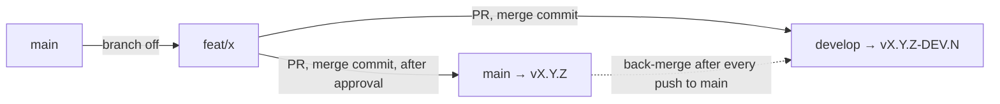

# Deployment & CI/CD

Deployment process for the `@duydpdev/style-generator` library.

## Table of contents

- [Deployment \& CI/CD](#deployment--cicd)
  - [Table of contents](#table-of-contents)
  - [CI/CD Overview](#cicd-overview)
  - [GitHub Actions Workflows](#github-actions-workflows)
    - [`ci.yml` — PR Check](#ciyml--pr-check)
    - [`ci-matrix.yml` — PR Matrix](#ci-matrixyml--pr-matrix)
    - [`pr-title.yml` — PR title lint](#pr-titleyml--pr-title-lint)
    - [Pull Request \& merge convention](#pull-request--merge-convention)
    - [Local (Pre-commit) — Husky](#local-pre-commit--husky)
    - [`release.yml` — Semantic Release Orchestrator](#releaseyml--semantic-release-orchestrator)
    - [`deploy.yml` — Build \& Publish](#deployyml--build--publish)
      - [Re-publishing a tag that was pushed but not published](#re-publishing-a-tag-that-was-pushed-but-not-published)
    - [`back-merge.yml` — Back-merge](#back-mergeyml--back-merge)
    - [`drift.yml` — Drift check](#driftyml--drift-check)
  - [Branching Strategy](#branching-strategy)
    - [Feature flow](#feature-flow)
    - [Removing a rejected feature](#removing-a-rejected-feature)
  - [Release Process](#release-process)
    - [Correct process](#correct-process)
    - [Required Secrets](#required-secrets)
  - [Commit Format](#commit-format)
    - [Config](#config)
  - [Site (landing + examples)](#site-landing--examples)
    - [Why `link:` instead of `workspace:*`](#why-link-instead-of-workspace)
    - [Script aliases (root)](#script-aliases-root)

---

## CI/CD Overview



Every merge into `main`/`develop` runs `release.yml` (semantic-release). When there is a new tag, `deploy.yml` publishes to GitHub Packages. Every push to `main` (with or without a release) ends with `back-merge.yml`, which merges `main` back into `develop`. `drift.yml` runs daily (06:17 UTC) and warns when `develop` still lacks commits from `main`.

---

## GitHub Actions Workflows

### `ci.yml` — PR Check

**Trigger:** Pull Request into `main`, `develop` or an integration branch `release/**` (for example `release/5.0` for the 5.0 cycle: a PR from a working branch into `release/5.0` and the `promote/<x>` → `develop` PR (created at the exact SHA of `release/5.0`, see [Pull Request & merge convention](#pull-request--merge-convention)) both get CI). `release.yml` does **not** run on `release/**`: releases are only published from `main`/`develop`.

**Draft:** the `check` job has no draft gate and `on.pull_request.types` is `opened`, `synchronize`, `reopened`: a draft PR runs CI like any other PR (Actions minutes are free on this public repo, and a skipped required check would count as passing, so a draft would have left the PR with no real result). `ready_for_review` is not a trigger: marking the PR ready does not re-run (and does not cancel) the run of the head commit. Open the PR as a draft until the local gate is green; CI then runs on every push to it. `ci.yml` has no path filter: a PR that only changes `documents/**` still runs `check`, because the site renders `documents/*.md` and `check:links` checks their links.

**Job** (Node 22):

- `check`: `yarn install --immutable` → `yarn npm audit --recursive --severity high --environment production` (blocks when a production dependency has a high/critical vulnerability) → `yarn npm audit --all --recursive || true` (log only, dev/example/site tooling is not shipped) → commitlint the PR's commits → `yarn build:all` (runs before lint: type-aware ESLint also scans `examples/**`, which import the built library) → `yarn lint` → `yarn prettier:check` → `yarn tsc --noEmit` → `node --check scripts/*.mjs site/scripts/*.mjs` + `yarn typecheck:scripts` → `yarn workspace site build` → `yarn workspace site check:links` → typecheck the 4 examples, `site`, `@duydpdev/ui-react` and `@duydpdev/ui-vue` (`yarn workspaces foreach -A --include '*-example' --include '@duydpdev/ui-react' --include '@duydpdev/ui-vue' --include site run typecheck`; the root `tsconfig.json` does not include `site/`) → `yarn workspace design-system-example test` (DX test, needs `dist/` from `build:all`) → build `next-v4-example` and `nuxt-v4-example` → `yarn check:externals` → `yarn check:browser-safe` → `yarn check:sizes` → `yarn check:smoke` → `yarn check:types-pack` (tarball + `@arethetypeswrong/cli`, node16 profile) → `node scripts/vite-dev-smoke.mjs` → `yarn typecheck:dist` → `yarn test:coverage` (`coverage.thresholds` limits) → `yarn test:types`. The examples that run a bundler build need Node >= 22.18 (the config imports `.ts` modules through type stripping); CI's Node 22 is 22.23.4.
  - Commitlint range: `base..head` for PRs into both `develop` and `main`. A feature is branched from `main` and enters both branches with the same commits (merge commit, no squash), so this range is exactly the feature's commits. Their headers decide the release type, so every commit is linted.

### `ci-matrix.yml` — PR Matrix

**Trigger:** Pull Request into `main`, `develop` or `release/**` (`types: [opened, synchronize, reopened, ready_for_review]`), except PRs that only change `documents/**`: `paths-ignore: ["documents/**"]` at the workflow level means GitHub does not create a run, so it costs no minutes. This filter replaces the old `changes` job of `ci.yml`, which cost at least 1 runner minute on every PR just to decide whether to run the four jobs below. It has its own `concurrency: ci-matrix-<ref>` with `cancel-in-progress: true`. Every job has `if: github.event.pull_request.draft == false`: unlike `check`, the matrix skips draft PRs and runs when the PR is marked ready.

**Jobs** (Node 22, except `node-floor`); each job runs its own `yarn install` and `yarn build:all`:

- `e2e`: `yarn build:all` → `yarn playwright install --with-deps chromium webkit` → `yarn test:e2e`.
- `tailwind-floor`: writes the Tailwind `resolutions` `~4.1.0` into the runner's `package.json` (not committed) → `yarn install --no-immutable` → `yarn build:all` → `yarn playwright install --with-deps chromium webkit` → `yarn test` → `yarn test:e2e`.
- `node-floor`: Node `20.19.0` (the floor of `engines.node`) → `yarn install --immutable` → `yarn build:all` → `yarn check:smoke`; the step that runs the TypeScript script generated by `init` is skipped because Node 20 cannot strip types (that script needs Node >= 22.18).
- `peer-matrix`: 4 legs (`vite` 5/6/8, `typescript` 6). `yarn install --immutable` → `yarn build:all` → write `resolutions[<peer>] = ^<major>.0.0` (not committed) → `yarn install --no-immutable` → assert the version resolved at the root and in `examples/react-v4` is `<major>.x` → build `examples/react-v4` → (`vite` leg) `node scripts/vite-dev-smoke.mjs` → typecheck the example → `yarn typecheck:dist` → (`typescript` leg) `yarn test:types`. Every leg must be green (no leg has `continue-on-error`); the TypeScript 7 leg was dropped because Yarn 4.10 cannot install native TypeScript 7, so that leg was never green and cost about 45 minutes per month. Green/red legs decide the `peerDependencies` ranges (edited by hand).

Playwright browsers are **not** cached, and this is a measured decision (PR #73). On a hit the install step takes 42 s; with no cache it is 49–52 s; on a miss it is 56–75 s, plus 5–8 s to save the cache, and every PR ref costs 383 MB. The cache cannot skip the `install-deps` (apt) step, which accounts for most of the time. `ci-matrix.yml` only runs on `pull_request`, so there is no base-branch cache for a new PR to reuse. The result is that every new PR is slower. Using the `mcr.microsoft.com/playwright` container is only worth revisiting if e2e becomes the bottleneck.

### `pr-title.yml` — PR title lint

**Trigger:** Pull Request into `main`, `develop` or `release/**`, `opened`, `edited`, `reopened` (`edited` also catches a title-only edit). It does not run on `synchronize`: pushing a new commit does not change the title, so the check is only attached to the head at the time the PR is opened/edited/reopened.

Runs `commitlint --config commitlint.pr-title.config.ts` on the PR title. This config reuses `commitlint.config.ts` and only turns off `defaultIgnores`, so a `Revert "…"` title (GitHub's default when reverting a PR) or `Merge …` also fails. The lint range in `ci.yml` still uses the shared config because real merge commits appear there. Since features enter `develop` through merge commits, the PR title no longer decides the release: the first line of a merge commit is `Merge pull request #N from …` (ignored by the analyzer), and the PR title only appears in the body. This check is kept so PR titles stay readable and match the commit header. The `Check branch name` step (it runs before the dependencies are installed) checks `github.head_ref` with `scripts/check-branch-name.sh`, the same rule as the `pre-push` hook (see [Branching Strategy](#branching-strategy)).

### Pull Request & merge convention

Rulesets protect `main`/`develop` (a PR is required, merge commits only, the `Build & Lint Check` check is required); admins can bypass because `release.yml`/`back-merge.yml` push with a PAT. The merger must still stop when a check outside the required list is red; the last safety net is `yarn test` + `yarn test:types` in `release.yml`, which run before the tag is cut.

| PR                  | Merge method                                                 | Notes                                                                                                                                                                               |
| ------------------- | ------------------------------------------------------------ | ----------------------------------------------------------------------------------------------------------------------------------------------------------------------------------- |
| Feature → `develop` | **Create a merge commit**                                    | The feature keeps its SHAs. When the feature enters `main`, the back-merge recognizes those commits as already on `develop`, so it merges cleanly and DEV does not re-analyze them. |
| Feature → `main`    | **Create a merge commit**                                    | Same feature branch, open a second PR after approval on `develop`.                                                                                                                  |
| `develop` → `main`  | **Not used**                                                 | `develop` also contains unapproved features; promoting the whole branch ships unapproved work.                                                                                      |
| Squash / Rebase     | Off (`allow_squash_merge=false`, `allow_rebase_merge=false`) | Squash creates a copy with a different SHA: DEV re-analyzes features already shipped and dependent features conflict (measured in plan `feature-from-main-flow`, phase 01).         |

**Load-bearing setting:** `merge_commit_title = MERGE_MESSAGE` (first line `Merge pull request #N …`) and `merge_commit_message = PR_TITLE`. If the first line becomes the PR title, the merge commit carries a `[type]` header, and every merge commit that exists only on `develop` is counted again after each back-merge. Do not change it.

`delete_branch_on_merge=true`: GitHub deletes the head branch when a PR is merged. The feature branch is still needed for the second PR into `main`. If the PR into `develop` came straight from `feat/x`, GitHub has already deleted `feat/x`: recreate it on GitHub at the exact merged SHA, never push it from a local clone: `SHA=$(gh pr view <PR into develop> --json headRefOid --jq .headRefOid)`, then `gh api -X POST repos/duydpdev/style-generator/git/refs -f ref=refs/heads/feat/x -f sha=$SHA`. Before merging the PR into `main`, `gh pr view <PR into main> --json headRefOid --jq .headRefOid` must print exactly `$SHA`. If the PR into `develop` went through `integrate/x`, `feat/x` is not deleted. The commits of a deleted branch stay in the PR (`refs/pull/<N>/head`), so deleting the branch loses no history.

`release/*` is never the head of a merged PR: merging a `release/5.0` → `develop` PR would delete `release/5.0`, and GitHub retargets every open PR whose base is `release/5.0`. To bring `release/*` into `develop` or `main`, create a `promote/<x>` branch at its exact SHA (`gh api -X POST repos/duydpdev/style-generator/git/refs -f ref=refs/heads/promote/<x> -f sha=$(gh api repos/duydpdev/style-generator/git/ref/heads/release/5.0 --jq .object.sha)`) and open the PR from `promote/<x>`; on merge, GitHub only deletes `promote/<x>`.

Template: `.github/pull_request_template.md`. Dependabot (`.github/dependabot.yml`) updates GitHub Actions monthly as **one** grouped PR (`groups`) targeting `main` (`target-branch`), with the prefix `"[ci] "` (trailing space so GitHub does not insert `:` after `]`). Dependabot branches off the target branch, so targeting `main` makes its branch a clean feature branch. Land it on `develop` first with a second PR from the same branch (`gh pr create --base develop --head <dependabot branch>`), then merge the Dependabot PR into `main`. If GitHub deleted the Dependabot branch when the PR into `develop` was merged (the Dependabot PR into `main` is then closed), recreate the branch at the `headRefOid` of the PR into `develop` (`gh api -X POST repos/duydpdev/style-generator/git/refs -f ref=refs/heads/<branch> -f sha=<SHA>`) and run `gh pr reopen <N>`. Dependabot only reads this file on the default branch `main`.

The `npm` entry in the same file runs monthly with the same flow (targets `main`, prefix `"[ci] "`, at most 2 open PRs). All minor/patch bumps are grouped into **one** PR (group `npm-minor-patch`); each major bump is its own PR. It never proposes a major for `tailwindcss`, `@tailwindcss/*`, `zod`, `vite` and `typescript`: these lines (and the peer ranges) are tracked by hand, and the `tailwind-floor` and `peer-matrix` jobs check them. A bump that changes a published range (`dependencies`/`peerDependencies`) must change its header to `[fix]`/`[feat]` before merging.

Both entries set `rebase-strategy: disabled`: Dependabot does not rebase open PRs on its own every time `main` changes, because each rebase re-runs the full CI of the PR. To update a PR, comment `@dependabot rebase`. PRs opened before rebase was disabled are still rebased up to 30 days after they were opened (GitHub's `rebase-strategy` documentation). Dependabot alerts and security updates are enabled (`gh api repos/duydpdev/style-generator/automated-security-fixes --jq .enabled` prints `true`): a security update PR opens as soon as an advisory appears, not on the `schedule`, and targets the default branch `main` (land it on `develop` first with the same flow).

---

### Local (Pre-commit) — Husky

The project uses **Husky** and **lint-staged** to block commits that do not meet the standard:

- `.husky/pre-commit` only calls `yarn lint-staged` (the single configuration: `lint-staged.config.js`). lint-staged first stashes unstaged changes, so every step only sees the staged snapshot.
- For staged code files: `eslint --fix` → `prettier --write` on those files → `tsc --noEmit` for the whole project → `vitest related --run` (only tests that import the staged files). `json`/`md`/`yml`/`css` files only go through `prettier --write`.
- The full `yarn test`, `yarn test:types` and the `check:*` gates run in CI, not in the hook.
- `.husky/pre-push` runs `scripts/check-branch-name.sh` for every pushed branch (it skips `main`, `develop`, tags and branch deletions). Skip once with `HUSKY=0 git push …`.
- The hook is installed via `postinstall: husky` (Yarn Berry does not run `prepare`); `pinst` disables `postinstall` in the published tarball; release CI sets `HUSKY=0`.

---

### `release.yml` — Semantic Release Orchestrator

**Trigger:** Push to `main` or `develop`. `concurrency: release-<ref>`, `cancel-in-progress: false`: one release run per branch at a time, and a running run is never cancelled (to avoid a pushed tag without a publish). GitHub keeps only one pending run per group, so a new push replaces the older pending run; the new run releases a set of commits that covers both.

**Steps:**

1. `yarn test` + `yarn test:types` on the commit that was just pushed, before cutting the tag
2. Run `semantic-release` → automatically computes the version and creates a git tag; only on `main` does it commit `package.json` + `CHANGELOG.md`
3. Detect the run's own tag: a tag on `HEAD`, not in the snapshot taken before running `semantic-release`, and on the branch's own channel (`main`: `vX.Y.Z`; `develop`: `vX.Y.Z-DEV.N`). semantic-release fetches every remote tag before running, so a tag just pushed by another branch's run also appears locally; comparing the before/after snapshot as before could pick that tag by mistake. Exactly one tag → release; none → no release (prints a `::warning` if the remote branch has moved on, because semantic-release skips a branch that is behind the remote); more than one → the job fails, publish by hand following the [runbook](#re-publishing-a-tag-that-was-pushed-but-not-published).
4. If there is a new tag → trigger `deploy.yml`
5. On `main`, after the release job succeeds (with or without a tag, `deploy` succeeded or skipped) → trigger `back-merge.yml`

`release.config.cjs` only enables `@semantic-release/changelog` and `@semantic-release/git` when the branch is exactly `main`, and prints `[release.config] branch=<b> commitsRelease=<bool>` to the log. A DEV release on `develop` only creates a tag and does not commit `package.json`/`CHANGELOG.md`: if it did, `develop` and `main` would edit the same version/changelog lines and every back-merge after a stable release would conflict.

---

### `deploy.yml` — Build & Publish

**Trigger:** Called from `release.yml` (workflow_call) when there is a new release, or run by hand (`workflow_dispatch`, input `tag`) to re-publish a tag. Checkout uses `persist-credentials: false` (no git operation happens afterwards).

**Steps:**

1. Checkout at the new tag
2. Node 22 (Yarn Berry reads the registry from `.yarnrc.yml`, not from `.npmrc`)
3. `yarn install --immutable`
4. `npm pkg set version=<tag without v>` then assert it matches the tag (fails if the tag is empty). Required for DEV, because `package.json` at a DEV tag is still the latest stable version; on `main` it is a no-op. Not committed.
5. `yarn build:all`
6. `yarn check:externals`
7. `yarn check:types-pack` (packed tarball + `@arethetypeswrong/cli`, node16 profile; needs `dist/*.d.cts` from `build:all`)
8. `yarn typecheck:dist` (checks `dist/*.d.ts` and `dist/*.d.cts` with `skipLibCheck: false`; attw does not resolve peer types, so it cannot replace this step)
9. `yarn check:smoke` (the tag's build works: every subpath loads in ESM/CJS, `style-gen --version` prints exactly the version just set in step 4)
10. `yarn check:browser-safe`
11. `yarn check:publish-target`
12. `yarn npm publish --dry-run` (assert the output contains `npm.pkg.github.com`)
13. Publish to **GitHub Packages** with `YARN_NPM_AUTH_TOKEN` = the built-in `GITHUB_TOKEN`: a tag with a suffix (`-DEV.N`) is published with `--tag DEV`, a stable tag is published as `latest`

Tests do not run again here: `release.yml` already tested exactly this commit before cutting the tag. Re-running them on the same code tree only adds flakiness that would produce a tag + GitHub release without a package. `check:smoke` is different: it checks the build that carries the tag's version, which is the only thing that gets published.

#### Re-publishing a tag that was pushed but not published

semantic-release pushes the tag before running the publish plugins (GitHub release), so a `release` job that fails after that step leaves a tag without a package; re-running the job will not see a new tag. Publish that tag by hand:

```bash
gh workflow run deploy.yml --ref main -f tag=v4.0.1   # or v4.0.1-DEV.1
gh run watch "$(gh run list --workflow=deploy.yml --limit 1 --json databaseId --jq '.[0].databaseId')"
```

`workflow_dispatch` can only run the version of `deploy.yml` that already exists on `main`. For a version that is already published, the registry rejects re-publishing (409); do not unpublish.

---

### `back-merge.yml` — Back-merge

**Trigger:** Called from `release.yml` after every push to `main` (the `version` input is empty when that push produces no release)

**Purpose:** Merge `main` back into `develop` so `develop` always contains every commit of `main`: release commits, and `[ci]`/`[docs]` features that do not create a release.

A plain merge, **not** `-X theirs` (that option picks the `main` side for every conflicting hunk and silently drops newer code from `develop`). A feature enters `develop` before `main` with the same commits, and DEV commits nothing, so a normal merge is clean. On conflict, the job lists the conflicting files, runs `git merge --abort` and fails; merge `main` into `develop` by hand using the command printed in the log. If the push is rejected because `develop` just received a new commit, the job fetches again, merges again from the new tip and retries up to 3 times. The message contains `[skip ci]`, so it does not create a new DEV.

### `drift.yml` — Drift check

**Trigger:** every day at 06:17 UTC (`schedule`, `cron: "17 6 * * *"`) and `workflow_dispatch`. An hourly schedule costs about 675 runner minutes per month (each ~6-second run is rounded up to 1 minute); a broken back-merge is now reported at most one day late.

Fails when `git rev-list --count origin/develop..origin/main` > 0 and the tip of `main` is older than 60 minutes (skipped while a release/back-merge run is in progress), and prints the missing commits. Limitation: the count does not catch the "revert trap" (see [Removing a rejected feature](#removing-a-rejected-feature)).

---

## Branching Strategy

| Branch                       | Purpose                                                                                                                                                                             |
| ---------------------------- | ----------------------------------------------------------------------------------------------------------------------------------------------------------------------------------- |
| `main`                       | Stable releases. Every push → release flow + back-merge                                                                                                                             |
| `develop`                    | Integration and testing. Pre-release versions (DEV suffix, dist-tag `DEV`)                                                                                                          |
| `<type>/<slug>`              | Branched from `main`. PR into `develop`, then a separate PR into `main` after approval. An urgent fix works the same way (`fix/<slug>`)                                             |
| `integrate/<slug>`           | Temporary branch to resolve a feature's conflicts with `develop`; only enters `develop`                                                                                             |
| `release/*`                  | Integration branch of a major cycle (for example `release/5.0`): PRs from working branches go here. Never the head of a merged PR; it enters `develop`/`main` through `promote/<x>` |
| `promote/*`, `dependabot/**` | `promote/<x>`: created at the exact SHA of a `release/*` to open the PR into `develop`/`main` (earlier example: `promote/4.0.0`); `dependabot/**`: branches created by Dependabot   |

**Branch name rule** (`scripts/check-branch-name.sh`): `^(feat|fix|docs|chore|ci|build|refactor|test|perf|revert)/[a-z0-9]+(-[a-z0-9]+){0,5}$`, i.e. `<type>/<slug>`: `type` is a commit type except `style`, `release`, `temp`, `conf`, `wip`; `slug` is 1–6 words of lowercase letters or digits joined by `-` (for example `feat/theme-axes`, `ci/branch-hygiene`). Exceptions: `release/<x>`, `promote/<x>`, `dependabot/**`, `integrate/<slug>`. The rule is checked in two places: the `.husky/pre-push` hook on the local machine and the `Check branch name` step of `pr-title.yml` on the PR's head branch (that step is skipped when the head lives in a fork, `github.event.pull_request.head.repo.full_name != github.repository`, because an outside contributor cannot follow the naming rule; the title check runs for everyone). The required checks of the rulesets only list `Build & Lint Check`, so a red `PR Title` check does not block the merge by itself: the merger must stop on it.

### Feature flow

1. `git fetch origin && git switch -c feat/x origin/main`. Never branch from `develop`.
2. **One commit, correct header.** The release type is decided by the headers of the commits in the branch (merge commits are ignored by the analyzer). Before the first PR, squash the branch into one `[type] subject` commit and use exactly that header as the title of both PRs. A leftover `[feat] wip` commit becomes a minor even if the PR is named `[fix] …`. Major: `[release] …`.
3. PR `feat/x` → `develop`, **Create a merge commit**. The result is `vX.Y.Z-DEV.N` on the `DEV` dist-tag. Consumers test with the exact version (`@duydpdev/style-generator@4.1.0-DEV.3`), not a range: `^4.1.0-DEV.3` resolves up to stable `4.1.0`, which may lack another feature that is on `develop`.
4. After approval: if `feat/x` was deleted when the PR into `develop` merged (`delete_branch_on_merge=true`), recreate it on GitHub at the exact merged SHA (see [Pull Request & merge convention](#pull-request--merge-convention)), never push it from a local clone. Then PR `feat/x` → `main`, **Create a merge commit**; before merging, the PR's `headRefOid` must equal that SHA. Stable release, publishes `latest`, back-merge.
5. **Depends on another feature:** branch from that other feature's branch, say so in the PR, and that other feature must enter `main` first.
6. **Conflict when entering `develop`:** do **not** use GitHub's "Resolve conflicts" or "Update branch" button: both merge `develop` into `feat/x`, and the later PR into `main` would then carry the unapproved feature along. Instead: `git switch -c integrate/x origin/develop && git merge feat/x`, resolve, open a PR `integrate/x` → `develop` (merge commit); GitHub deletes the branch on merge (`delete_branch_on_merge=true`). `feat/x` stays clean for `main`. Update `feat/x` only with `git merge origin/main`.

### Removing a rejected feature

- **From `develop`:** PR `[revert] <feature>` (`git revert -m 1 <merge-commit>`), which creates a new DEV patch. Never force-push `develop`.
- **Revert trap:** the feature's commits are already ancestors of `develop`. If exactly those commits are merged again later (into `develop` or `main`), git considers them already present: `develop` lacks the code while `drift.yml` still reports 0 (measured in plan `feature-from-main-flow`, phase 01). Rule: before a reverted feature lands again anywhere, run `git rebase --force-rebase origin/main` on the branch so the commits get new SHAs.
- **From `main`:** PR `[revert] <feature>` into `develop` and then into `main`, producing a patch release. The old published version remains on the registry.

---

## Release Process

> [!IMPORTANT]
> The project uses **semantic-release** — the version is computed automatically from commit messages. There is **no need** to edit `package.json` by hand.
> A major release needs a `[release] …` commit (see the Commit Format table).

### Correct process

1. Branch `feat/x` from `main` (see [Feature flow](#feature-flow))
2. One commit in the format `[type] subject` (see below)
3. PR into `develop`, CI passes → **Create a merge commit** → `release.yml` cuts `vX.Y.Z-DEV.N` (tag only, no commit) and publishes the dist-tag `DEV`
4. After approval → PR from the same branch into `main`, CI passes → **Create a merge commit** → `release.yml`:
   - Computes the new version from the headers of the feature's commits
   - Commits `package.json` + `CHANGELOG.md` (`[chore] release x [skip ci]`) and creates the tag `vX.Y.Z`
   - Triggers `deploy.yml` to publish to GitHub Packages
   - Triggers `back-merge.yml` to merge `main` back into `develop`

### Required Secrets

- `CI_WORKER_REPOSITORY_TOKEN`: a PAT with permission to push the release commit and tag to the GitHub repo. It is not declared at the workflow-level `env`; it is only passed to checkout + semantic-release (env `GITHUB_TOKEN`) in `release.yml` and to checkout in `back-merge.yml` (the job that calls it uses `secrets: inherit`). `deploy.yml` does not receive it (the `deploy` job does not use `secrets: inherit`). The `release` job's checkout uses `persist-credentials: false`, so the token is not in `.git/config` while `yarn install`/tests run: semantic-release injects the env `GITHUB_TOKEN` into the URL of every fetch/push command itself, and the tag detection step only reads local tags. `back-merge.yml` keeps the default (`true`) because it does its own `git fetch`/`git push` after checkout, and it installs no dependencies.
- Publishing uses the built-in `GITHUB_TOKEN` — no npm secret is needed. `GITHUB_TOKEN` defaults to `contents: read` only throughout `release.yml`; only the `deploy` job opens `packages: write` (a reusable workflow's permissions cannot exceed the job that calls it). `release` and `back-merge` push with the PAT, so they do not need `contents: write` on `GITHUB_TOKEN`.

---

## Commit Format

Commit message format: `[type] subject`, with the type in lowercase (`[Feat] …` is rejected by commitlint, because the analyzer only maps lowercase types and would not release).

| Type                                                          | Version bump    | Example                              |
| ------------------------------------------------------------- | --------------- | ------------------------------------ |
| `release`                                                     | Major (`2.0.0`) | `[release] ship public v2 API`       |
| `feat`                                                        | Minor (`1.1.0`) | `[feat] add multi-theme support`     |
| `fix`                                                         | Patch (`1.0.1`) | `[fix] correct spacing var fallback` |
| `perf`                                                        | Patch (`1.0.1`) | `[perf] reduce generated CSS size`   |
| `refactor`, `style`, `revert`                                 | Patch (`1.0.1`) | `[refactor] simplify registry walk`  |
| `docs`, `chore`, `test`, `build`, `ci`, `conf`, `temp`, `wip` | No bump         | `[docs] update architecture guide`   |

Release notes use the `conventionalcommits` preset (declared in `devDependencies`) with the `changelog-template.hbs` template; the sections are in this order: `Release`, `Features`, `Bug Fixes`, `Performance Improvements`, `Refactor`, `Style`, `Reverts`. Types that do not bump do not appear in the notes. The body of `[feat]` and `[fix]` commits is printed indented right under the entry (`finalizeContext` in `release.config.cjs`). Because `[fix]` often tightens validation, write a body that says clearly what is now rejected and how to migrate; the body of a `[feat]` lists the behavior changes users need to know about (new defaults, new semantics). The bodies of other types do not appear in the notes.

### Config

See: [`commitlint.config.ts`](../commitlint.config.ts) and [`release.config.cjs`](../release.config.cjs)

---

## Site (landing + examples)

The landing site (`site/`) and the examples (`examples/design-system`, `react-v4`, `next-v4`, `nuxt-v4`) use the library through a `link:` dependency. The site is **not deployed** (there is no hosting plan yet). `deploy-site.yml` and `site:deploy:manual` were removed (2026-09-30). Re-enabling it needs a separate plan.

The site is still built on every PR: the `check` job of `ci.yml` runs `yarn workspace site build` right after `yarn build:all`, even for PRs that only change `documents/**`, because the site renders `documents/*.md`. `yarn workspace site build` runs `build:examples` (builds `examples/react-v4` with base `./`, copies `examples/react-v4/dist` into `site/public/examples/v4`), then the Vite site build. `react-v4` imports its theme, options and recipes from the `design-system-example` workspace (`workspace:*`, a real symlink), so the site build needs no extra step; the site's source explorer also reads `examples/design-system`.

### Why `link:` instead of `workspace:*`

The root package is the `@duydpdev/style-generator` library itself. With `nodeLinker: node-modules`, Yarn hoists a `workspace:*` dependency pointing back at the root up to the root `node_modules`, treats it as a self-reference and drops it. The result is that after a clean `yarn install`, there is no `node_modules/@duydpdev/style-generator` anywhere (`nmSelfReferences` does not apply to this case). `link:..` (site) and `link:../..` (examples) create symlinks in each workspace's `node_modules`. Do not alias the package in Vite: the example must go through the package's real `exports`. This rule only applies to the root library: `design-system-example` is a separate workspace, so the three apps reference it with `workspace:*`.

### Script aliases (root)

| Script              | Description                                         |
| ------------------- | --------------------------------------------------- |
| `yarn site:dev`     | Vite dev server for the site (port 5174)            |
| `yarn site:build`   | Library build → site build → output in `site/dist/` |
| `yarn site:preview` | Vite preview server that reads `site/dist/`         |
