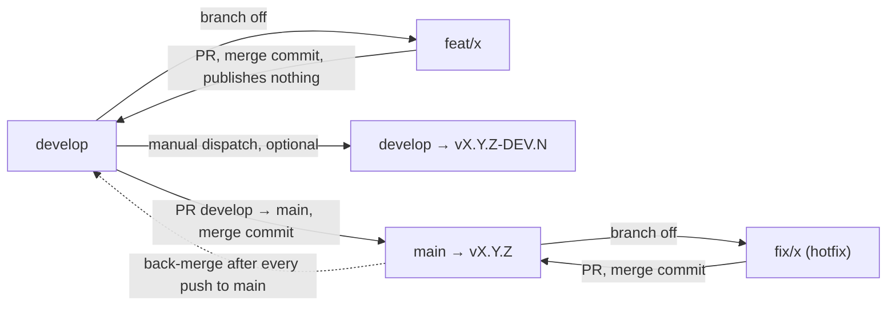

# Deployment & CI/CD

Deployment process for the `@duydpdev/style-generator` library.

## Table of contents

- [Deployment \& CI/CD](#deployment--cicd)
  - [Table of contents](#table-of-contents)
  - [CI/CD Overview](#cicd-overview)
  - [GitHub Actions Workflows](#github-actions-workflows)
    - [`ci.yml` — PR Check](#ciyml--pr-check)
    - [`ci-matrix.yml` — Heavy tier](#ci-matrixyml--heavy-tier)
    - [`nightly.yml` — macOS and Bun](#nightlyyml--macos-and-bun)
    - [`deploy-site.yml` — Site on GitHub Pages](#deploy-siteyml--site-on-github-pages)
    - [`pr-title.yml` — PR title lint](#pr-titleyml--pr-title-lint)
    - [Pull Request \& merge convention](#pull-request--merge-convention)
    - [Local (Pre-commit) — Husky](#local-pre-commit--husky)
    - [`release.yml` — Semantic Release Orchestrator](#releaseyml--semantic-release-orchestrator)
    - [`deploy.yml` — Build \& Publish](#deployyml--build--publish)
      - [Re-publishing a tag that was pushed but not published](#re-publishing-a-tag-that-was-pushed-but-not-published)
    - [`back-merge.yml` — Back-merge](#back-mergeyml--back-merge)
    - [`drift.yml` — Drift check](#driftyml--drift-check)
  - [Branching Strategy](#branching-strategy)
    - [Feature flow](#feature-flow)
    - [Removing a rejected feature](#removing-a-rejected-feature)
  - [Release Process](#release-process)
    - [Correct process](#correct-process)
    - [Cutting a release](#cutting-a-release)
    - [Release cadence](#release-cadence)
    - [DEV on demand](#dev-on-demand)
    - [Hotfix](#hotfix)
    - [Major cycle](#major-cycle)
    - [Required Secrets](#required-secrets)
  - [Commit Format](#commit-format)
    - [Config](#config)
  - [Site (landing + examples)](#site-landing--examples)
    - [Why `link:` instead of `workspace:*`](#why-link-instead-of-workspace)
    - [Script aliases (root)](#script-aliases-root)

---

## CI/CD Overview



A merge into `develop` publishes nothing. A stable release is one merge of the PR `develop` → `main`: `release.yml` (semantic-release) computes one version from every commit header the PR adds, and `deploy.yml` publishes it to the public npm registry (`registry.npmjs.org`). A DEV pre-release is cut only by hand: `gh workflow run release.yml --ref develop`. Every push to `main` (with or without a release) ends with `back-merge.yml`, which merges `main` back into `develop`. `drift.yml` runs daily (06:17 UTC) and warns when `develop` still lacks commits from `main`.

---

## GitHub Actions Workflows

### `ci.yml` — PR Check

**Trigger:** Pull Request into `main` or `develop`. `release.yml` does **not** run for a PR: a release is published only by a push to `main` or a manual dispatch on `develop`.

**Draft:** the `check` job has no draft gate and `on.pull_request.types` is `opened`, `synchronize`, `reopened`, `ready_for_review`: a draft PR runs CI like any other PR (Actions minutes are free on this public repo, and a skipped required check would count as passing, so a draft would have left the PR with no real result). The `e2e` job is the exception: it skips draft PRs (`if: github.event.pull_request.draft == false`), and `ready_for_review` re-runs the workflow so that the skipped draft run is replaced when the PR is marked ready. Open the PR as a draft until the local gate is green; CI then runs on every push to it. `ci.yml` has no path filter: a PR that only changes `documents/**` still runs `check`, because the site renders `documents/*.md` and `check:links` checks their links.

**Job** (Node 22):

- `check`: `yarn install --immutable` → `yarn npm audit --recursive --severity high --environment production` (blocks when a production dependency has a high/critical vulnerability) → `yarn npm audit --all --recursive || true` (log only, dev/example/site tooling is not shipped) → commitlint the PR's commits → `yarn build:all` (runs before lint: type-aware ESLint also scans `examples/**`, which import the built library) → `yarn check:tokens` (every committed `theme.tokens.ts` still matches its theme and config) → `yarn lint` → `yarn prettier:check` → `yarn tsc --noEmit` → `node --check scripts/*.mjs site/scripts/*.mjs` + `yarn typecheck:scripts` → `yarn workspace site build` → `yarn workspace site check:links` → typecheck the 4 examples and `site` (`yarn workspaces foreach -A --include '*-example' --include site run typecheck`; also compiles the sample components' type-check files; the root `tsconfig.json` does not include `site/`) → `yarn workspace design-system-example test` (DX test, needs `dist/` from `build:all`) → build `plain-react-example` and `plain-nuxt-example` → `yarn check:externals` → `yarn check:browser-safe` → `yarn check:sizes` → `yarn check:smoke` → `yarn check:types-pack` (tarball + `@arethetypeswrong/cli`, node16 profile) → `node scripts/vite-dev-smoke.mjs` → `yarn typecheck:dist` → `yarn test:coverage` (`coverage.thresholds` limits) → `yarn test:types`.
  - `e2e` (check name `E2E (Playwright)`, a job of its own so it reports on every PR, documentation-only ones included): `yarn build:all` → `yarn playwright install --with-deps chromium webkit` → `yarn test:e2e`. It skips draft PRs.
  - Commitlint range: `base..head` for PRs into both `develop` and `main`: for a feature PR exactly the feature's commits, for the release PR `develop` → `main` every commit the release adds (merge commits, no squash). Their headers decide the release type, so every commit is linted. For a PR into `develop`, a following step fails when a commit header starts with `[release]` and the repository variable `MAJOR_CYCLE` is not `open` (see [Major cycle](#major-cycle)).

### `ci-matrix.yml` — Heavy tier

**Trigger:** the heavy tier. A nightly `schedule` (cron `43 5 * * *`, run by GitHub on the default branch `main`), `workflow_dispatch` (`gh workflow run ci-matrix.yml --ref main`) and a Pull Request into `main`, which is the `develop` → `main` release PR (`types: [opened, synchronize, reopened, ready_for_review]`), except PRs that only change `documents/**`: `paths-ignore: ["documents/**"]` at the workflow level means GitHub does not create a run, so it costs no minutes. It does not run on a PR into `develop`: the per-PR tier lives in `ci.yml`. It is not a required check, so **every leg must be green before the PR into `main` is merged** (the merger checks this by hand). It has its own `concurrency: ci-matrix-<ref>` with `cancel-in-progress: true`. Every job has `if: github.event_name != 'pull_request' || github.event.pull_request.draft == false`: on a PR the matrix skips drafts and runs when the PR is marked ready; `schedule` and `workflow_dispatch` events carry no `pull_request.draft`, so the first clause lets them run.

**Jobs** (Node 22, except `node-floor`); each job runs its own `yarn install` and `yarn build:all`:

- `tailwind-floor`: writes the Tailwind `resolutions` `~4.1.0` into the runner's `package.json` (not committed) → `yarn install --no-immutable` → `yarn build:all` → `yarn playwright install --with-deps chromium webkit` → `yarn test` → `yarn test:e2e`.
- `node-floor`: Node `20.19.0` (the floor of `engines.node`) → `yarn install --immutable` → `yarn build:all` → `yarn check:smoke` (every step, `init` included) → `yarn check:next-build` (packed tarball + `next@16.4.5` in a scratch project, `style-gen init`, `next build` with Turbopack; asserts `styleGenNext` wrote `styles/theme.css` and the built CSS carries the theme).
- `peer-matrix`: 5 legs (`vite` 5/6/7/8, `typescript` 6). `yarn install --immutable` → `yarn build:all` → write `resolutions[<peer>] = ^<major>.0.0` (not committed) → `yarn install --no-immutable` → assert the version resolved at the root and in `examples/harness` is `<major>.x` → build `examples/harness` → (`vite` leg) `node scripts/vite-dev-smoke.mjs` → typecheck the example → `yarn typecheck:dist` → (`typescript` leg) `yarn test:types`. Every leg must be green (no leg has `continue-on-error`). Green/red legs decide the `peerDependencies` ranges (edited by hand).
- `ts-peer`: 5 legs (`typescript` 5.0.4, 5.2.2, 5.9.3, 6, 7.0.2). `yarn install --immutable` → `yarn build:all` → `yarn check:ts-peer` (packed tarball + one TypeScript release + the peers in a scratch npm project, `tsc` under `node16` on every subpath for both the `require` and the `import` condition; `skipLibCheck` on for 5.0.4 and 5.2.2). It proves the `typescript` peer range, TypeScript 7 included, which Yarn 4.10 cannot install.
- `ui-peer-floor`: builds the lib with the committed toolchain, forces the four UI-kit optional peers (`class-variance-authority`, `clsx`, `tailwind-merge`, `@types/react`) to the floor of their `peerDependencies` ranges through `resolutions` (not committed), asserts the resolved versions, then runs `yarn typecheck:dist` and `yarn vitest run src/features/ui`. It fails when a pinned floor stops being the minimum of the range in `package.json`. Two harness-only pins mirror what a consumer actually gets: cva 0.7.0 needs clsx 2.0.0 exactly, so it keeps its own nested copy, and `@types/scheduler` is held at 0.16.8, the last version with `scheduler/tracing`, which `@types/react` <=18.2.71 imports.

Playwright browsers are **not** cached, and this is a measured decision (PR #73). On a hit the install step takes 42 s; with no cache it is 49–52 s; on a miss it is 56–75 s, plus 5–8 s to save the cache, and every PR ref costs 383 MB. The cache cannot skip the `install-deps` (apt) step, which accounts for most of the time. The measurement was taken when `e2e` still ran in `ci-matrix.yml`; `e2e` now lives in `ci.yml` and the decision is unchanged. The result is that every new PR is slower. Using the `mcr.microsoft.com/playwright` container is only worth revisiting if e2e becomes the bottleneck.

### `nightly.yml` — macOS and Bun

**Trigger:** a nightly `schedule` (cron `17 6 * * *`, run by GitHub on the default branch `main`), `workflow_dispatch` (`gh workflow run nightly.yml --ref main`) and a Pull Request into `main` that changes `.github/workflows/nightly.yml` or `scripts/bun-smoke.mjs`, so an ordinary PR pays nothing for it. It is not a required check. It has its own `concurrency: nightly-<event>-<ref>` with `cancel-in-progress: true`, `permissions: contents: read` and `persist-credentials: false` on both checkouts.

**Jobs** (Node 22): `yarn install --immutable` → `yarn build:all` in each.

- `macos` (`macos-latest`, 30 minutes): `yarn test`. It runs the case-insensitive filesystem cases of `sameFile` (skipped on Linux) and the real-chokidar watcher tests on FSEvents.
- `bun` (`ubuntu-latest`, 20 minutes): `npm install -g bun@1.3.14` (the repo allows GitHub-owned actions only, so no `oven-sh/setup-bun`) → `node scripts/bun-smoke.mjs`: packs the tarball, installs it with `bun add` next to the Tailwind version of the repo, checks the `.bin/style-gen` link, runs `dist/cli/index.mjs generate` with `bun` directly (`bun x style-gen` would follow the Node shebang) and calls `generate()` from the package name under `bun`.

### `deploy-site.yml` — Site on GitHub Pages

**Trigger:** a push to `main` that changes `site/**`, `documents/**`, `examples/**`, `src/**`, `README.md`, `package.json`, `yarn.lock` or the workflow itself; `workflow_dispatch` (`gh workflow run deploy-site.yml --ref main`); and a Pull Request that changes the workflow or `site/scripts/build-llms.mjs`, which runs the `build` job only. The workflow has `permissions: contents: read` and is independent of `release.yml` and `deploy.yml` (npm publish). The repository's Pages source is **GitHub Actions**; the site is served at `https://duydpdev.github.io/style-generator/`.

**Jobs** (Node 22):

- `build` (check name `Build site bundle`): checkout without persisted credentials → `yarn install --immutable` → `yarn site:build` with `VITE_BASE=/<repo>/` (library build, the embedded examples, the Vite site build, then `site/scripts/build-llms.mjs` writes `llms.txt` into `site/dist/`) → `cp site/dist/index.html site/dist/404.html` (the SPA fallback: GitHub Pages serves it for a deep link with status 404, and the browser still renders the page) → `actions/upload-pages-artifact`.
- `deploy` (check name `Deploy to GitHub Pages`): runs only for `push` and `workflow_dispatch` on `refs/heads/main`. It is the only job with `pages: write` and `id-token: write`, and the only one in the `pages` concurrency group (`cancel-in-progress: false`), so a PR build cannot cancel a deploy. One step, `actions/deploy-pages`, in the `github-pages` environment. Every action in the file is GitHub-owned (`actions/*`).

### `pr-title.yml` — PR title lint

**Trigger:** Pull Request into `main` or `develop`, `opened`, `edited`, `reopened` (`edited` also catches a title-only edit). It does not run on `synchronize`: pushing a new commit does not change the title, so the check is only attached to the head at the time the PR is opened/edited/reopened.

Runs `commitlint --config commitlint.pr-title.config.ts` on the PR title. This config reuses `commitlint.config.ts` and only turns off `defaultIgnores`, so a `Revert "…"` title (GitHub's default when reverting a PR) or `Merge …` also fails. The lint range in `ci.yml` still uses the shared config because real merge commits appear there. Since features enter `develop` through merge commits, the PR title no longer decides the release: the first line of a merge commit is `Merge pull request #N from …` (ignored by the analyzer), and the PR title only appears in the body. This check is kept so PR titles stay readable and match the commit header. The `Check branch name` step (it runs before the dependencies are installed) checks `github.head_ref` with `scripts/check-branch-name.sh`, the same rule as the `pre-push` hook (see [Branching Strategy](#branching-strategy)). For a PR into `main` the step also passes the base branch, and the head must be `develop`, `fix/<slug>`, `docs/<slug>` or `dependabot/**`.

### Pull Request & merge convention

Rulesets protect `main`/`develop` (a PR is required, merge commits only, and three checks are required: `Build & Lint Check`, `Plain React (Storybook + parity)` and `E2E (Playwright)`); admins can bypass because `release.yml`/`back-merge.yml` push with a PAT. The merger must still stop when a check outside the required list is red; the last safety net is `yarn test` + `yarn test:types` in `release.yml`, which run before the tag is cut. The ruleset `no-delete` (no bypass actor, rules `deletion` and `non_fast_forward`) forbids deleting or force-pushing `main` and `develop`, so merging the PR `develop` → `main` cannot make GitHub delete `develop`.

| PR                  | Merge method                                                 | Notes                                                                                                                                                                                       |
| ------------------- | ------------------------------------------------------------ | ------------------------------------------------------------------------------------------------------------------------------------------------------------------------------------------- |
| Feature → `develop` | **Create a merge commit**                                    | The feature keeps its SHAs; nothing is published.                                                                                                                                           |
| `develop` → `main`  | **Create a merge commit**                                    | The release PR: one merge publishes one version for every commit of the range. The head is `develop` itself; the `no-delete` ruleset keeps GitHub from deleting it after the merge.         |
| Hotfix → `main`     | **Create a merge commit**                                    | `fix/<slug>` or `docs/<slug>`, cut from `main`; the back-merge brings it into `develop`.                                                                                                    |
| Squash / Rebase     | Off (`allow_squash_merge=false`, `allow_rebase_merge=false`) | Squash creates a copy with a different SHA: a release would re-analyze commits already shipped and dependent features would conflict (measured in plan `feature-from-main-flow`, phase 01). |

**Load-bearing setting:** `merge_commit_title = MERGE_MESSAGE` (first line `Merge pull request #N …`) and `merge_commit_message = PR_TITLE`. If the first line becomes the PR title, the merge commit carries a `[type]` header, and every merge commit that exists only on `develop` is counted again after each back-merge. Do not change it.

`delete_branch_on_merge=true`: GitHub deletes the head branch when a PR is merged, so a feature branch is gone after its PR. The commits of a deleted branch stay in the PR (`refs/pull/<N>/head`), so deleting the branch loses no history. `main` and `develop` are protected from that deletion by the `no-delete` ruleset.

Template: `.github/pull_request_template.md`. Dependabot (`.github/dependabot.yml`) updates GitHub Actions monthly as **one** grouped PR (`groups`) targeting `develop` (`target-branch`), with the prefix `"[ci] "` (trailing space so GitHub does not insert `:` after `]`). Dependabot branches off the target branch, so its PR lands on `develop` like any feature and reaches `main` with the next release PR. Dependabot only reads this file on the default branch `main`.

The `npm` entry in the same file runs monthly the same way (targets `develop`, prefix `"[ci] "`, at most 2 open PRs). All minor/patch bumps are grouped into **one** PR (group `npm-minor-patch`); each major bump is its own PR. It never proposes a major for `tailwindcss`, `@tailwindcss/*`, `zod`, `vite` and `typescript`: these lines (and the peer ranges) are tracked by hand, and the `tailwind-floor` and `peer-matrix` jobs check them. A bump that changes a published range (`dependencies`/`peerDependencies`) must change its header to `[fix]`/`[feat]` before merging.

Both entries set `rebase-strategy: disabled`: Dependabot does not rebase open PRs on its own every time `develop` changes, because each rebase re-runs the full CI of the PR. To update a PR, comment `@dependabot rebase`. PRs opened before rebase was disabled are still rebased up to 30 days after they were opened (GitHub's `rebase-strategy` documentation). Dependabot alerts and security updates are enabled (`gh api repos/duydpdev/style-generator/automated-security-fixes --jq .enabled` prints `true`): a security update PR opens as soon as an advisory appears, not on the `schedule`, and targets the default branch `main`: merge it into `main` like a hotfix; the back-merge brings it into `develop`.

---

### Local (Pre-commit) — Husky

The project uses **Husky** and **lint-staged** to block commits that do not meet the standard:

- `.husky/pre-commit` only calls `yarn lint-staged` (the single configuration: `lint-staged.config.js`). lint-staged first stashes unstaged changes, so every step only sees the staged snapshot.
- For staged code files: `eslint --fix` → `prettier --write` on those files → `tsc --noEmit` for the whole project → `vitest related --run` (only tests that import the staged files). `json`/`md`/`yml`/`css` files only go through `prettier --write`.
- The full `yarn test`, `yarn test:types` and the `check:*` gates run in CI, not in the hook.
- `.husky/pre-push` runs `scripts/check-branch-name.sh` for every pushed branch (it skips `main`, `develop`, tags and branch deletions). Skip once with `HUSKY=0 git push …`.
- The hook is installed via `postinstall: husky` (Yarn Berry does not run `prepare`); `pinst` disables `postinstall` in the published tarball; release CI sets `HUSKY=0`.

---

### `release.yml` — Semantic Release Orchestrator

**Trigger:** Push to `main` (stable release) or `workflow_dispatch` on `develop` (DEV release, `gh workflow run release.yml --ref develop`; the job refuses any other ref). A push to `develop` does not start it. `concurrency: release-<ref>`, `cancel-in-progress: false`: one release run per ref at a time, and a running run is never cancelled (to avoid a pushed tag without a publish). GitHub keeps only one pending run per group, so a new push replaces the older pending run; the new run releases a set of commits that covers both.

**Steps:**

1. `yarn test` + `yarn test:types` on the commit that was just pushed, before cutting the tag
2. Run `semantic-release` → automatically computes the version and creates a git tag; only on `main` does it commit `package.json` + `CHANGELOG.md`
3. Detect the run's own tag: a tag on `HEAD`, not in the snapshot taken before running `semantic-release`, and on the branch's own channel (`main`: `vX.Y.Z`; `develop`: `vX.Y.Z-DEV.N`). semantic-release fetches every remote tag before running, so a tag just pushed by another branch's run also appears locally; comparing the before/after snapshot as before could pick that tag by mistake. Exactly one tag → release; none → no release (prints a `::warning` if the remote branch has moved on, because semantic-release skips a branch that is behind the remote); more than one → the job fails, publish by hand following the [runbook](#re-publishing-a-tag-that-was-pushed-but-not-published).
4. If there is a new tag → trigger `deploy.yml`
5. On `main`, after the release job succeeds (with or without a tag, `deploy` succeeded or skipped) → trigger `back-merge.yml`

`release.config.cjs` only enables `@semantic-release/changelog` and `@semantic-release/git` when the branch is exactly `main`, and prints `[release.config] branch=<b> commitsRelease=<bool>` to the log. A DEV release on `develop` only creates a tag and does not commit `package.json`/`CHANGELOG.md`: if it did, the `develop` → `main` PR and every back-merge after a stable release would conflict on the version and changelog lines. `refactor` and `style` commits do not release (see [Commit Format](#commit-format)).

---

### `deploy.yml` — Build & Publish

**Trigger:** Called from `release.yml` (workflow_call) when there is a new release, or run by hand (`workflow_dispatch`, input `tag`) to re-publish a tag. Checkout uses `persist-credentials: false` (no git operation happens afterwards).

**Steps:**

1. Checkout at the new tag
2. Node 22 (Yarn Berry reads the registry from `.yarnrc.yml`, not from `.npmrc`)
3. `yarn install --immutable`
4. `npm pkg set version=<tag without v>` then assert it matches the tag (fails if the tag is empty). Required for DEV, because `package.json` at a DEV tag is still the latest stable version; on `main` it is a no-op. Not committed.
5. `yarn build:all`
6. `yarn check:externals`
7. `yarn check:types-pack` (packed tarball + `@arethetypeswrong/cli`, node16 profile; needs `dist/*.d.cts` from `build:all`)
8. `yarn typecheck:dist` (checks `dist/*.d.ts` and `dist/*.d.cts` with `skipLibCheck: false`; attw does not resolve peer types, so it cannot replace this step)
9. `yarn check:smoke` (the tag's build works: every subpath loads in ESM/CJS, `style-gen --version` prints exactly the version just set in step 4)
10. `yarn check:browser-safe`
11. `yarn check:publish-target`
12. `yarn npm publish --dry-run` (assert the output contains `Package would be published to https://registry.npmjs.org`)
13. `yarn npm publish --provenance` to **npmjs.org**, authenticated by npm trusted publishing (the job's OIDC token, no secret): a tag with a suffix (`-DEV.N`) is published with `--tag DEV`, a stable tag is published as `latest`

Tests do not run again here: `release.yml` already tested exactly this commit before cutting the tag. Re-running them on the same code tree only adds flakiness that would produce a tag + GitHub release without a package. `check:smoke` is different: it checks the build that carries the tag's version, which is the only thing that gets published.

#### Re-publishing a tag that was pushed but not published

semantic-release pushes the tag before running the publish plugins (GitHub release), so a `release` job that fails after that step leaves a tag without a package; re-running the job will not see a new tag. Publish that tag by hand:

```bash
gh workflow run deploy.yml --ref main -f tag=v4.0.1   # or v4.0.1-DEV.1
gh run watch "$(gh run list --workflow=deploy.yml --limit 1 --json databaseId --jq '.[0].databaseId')"
```

`workflow_dispatch` can only run the version of `deploy.yml` that already exists on `main`. For a version that is already published, the registry rejects re-publishing (409); do not unpublish.

---

### `back-merge.yml` — Back-merge

**Trigger:** Called from `release.yml` after every push to `main` (the `version` input is empty when that push produces no release)

**Purpose:** Merge `main` back into `develop` so `develop` always contains every commit of `main`: the merge commit of each release PR, the release commit, and hotfixes.

A plain merge, **not** `-X theirs` (that option picks the `main` side for every conflicting hunk and silently drops newer code from `develop`). `main` only gains the release merge, the release commit and hotfixes, and a DEV release commits nothing, so a normal merge is clean unless a hotfix touches lines that `develop` also changed. On conflict, the job lists the conflicting files, runs `git merge --abort` and fails; merge `main` into `develop` by hand using the command printed in the log. If the push is rejected because `develop` just received a new commit, the job fetches again, merges again from the new tip and retries up to 3 times. The message contains `[skip ci]`, so it does not create a new DEV.

### `drift.yml` — Drift check

**Trigger:** every day at 06:17 UTC (`schedule`, `cron: "17 6 * * *"`) and `workflow_dispatch`. An hourly schedule costs about 675 runner minutes per month (each ~6-second run is rounded up to 1 minute); a broken back-merge is now reported at most one day late.

Fails when `git rev-list --count origin/develop..origin/main` > 0 and the tip of `main` is older than 60 minutes (skipped while a release/back-merge run is in progress), and prints the missing commits. Limitation: the count does not catch the "revert trap" (see [Removing a rejected feature](#removing-a-rejected-feature)).

---

## Branching Strategy

| Branch                               | Purpose                                                                                                       |
| ------------------------------------ | ------------------------------------------------------------------------------------------------------------- |
| `main`                               | Released code only, plus hotfixes. Every push → release flow + back-merge                                     |
| `develop`                            | Integration. Features land here; a merge publishes nothing. DEV pre-releases (dist-tag `DEV`) are cut by hand |
| `<type>/<slug>`                      | Branched from `develop`. One PR into `develop`                                                                |
| `fix/<slug>`, `docs/<slug>` (hotfix) | Branched from `main`. PR into `main`; the back-merge brings it into `develop`                                 |
| `dependabot/**`                      | Branches created by Dependabot (target `develop`; security updates target `main`)                             |

**Branch name rule** (`scripts/check-branch-name.sh`): `^(feat|fix|docs|chore|ci|build|refactor|test|perf|revert)/[a-z0-9]+(-[a-z0-9]+){0,5}$`, i.e. `<type>/<slug>`: `type` is a commit type except `style`, `release`, `temp`, `conf`, `wip`; `slug` is 1–6 words of lowercase letters or digits joined by `-` (for example `feat/theme-axes`, `ci/branch-hygiene`). Exception: `dependabot/**`. A PR into `main` has a second rule: its head must be `develop`, `fix/<slug>`, `docs/<slug>` or `dependabot/**` (the script takes the base branch as its second argument). The rule is checked in two places: the `.husky/pre-push` hook on the local machine and the `Check branch name` step of `pr-title.yml` on the PR's head branch (that step is skipped when the head lives in a fork, `github.event.pull_request.head.repo.full_name != github.repository`, because an outside contributor cannot follow the naming rule; the title check runs for everyone). The required checks of the rulesets are `Build & Lint Check`, `Plain React (Storybook + parity)` and `E2E (Playwright)`, so a red `PR Title` check does not block the merge by itself: the merger must stop on it.

### Feature flow

1. `git fetch origin && git switch -c feat/x origin/develop`. Features branch from `develop`; hotfixes are the only branches cut from `main`.
2. **One commit, correct header.** The release type is decided by the headers of the commits a release PR adds (merge commits are ignored by the analyzer). Before the PR, squash the branch into one `[type] subject` commit and use exactly that header as the title of the PR. A leftover `[feat] wip` commit becomes a minor even if the PR is named `[fix] …`. `[release] …` (major) is only allowed while a major cycle is open (see [Major cycle](#major-cycle)).
3. PR `feat/x` → `develop`, **Create a merge commit**. Nothing is published; CI (`ci.yml`) runs on the PR.
4. The change waits on `develop` for the next release PR (see [Cutting a release](#cutting-a-release)). To try it in a real app before that, cut a DEV (see [DEV on demand](#dev-on-demand)).
5. **Depends on another feature:** branch from that feature's branch, say so in the PR, and merge that feature into `develop` first.
6. **Conflict or out of date:** `git merge origin/develop` into `feat/x`, resolve, push. Never use GitHub's "Resolve conflicts" button on a PR whose branch is shared.

### Removing a rejected feature

- **Unreleased (on `develop`):** PR `[revert] <feature>` into `develop` (`git revert -m 1 <merge-commit>`). Never force-push `develop`.
- **Revert trap:** the feature's commits are already ancestors of `develop`. If exactly those commits are merged again later, git considers them already present: `develop` lacks the code while `drift.yml` still reports 0. Rule: before a reverted feature lands again, run `git rebase --force-rebase origin/develop` on the branch so the commits get new SHAs.
- **Already released:** PR `[revert] <feature>` into `develop`; it ships with the next release PR as a patch. The old published version remains on the registry.

---

## Release Process

> [!IMPORTANT]
> The project uses **semantic-release** — the version is computed automatically from commit messages. There is **no need** to edit `package.json` by hand.
> A major release needs a `[release] …` commit (see the Commit Format table).
> `[refactor]` and `[style]` do not release; a behaviour change must be written `[fix]`, `[perf]` or `[feat]`.

### Correct process

1. Branch `feat/x` from `develop` (see [Feature flow](#feature-flow)).
2. One commit in the format `[type] subject` (see [Commit Format](#commit-format)).
3. PR into `develop`, CI passes → **Create a merge commit**. Nothing is published.
4. When `develop` holds enough, cut a release (next section). `release.yml` then computes the new version from the headers of every commit in the range, commits `package.json` + `CHANGELOG.md` (`[chore] release x [skip ci]`), creates the tag `vX.Y.Z`, triggers `deploy.yml` to publish to npmjs.org, and triggers `back-merge.yml` to merge `main` back into `develop`.

### Cutting a release

1. `git fetch origin && git rev-list --count origin/develop..origin/main` prints `0` (else a back-merge is pending: fix it first).
2. `git log --no-merges --format=%s origin/main..origin/develop` shows what will ship: a `[release]` header gives a major, `[feat]` a minor, `[fix]`/`[perf]`/`[revert]` a patch; with none of those there is nothing to release.
3. `gh pr create --base main --head develop --title "[chore] release $(date +%F)" --body-file <file listing the changes>`. Do not put a version number in the title: semantic-release computes it.
4. Wait for the three required checks and every heavy-tier job of `ci-matrix.yml` to pass.
5. **Create a merge commit**, then `npm view @duydpdev/style-generator dist-tags` shows the new `latest` (it can take about 10 minutes).

### Release cadence

Open the `develop` → `main` release PR only when the change reaches consumers of the package: theme syntax, generated CSS or the CLI contract. Documentation, tests, agent rules (`.claude/**`) and refactors that change none of those wait on `develop` and ride the next release that does. A product's canvas allowance (a radius key, an extra board, a type scale) is an edit to that product's own `--standard` file (`canvas-standard.json`), never a library release.

### DEV on demand

`gh workflow run release.yml --ref develop` cuts `vX.Y.Z-DEV.N` on the dist-tag `DEV` when `develop` holds a releasable commit that no release contains; `latest` does not change. Consumers test with the exact version (`@duydpdev/style-generator@4.1.0-DEV.3`), not a range: `^4.1.0-DEV.3` resolves up to stable `4.1.0`.

### Hotfix

`git fetch origin && git switch -c fix/x origin/main`, one commit, PR `fix/x` → `main` with **Create a merge commit**: a stable patch is released at once and the back-merge brings the fix into `develop`. A documentation fix that must reach the site now uses `docs/x` the same way (`[docs]` releases nothing; `deploy-site.yml` runs on the push to `main`). A Dependabot security PR targets `main` and is a hotfix.

### Major cycle

A major is planned, not incidental. `[release]` commits enter `develop` only while the repository variable `MAJOR_CYCLE` is `open`.

1. `gh variable set MAJOR_CYCLE --body open`, then re-run the failed `Build & Lint Check` of the waiting `[release]` PRs (`gh run rerun <id> --failed`) and merge them into `develop`.
2. Write one migration guide `documents/migration/<old>-to-<new>.md`; cut `X.0.0-DEV.N` builds on demand to try the major in real apps.
3. Cut the release as usual; the version is a major because of the `[release]` header.
4. `gh variable set MAJOR_CYCLE --body closed`.

Between two majors only minor and patch releases ship; a gap of at least three months is the recommended minimum. Prefer deprecating first: ship the replacement API in a minor, mark the old one `@deprecated` and make `style-gen doctor` warn, then remove it in the major.

### Required Secrets

- `CI_WORKER_REPOSITORY_TOKEN`: a PAT with permission to push the release commit and tag to the GitHub repo. It is not declared at the workflow-level `env`; it is only passed to checkout + semantic-release (env `GITHUB_TOKEN`) in `release.yml` and to checkout in `back-merge.yml` (the job that calls it uses `secrets: inherit`). `deploy.yml` does not receive it (the `deploy` job does not use `secrets: inherit`). The `release` job's checkout uses `persist-credentials: false`, so the token is not in `.git/config` while `yarn install`/tests run: semantic-release injects the env `GITHUB_TOKEN` into the URL of every fetch/push command itself, and the tag detection step only reads local tags. `back-merge.yml` keeps the default (`true`) because it does its own `git fetch`/`git push` after checkout, and it installs no dependencies.
- Publishing to npm uses **no secret**: npm trusted publishing (OIDC). The `deploy` job in `release.yml` and the `deploy.yml` workflow hold `id-token: write` (a reusable workflow's permissions cannot exceed the job that calls it) and `yarn npm publish --provenance` exchanges that OIDC token for a short-lived publish credential, so there is no `NPM_TOKEN` to expire and no token for the PAT-using jobs to leak. `GITHUB_TOKEN` stays `contents: read` throughout `release.yml`. `release` and `back-merge` push with the PAT, so they do not need `contents: write` on `GITHUB_TOKEN`.

### npm trusted publisher (one-time setup)

The package's **Trusted Publisher** on npmjs.com is what lets the workflow publish. Package `@duydpdev/style-generator` → Settings → Trusted Publisher → GitHub Actions: user `duydpdev`, repository `style-generator`, workflow filename `release.yml`, environment blank, and tick "Allow npm publish" (a publisher created without it can only stage). npm matches the workflow that **starts** the run, so the automatic publish (called from `release.yml`) needs `release.yml`; running `deploy.yml` by hand (runbook below) needs `deploy.yml` registered as a second publisher. A publisher that publishes nothing for 2 days expires: register it on the day the first release is merged. After the first publish, set "Require two-factor authentication and disallow tokens" on the package.

If `Publish to npm` fails with `E404`/`ENEEDAUTH`, the publisher is missing or its workflow name does not match: fix it on npmjs.com, then "Re-run failed jobs" on the run. Never delete the tag.

A green `Publish to npm` does not prove the version is public. A publisher that allows only `npm stage publish` (the default for publishers created after 2026-09-03) makes `yarn npm publish` exit 0 while the version only waits in the staging queue: `npm view @duydpdev/style-generator dist-tags` does not move until a maintainer approves it on npmjs.com (Staged Packages → Approve, with 2FA). Either approve each release there, or recreate the publisher with the `npm publish` allowed action ticked so releases go out directly. After every release, check `npm view @duydpdev/style-generator dist-tags`.

---

## Commit Format

Commit message format: `[type] subject`, with the type in lowercase (`[Feat] …` is rejected by commitlint, because the analyzer only maps lowercase types and would not release).

| Type                                                                               | Version bump    | Example                              |
| ---------------------------------------------------------------------------------- | --------------- | ------------------------------------ |
| `release`                                                                          | Major (`2.0.0`) | `[release] ship public v2 API`       |
| `feat`                                                                             | Minor (`1.1.0`) | `[feat] add multi-theme support`     |
| `fix`, `perf`, `revert`                                                            | Patch (`1.0.1`) | `[fix] correct spacing var fallback` |
| `refactor`, `style`, `docs`, `chore`, `test`, `build`, `ci`, `conf`, `temp`, `wip` | No bump         | `[refactor] simplify registry walk`  |

Release notes use the `conventionalcommits` preset (declared in `devDependencies`) with the `changelog-template.hbs` template; the sections are in this order: `Release`, `Features`, `Bug Fixes`, `Performance Improvements`, `Refactor`, `Style`, `Reverts`. `docs`, `chore`, `test`, `build`, `ci`, `conf`, `temp` and `wip` never appear in the notes; `refactor` and `style` do not bump the version but are listed under `Refactor` and `Style` when the same release is cut for another commit. The body of `[release]`, `[feat]` and `[fix]` commits is printed indented right under the entry (`finalizeContext` in `release.config.cjs`). The body of a `[release]` lists the breaking changes and names the migration guide; a line starting `BREAKING CHANGE:` moves the rest of the body into a separate `BREAKING CHANGES` section instead. Because `[fix]` often tightens validation, write a body that says clearly what is now rejected and how to migrate; the body of a `[feat]` lists the behavior changes users need to know about (new defaults, new semantics). The bodies of other types do not appear in the notes.

### Config

See: [`commitlint.config.ts`](../commitlint.config.ts) and [`release.config.cjs`](../release.config.cjs)

---

## Site (landing + examples)

The landing site (`site/`) and the examples (`examples/design-system`, `harness`, `plain-react`, `plain-nuxt`) use the library through a `link:` dependency. `deploy-site.yml` deploys the site to `https://duydpdev.github.io/style-generator/` on every push to `main` that changes its inputs; deep links work through a `404.html` copy of `index.html`; the build also writes `llms.txt`.

The site is still built on every PR: the `check` job of `ci.yml` runs `yarn workspace site build` right after `yarn build:all`, even for PRs that only change `documents/**`, because the site renders `documents/*.md`. `yarn workspace site build` runs `build:examples` (builds `examples/harness` with base `./`, copies `examples/harness/dist` into `site/public/examples/v4`), then the Vite site build. `harness` imports its theme, tokens and recipes from the `design-system-example` workspace (`workspace:*`, a real symlink), so the site build needs no extra step; the site's source explorer also reads `examples/design-system`.

### Why `link:` instead of `workspace:*`

The root package is the `@duydpdev/style-generator` library itself.
With `nodeLinker: node-modules`, Yarn hoists a `workspace:*` dependency pointing back at the root up to the root `node_modules`, treats it as a self-reference and drops it.
The result is that after a clean `yarn install`, there is no `node_modules/@duydpdev/style-generator` anywhere (`nmSelfReferences` does not apply to this case).
`link:..` (site) and `link:../..` (examples) create symlinks in each workspace's `node_modules`.
Do not alias the package in Vite: the example must go through the package's real `exports`.
This rule only applies to the root library: `design-system-example` is a separate workspace, so the two apps that use it (`harness` and `plain-react`) reference it with `workspace:*`.

### Script aliases (root)

| Script            | Description                                         |
| ----------------- | --------------------------------------------------- |
| `yarn site:build` | Library build → site build → output in `site/dist/` |
