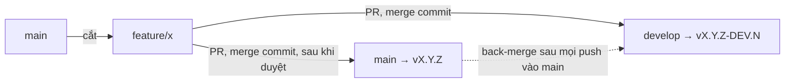

# Deployment & CI/CD

Quy trình deploy thư viện `@duydpdev/style-generator`.

## Mục lục

- [Deployment \& CI/CD](#deployment--cicd)
  - [Mục lục](#mục-lục)
  - [CI/CD Overview](#cicd-overview)
  - [GitHub Actions Workflows](#github-actions-workflows)
    - [`ci.yml` — PR Check](#ciyml--pr-check)
    - [Local (Pre-commit) — Husky](#local-pre-commit--husky)
    - [`release.yml` — Semantic Release Orchestrator](#releaseyml--semantic-release-orchestrator)
    - [`deploy.yml` — Build \& Publish](#deployyml--build--publish)
    - [`back-merge.yml` — Back-merge](#back-mergeyml--back-merge)
    - [`drift.yml` — Drift check](#driftyml--drift-check)
  - [Branching Strategy](#branching-strategy)
    - [Luồng một feature](#luồng-một-feature)
    - [Gỡ feature bị reject](#gỡ-feature-bị-reject)
  - [Release Process](#release-process)
    - [Quy trình đúng](#quy-trình-đúng)
  - [Commit Format](#commit-format)
    - [Config](#config)

---

## CI/CD Overview

Mỗi merge vào `main`/`develop` chạy `release.yml` (semantic-release). Có tag mới thì `deploy.yml` publish lên GitHub Packages. Mọi push vào `main` (có hoặc không có release) kết thúc bằng `back-merge.yml`, merge `main` về `develop`. `drift.yml` chạy mỗi giờ, cảnh báo khi `develop` vẫn thiếu commit của `main`.

---

## GitHub Actions Workflows

### `ci.yml` — PR Check

**Trigger:** Pull Request vào `main` hoặc `develop`

**Các job** (Node 22):

- `check`: `yarn install --immutable` → commitlint các commit của PR → `yarn lint` → `yarn prettier:check` → `yarn tsc --noEmit` → `node --check scripts/*.mjs` → `yarn build:all` → `yarn workspace site build` → `yarn check:externals` → `yarn check:browser-safe` → `yarn check:sizes` → `yarn test` → `yarn test:types`.
  - Commitlint range: `base..head` cho cả PR vào `develop` lẫn `main`. Feature được cắt từ `main` và vào hai nhánh bằng cùng các commit (merge commit, không squash), nên range này đúng bằng các commit của feature. Header của chúng quyết định loại release, nên commit nào cũng bị lint.
- `changes`: `git diff --name-only base...head`; `code=false` khi PR chỉ đổi `documents/**`.
- `e2e`: chỉ chạy khi `changes.code == 'true'`. `yarn build:all` → `yarn playwright install --with-deps chromium webkit` → `yarn test:e2e`.
- `tailwind-floor`: chỉ chạy khi `changes.code == 'true'`. Ghi `resolutions` Tailwind `~4.1.0` vào `package.json` của runner (không commit) → `yarn install --no-immutable` → `yarn build:all` → `yarn playwright install --with-deps chromium webkit` → `yarn test` → `yarn test:e2e`.

Browser Playwright **không** được cache, và đây là quyết định có đo đạc (PR #73). Khi hit, bước install mất 42 s; không có cache là 49–52 s; khi miss là 56–75 s, cộng 5–8 s để lưu cache, và mỗi ref PR tốn 383 MB. Cache không bỏ được bước `install-deps` (apt), vốn chiếm phần lớn thời gian. `ci.yml` chỉ chạy trên `pull_request`, nên không có cache của nhánh base để PR mới dùng lại. Kết quả là mọi PR mới đều chậm hơn. Dùng container `mcr.microsoft.com/playwright` chỉ đáng xem lại khi e2e trở thành nút cổ chai.

### `pr-title.yml` — PR title lint

**Trigger:** Pull Request vào `main` hoặc `develop`, `opened`, `edited`, `synchronize`, `reopened` (`edited` bắt cả lần chỉ sửa tiêu đề).

Chạy `commitlint --config commitlint.pr-title.config.ts` trên tiêu đề PR. Config này dùng lại `commitlint.config.ts` và chỉ tắt `defaultIgnores`, để tiêu đề `Revert "…"` (mặc định của GitHub khi revert PR) hay `Merge …` cũng fail. Range lint trong `ci.yml` vẫn dùng config chung vì ở đó có merge commit thật. Từ khi feature vào `develop` bằng merge commit, tiêu đề PR **không** còn quyết định release: dòng đầu của merge commit là `Merge pull request #N from …` (analyzer bỏ qua), tiêu đề PR chỉ nằm trong body. Check này giữ lại để tiêu đề PR dễ đọc và khớp với header của commit.

### Pull Request & merge convention

GitHub Free + repo private: không có branch protection, mọi check chỉ là cảnh báo. Người merge phải tự dừng khi check đỏ; lưới cuối là `yarn test` + `yarn test:types` trong `release.yml`, chạy trước khi cắt tag.

| PR                  | Merge method                                                 | Ghi chú                                                                                                                                                  |
| ------------------- | ------------------------------------------------------------ | -------------------------------------------------------------------------------------------------------------------------------------------------------- |
| Feature → `develop` | **Create a merge commit**                                    | Feature giữ nguyên SHA. Khi feature vào `main`, back-merge nhận ra các commit đó đã có trên `develop`, nên merge sạch và DEV sau đó không phân tích lại. |
| Feature → `main`    | **Create a merge commit**                                    | Cùng nhánh feature, mở PR thứ hai sau khi đã duyệt trên `develop`.                                                                                       |
| `develop` → `main`  | **Không dùng**                                               | `develop` chứa cả feature chưa duyệt; promote cả nhánh là ship thứ chưa duyệt.                                                                           |
| Squash / Rebase     | Tắt (`allow_squash_merge=false`, `allow_rebase_merge=false`) | Squash tạo bản sao khác SHA: DEV phân tích lại feature đã ship và feature phụ thuộc bị conflict (đo trong plan `feature-from-main-flow`, phase 01).      |

**Setting chịu tải:** `merge_commit_title = MERGE_MESSAGE` (dòng đầu `Merge pull request #N …`) và `merge_commit_message = PR_TITLE`. Đổi dòng đầu thành tiêu đề PR thì merge commit mang header `[type]`, và mọi merge commit chỉ có trên `develop` bị tính lại sau mỗi back-merge. Không đổi.

`delete_branch_on_merge` giữ `false`: nhánh feature còn cần cho PR thứ hai vào `main`.

Template: `.github/pull_request_template.md`. Dependabot (`.github/dependabot.yml`) cập nhật GitHub Actions hàng tháng thành **một** PR gộp (`groups`) nhắm vào `main` (`target-branch`), với prefix `"[ci] "` (dấu cách cuối để GitHub không chèn `:` sau `]`). Dependabot cắt nhánh từ nhánh đích, nên nhắm `main` thì nhánh của nó là một feature branch sạch. Land vào `develop` trước bằng PR thứ hai từ cùng nhánh (`gh pr create --base develop --head <nhánh dependabot>`), rồi mới merge PR của Dependabot vào `main`. Dependabot chỉ đọc file này trên nhánh mặc định `main`.

---

### Local (Pre-commit) — Husky

Dự án sử dụng **Husky** và **lint-staged** để chặn các commit không đạt tiêu chuẩn:

- Tự động chạy `lint` và `prettier` cho các file đang thay đổi.
- Chạy `tsc --noEmit` để đảm bảo không lỗi type.
- Chạy `vitest run` cho các unit tests liên quan.
- Hook được cài qua `postinstall: husky` (Yarn Berry không chạy `prepare`); `pinst` tắt `postinstall` trong tarball publish; release CI đặt `HUSKY=0`.

---

### `release.yml` — Semantic Release Orchestrator

**Trigger:** Push vào `main` hoặc `develop`. `concurrency: release-<ref>`, `cancel-in-progress: false`: một run release mỗi nhánh tại một thời điểm, run đang chạy không bao giờ bị huỷ (tránh tag đã push mà chưa publish). GitHub chỉ giữ một run chờ mỗi group, nên push mới thay run chờ cũ; run mới release một tập commit bao trùm.

**Các bước:**

1. `yarn test` + `yarn test:types` trên commit vừa push, trước khi cắt tag
2. Chạy `semantic-release` → tự động tăng version, tạo git tag, cập nhật CHANGELOG
3. So sánh tags trước/sau để phát hiện tag mới
4. Nếu có tag mới → trigger `deploy.yml`
5. Trên `main`, sau khi job release thành công (có hoặc không có tag, `deploy` thành công hoặc bị skip) → trigger `back-merge.yml`

`release.config.cjs` chỉ bật `@semantic-release/changelog` và `@semantic-release/git` khi nhánh là đúng `main`, và in `[release.config] branch=<b> commitsRelease=<bool>` vào log. Release DEV trên `develop` chỉ tạo tag, không commit `package.json`/`CHANGELOG.md`: nếu commit, `develop` và `main` sửa cùng dòng version/changelog và mọi back-merge sau stable release sẽ conflict.

---

### `deploy.yml` — Build & Publish

**Trigger:** Được gọi từ `release.yml` (workflow_call) khi có release mới

**Các bước:**

1. Checkout tại tag mới
2. Node 22 với `registry-url: https://npm.pkg.github.com`
3. `yarn install --immutable`
4. `npm pkg set version=<tag bỏ v>` rồi assert khớp tag (fail nếu tag rỗng). Bắt buộc cho DEV, vì `package.json` tại tag DEV vẫn là version stable gần nhất; trên `main` là no-op. Không commit.
5. `yarn build:all`
6. `yarn check:externals`
7. `yarn check:browser-safe`
8. `yarn check:publish-target`
9. `yarn npm publish --dry-run` (assert output chứa `npm.pkg.github.com`)
10. Publish lên **GitHub Packages** với `YARN_NPM_AUTH_TOKEN` = `GITHUB_TOKEN` built-in

Test không chạy lại ở đây: `release.yml` đã test đúng commit này trước khi cắt tag. Chạy lại cùng cây code chỉ thêm khả năng flaky tạo ra tag + GitHub release mà không có package.

---

### `back-merge.yml` — Back-merge

**Trigger:** Được gọi từ `release.yml` sau mọi push vào `main` (input `version` rỗng khi push đó không ra release)

**Mục đích:** Merge `main` về `develop` để `develop` luôn chứa mọi commit của `main`: commit release, và feature `[ci]`/`[docs]` không tạo release.

Merge thường, **không** `-X theirs` (option đó chọn phía `main` cho mọi hunk conflict và âm thầm bỏ code mới hơn của `develop`). Feature vào `develop` trước `main` bằng cùng các commit, và DEV không commit gì, nên merge bình thường sạch. Khi conflict, job liệt kê file conflict, `git merge --abort` và fail; merge `main` vào `develop` bằng tay theo lệnh in trong log. Nếu push bị từ chối vì `develop` vừa có commit mới, job fetch lại, merge lại từ đỉnh mới và thử tối đa 3 lần. Message có `[skip ci]` nên không tạo DEV mới.

### `drift.yml` — Drift check

**Trigger:** mỗi giờ (`schedule`) và `workflow_dispatch`.

Fail khi `git rev-list --count origin/develop..origin/main` > 0 và đỉnh `main` đã cũ hơn 60 phút (bỏ qua lúc một run release/back-merge đang chạy), in ra các commit bị thiếu. Giới hạn: số đếm không bắt được "revert trap" (xem [Gỡ feature bị reject](#gỡ-feature-bị-reject)).

---

## Branching Strategy

| Branch        | Mục đích                                                                       |
| ------------- | ------------------------------------------------------------------------------ |
| `main`        | Stable releases. Mọi push → release flow + back-merge                          |
| `develop`     | Tích hợp và test. Pre-release versions (DEV suffix, dist-tag `DEV`)            |
| `feature/*`   | Cắt từ `main`. PR vào `develop`, rồi PR riêng vào `main` sau khi duyệt         |
| `hotfix/*`    | Như feature: cắt từ `main`, vào `develop` trước rồi mới vào `main`             |
| `integrate/*` | Nhánh tạm để resolve conflict của một feature với `develop`; chỉ vào `develop` |

### Luồng một feature

1. `git fetch origin && git switch -c feature/x origin/main`. Không bao giờ cắt từ `develop`.
2. **Một commit, header đúng.** Loại release do header của các commit trong nhánh quyết định (merge commit bị analyzer bỏ qua). Trước PR đầu tiên, gom nhánh thành một commit `[type] subject` và dùng đúng header đó làm tiêu đề cả hai PR. Một commit `[feat] wip` sót lại sẽ thành minor dù PR tên `[fix] …`. Major: `[release] …`.
3. PR `feature/x` → `develop`, **Create a merge commit**. Kết quả là `vX.Y.Z-DEV.N` trên dist-tag `DEV`. Consumer test bằng version chính xác (`@duydpdev/style-generator@4.1.0-DEV.3`), không dùng range: `^4.1.0-DEV.3` resolve lên `4.1.0` stable, có thể thiếu feature khác đang ở `develop`.
4. Duyệt xong: PR `feature/x` → `main`, **Create a merge commit**. Release stable, publish `latest`, back-merge.
5. **Phụ thuộc feature khác:** cắt từ nhánh feature kia, ghi rõ trong PR, và feature kia phải vào `main` trước.
6. **Conflict khi vào `develop`:** **không** dùng nút "Resolve conflicts" hay "Update branch" của GitHub: cả hai merge `develop` vào `feature/x`, và PR vào `main` sau đó sẽ mang theo feature chưa duyệt. Thay vào đó: `git switch -c integrate/x origin/develop && git merge feature/x`, resolve, mở PR `integrate/x` → `develop` (merge commit), rồi xoá nhánh. `feature/x` giữ sạch cho `main`. Cập nhật `feature/x` chỉ bằng `git merge origin/main`.

### Gỡ feature bị reject

- **Khỏi `develop`:** PR `[revert] <feature>` (`git revert -m 1 <merge-commit>`), tạo một DEV patch mới. Không force-push `develop`.
- **Revert trap:** commit của feature đã là tổ tiên của `develop`. Nếu sau đó merge lại đúng các commit đó (vào `develop` hay `main`), git coi là đã có: `develop` thiếu code mà `drift.yml` vẫn báo 0 (đo trong plan `feature-from-main-flow`, phase 01). Luật: trước khi feature đã bị revert land lại ở bất kỳ đâu, chạy `git rebase --force-rebase origin/main` trên nhánh để các commit có SHA mới.
- **Khỏi `main`:** PR `[revert] <feature>` vào `develop` rồi vào `main`, ra một patch release. Version cũ đã publish vẫn nằm trên registry.

---

## Release Process

> [!IMPORTANT]
> Dự án dùng **semantic-release** — version được tự động tính từ commit messages. **Không cần** tự tay chỉnh `package.json`.
> Major release cần commit `[release] …` (xem bảng Commit Format).

### Quy trình đúng

1. Cắt `feature/x` từ `main` (xem [Luồng một feature](#luồng-một-feature))
2. Một commit theo format `[type] subject` (xem bên dưới)
3. PR vào `develop`, CI pass → **Create a merge commit** → `release.yml` cắt `vX.Y.Z-DEV.N` (chỉ tag, không commit) và publish dist-tag `DEV`
4. Duyệt xong → PR cùng nhánh vào `main`, CI pass → **Create a merge commit** → `release.yml`:
   - Tính version mới từ header các commit của feature
   - Commit `package.json` + `CHANGELOG.md` (`[chore] release x [skip ci]`) và tạo tag `vX.Y.Z`
   - Trigger `deploy.yml` để publish lên GitHub Packages
   - Trigger `back-merge.yml` merge `main` về `develop`

### Required Secrets

- `CI_WORKER_REPOSITORY_TOKEN`: token có quyền push release commit và tag về GitHub repo. Không còn khai báo ở mức workflow `env`, và `deploy.yml` không nhận token này. Nó được truyền cho checkout + semantic-release trong `release.yml` và checkout trong `back-merge.yml`. Lưu ý: `actions/checkout` với `token:` và `persist-credentials` mặc định `true` ghi token vào `.git/config`, nên các step sau trong cùng job (install, test) vẫn đọc được. Tắt `persist-credentials` sẽ làm hỏng `git fetch --tags` ở bước phát hiện tag mới, nên chưa làm.
- Publish dùng `GITHUB_TOKEN` built-in — không cần secret npm. `release.yml` khai `packages: write` để reusable workflow `deploy.yml` được quyền publish.

---

## Commit Format

Commit message format: `[type] subject`

| Type                                   | Version bump    | Ví dụ                                |
| -------------------------------------- | --------------- | ------------------------------------ |
| `release`                              | Major (`2.0.0`) | `[release] ship public v2 API`       |
| `feat`                                 | Minor (`1.1.0`) | `[feat] add multi-theme support`     |
| `fix`                                  | Patch (`1.0.1`) | `[fix] correct spacing var fallback` |
| `perf`                                 | Patch (`1.0.1`) | `[perf] reduce generated CSS size`   |
| `refactor`, `style`, `revert`          | Patch (`1.0.1`) | `[refactor] simplify registry walk`  |
| `docs`, `chore`, `test`, `build`, `ci` | Không bump      | `[docs] update architecture guide`   |

### Config

Xem: [`commitlint.config.ts`](../commitlint.config.ts) và [`release.config.cjs`](../release.config.cjs)

---

## Site (landing + examples)

Landing site (`site/`) và `examples/react-v4` dùng thư viện qua dependency `link:`. Site **không được deploy**: repo private trên GitHub Free không có GitHub Pages (Pages cho repo private cần Pro/Team/Enterprise: https://docs.github.com/pages/quickstart). `deploy-site.yml` và `site:deploy:manual` đã bị xoá (2026-09-30). Muốn bật lại cần nâng gói hoặc host ở nơi khác, qua một plan riêng.

Site vẫn được build trên mọi PR: job `check` của `ci.yml` chạy `yarn workspace site build` ngay sau `yarn build:all`, kể cả với PR chỉ đổi `documents/**`, vì site render `documents/*.md`. `yarn workspace site build` chạy `build:examples` (build `examples/react-v4` với base `./`, copy `examples/react-v4/dist` vào `site/public/examples/v4`), rồi Vite build site.

### Vì sao `link:` thay vì `workspace:*`

Gói root chính là thư viện `@duydpdev/style-generator`. Với `nodeLinker: node-modules`, Yarn hoist một dependency `workspace:*` trỏ về root lên `node_modules` của root, coi đó là self-reference và bỏ đi. Kết quả là sau một lần `yarn install` sạch, không có `node_modules/@duydpdev/style-generator` ở đâu cả (`nmSelfReferences` không áp dụng cho trường hợp này). `link:..` (site) và `link:../..` (examples) tạo symlink trong `node_modules` của từng workspace. Không alias gói trong Vite: example phải đi qua `exports` thật của package.

### Script aliases (root)

| Script              | Description                                        |
| ------------------- | -------------------------------------------------- |
| `yarn site:dev`     | Vite dev server site (port 5174)                   |
| `yarn site:build`   | Library build → site build → dist tại `site/dist/` |
| `yarn site:preview` | Vite preview server đọc `site/dist/`               |
