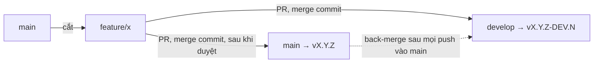

# Deployment & CI/CD

Quy trình deploy thư viện `@duydpdev/style-generator`.

## Mục lục

- [Deployment \& CI/CD](#deployment--cicd)
  - [Mục lục](#mục-lục)
  - [CI/CD Overview](#cicd-overview)
  - [GitHub Actions Workflows](#github-actions-workflows)
    - [`ci.yml` — PR Check](#ciyml--pr-check)
    - [`ci-matrix.yml` — PR Matrix](#ci-matrixyml--pr-matrix)
    - [`pr-title.yml` — PR title lint](#pr-titleyml--pr-title-lint)
    - [Pull Request \& merge convention](#pull-request--merge-convention)
    - [Local (Pre-commit) — Husky](#local-pre-commit--husky)
    - [`release.yml` — Semantic Release Orchestrator](#releaseyml--semantic-release-orchestrator)
    - [`deploy.yml` — Build \& Publish](#deployyml--build--publish)
      - [Publish lại một tag đã push nhưng chưa publish](#publish-lại-một-tag-đã-push-nhưng-chưa-publish)
    - [`back-merge.yml` — Back-merge](#back-mergeyml--back-merge)
    - [`drift.yml` — Drift check](#driftyml--drift-check)
  - [Branching Strategy](#branching-strategy)
    - [Luồng một feature](#luồng-một-feature)
    - [Gỡ feature bị reject](#gỡ-feature-bị-reject)
  - [Release Process](#release-process)
    - [Quy trình đúng](#quy-trình-đúng)
    - [Required Secrets](#required-secrets)
  - [Commit Format](#commit-format)
    - [Config](#config)
  - [Site (landing + examples)](#site-landing--examples)
    - [Vì sao `link:` thay vì `workspace:*`](#vì-sao-link-thay-vì-workspace)
    - [Script aliases (root)](#script-aliases-root)

---

## CI/CD Overview



Mỗi merge vào `main`/`develop` chạy `release.yml` (semantic-release). Có tag mới thì `deploy.yml` publish lên GitHub Packages. Mọi push vào `main` (có hoặc không có release) kết thúc bằng `back-merge.yml`, merge `main` về `develop`. `drift.yml` chạy mỗi ngày (06:17 UTC), cảnh báo khi `develop` vẫn thiếu commit của `main`.

---

## GitHub Actions Workflows

### `ci.yml` — PR Check

**Trigger:** Pull Request vào `main`, `develop` hoặc nhánh tích hợp `release/**` (ví dụ `release/5.0` của chuyến 5.0: PR từ nhánh làm việc vào `release/5.0` và PR `release/5.0` → `develop` đều có CI). `release.yml` thì **không** chạy trên `release/**`: release chỉ phát hành từ `main`/`develop`.

**Draft:** job `check` có `if: github.event.pull_request.draft == false` và `on.pull_request.types` có thêm `ready_for_review`: PR draft không chạy CI, CI chạy khi PR được đánh dấu ready. Mở PR ở draft cho đến khi gate local xanh. `ci.yml` không có bộ lọc path: PR chỉ đổi `documents/**` vẫn chạy `check`, vì site render `documents/*.md` và `check:links` kiểm link của chúng.

**Job** (Node 22):

- `check`: `yarn install --immutable` → `yarn npm audit --recursive --severity high --environment production` (chặn khi dependency production có lỗ hổng high/critical) → `yarn npm audit --all --recursive || true` (chỉ in log, tooling dev/example/site không được ship) → commitlint các commit của PR → `yarn lint` → `yarn prettier:check` → `yarn tsc --noEmit` → `node --check scripts/*.mjs site/scripts/*.mjs` + `yarn typecheck:scripts` → `yarn build:all` → `yarn workspace site build` → `yarn workspace site check:links` → typecheck 3 example (`yarn workspaces foreach -A --include '*-example' run typecheck`) → build `next-v4-example` và `nuxt-v4-example` → `yarn check:externals` → `yarn check:browser-safe` → `yarn check:sizes` → `yarn check:smoke` → `node scripts/vite-dev-smoke.mjs` → `yarn typecheck:dist` → `yarn test:coverage` (ngưỡng `coverage.thresholds`) → `yarn test:types`.
  - Commitlint range: `base..head` cho cả PR vào `develop` lẫn `main`. Feature được cắt từ `main` và vào hai nhánh bằng cùng các commit (merge commit, không squash), nên range này đúng bằng các commit của feature. Header của chúng quyết định loại release, nên commit nào cũng bị lint.

### `ci-matrix.yml` — PR Matrix

**Trigger:** Pull Request vào `main`, `develop` hoặc `release/**` (`types: [opened, synchronize, reopened, ready_for_review]`), trừ PR chỉ đổi `documents/**`: `paths-ignore: ["documents/**"]` ở mức workflow khiến GitHub không tạo run, nên không tốn phút. Bộ lọc này thay cho job `changes` cũ của `ci.yml`, vốn tốn tối thiểu 1 phút runner ở mọi PR chỉ để quyết định có chạy bốn job dưới đây hay không. `concurrency: ci-matrix-<ref>` riêng, `cancel-in-progress: true`. Mọi job có `if: github.event.pull_request.draft == false` như `check`.

**Các job** (Node 22, trừ `node-floor`); mỗi job tự `yarn install` và `yarn build:all`:

- `e2e`: `yarn build:all` → `yarn playwright install --with-deps chromium webkit` → `yarn test:e2e`.
- `tailwind-floor`: Ghi `resolutions` Tailwind `~4.1.0` vào `package.json` của runner (không commit) → `yarn install --no-immutable` → `yarn build:all` → `yarn playwright install --with-deps chromium webkit` → `yarn test` → `yarn test:e2e`.
- `node-floor`: Node `20.19.0` (sàn của `engines.node`) → `yarn install --immutable` → `yarn build:all` → `yarn check:smoke`; bước chạy script TypeScript do `init` sinh ra bị bỏ qua vì Node 20 không strip được type (script đó cần Node >= 22.18).
- `peer-matrix`: 4 leg (`vite` 5/6/8, `typescript` 6). `yarn install --immutable` → `yarn build:all` → ghi `resolutions[<peer>] = ^<major>.0.0` (không commit) → `yarn install --no-immutable` → assert bản resolve ở root và `examples/react-v4` là `<major>.x` → build `examples/react-v4` → (leg `vite`) `node scripts/vite-dev-smoke.mjs` → typecheck example → `yarn typecheck:dist` → (leg `typescript`) `yarn test:types`. Mọi leg phải xanh (không leg nào có `continue-on-error`); leg TypeScript 7 đã bỏ vì Yarn 4.10 không cài được TypeScript 7 native, nên leg đó không bao giờ xanh và tốn khoảng 45 phút mỗi tháng. Leg xanh/đỏ quyết định range `peerDependencies` (sửa tay).

Browser Playwright **không** được cache, và đây là quyết định có đo đạc (PR #73). Khi hit, bước install mất 42 s; không có cache là 49–52 s; khi miss là 56–75 s, cộng 5–8 s để lưu cache, và mỗi ref PR tốn 383 MB. Cache không bỏ được bước `install-deps` (apt), vốn chiếm phần lớn thời gian. `ci-matrix.yml` chỉ chạy trên `pull_request`, nên không có cache của nhánh base để PR mới dùng lại. Kết quả là mọi PR mới đều chậm hơn. Dùng container `mcr.microsoft.com/playwright` chỉ đáng xem lại khi e2e trở thành nút cổ chai.

### `pr-title.yml` — PR title lint

**Trigger:** Pull Request vào `main`, `develop` hoặc `release/**`, `opened`, `edited`, `reopened` (`edited` bắt cả lần chỉ sửa tiêu đề). Không chạy ở `synchronize`: push commit mới không đổi tiêu đề, nên check chỉ gắn vào head lúc PR được mở/sửa/mở lại.

Chạy `commitlint --config commitlint.pr-title.config.ts` trên tiêu đề PR. Config này dùng lại `commitlint.config.ts` và chỉ tắt `defaultIgnores`, để tiêu đề `Revert "…"` (mặc định của GitHub khi revert PR) hay `Merge …` cũng fail. Range lint trong `ci.yml` vẫn dùng config chung vì ở đó có merge commit thật. Từ khi feature vào `develop` bằng merge commit, tiêu đề PR **không** còn quyết định release: dòng đầu của merge commit là `Merge pull request #N from …` (analyzer bỏ qua), tiêu đề PR chỉ nằm trong body. Check này giữ lại để tiêu đề PR dễ đọc và khớp với header của commit.

### Pull Request & merge convention

GitHub Free + repo private: không có branch protection, mọi check chỉ là cảnh báo. Người merge phải tự dừng khi check đỏ; lưới cuối là `yarn test` + `yarn test:types` trong `release.yml`, chạy trước khi cắt tag.

| PR                  | Merge method                                                 | Ghi chú                                                                                                                                                  |
| ------------------- | ------------------------------------------------------------ | -------------------------------------------------------------------------------------------------------------------------------------------------------- |
| Feature → `develop` | **Create a merge commit**                                    | Feature giữ nguyên SHA. Khi feature vào `main`, back-merge nhận ra các commit đó đã có trên `develop`, nên merge sạch và DEV sau đó không phân tích lại. |
| Feature → `main`    | **Create a merge commit**                                    | Cùng nhánh feature, mở PR thứ hai sau khi đã duyệt trên `develop`.                                                                                       |
| `develop` → `main`  | **Không dùng**                                               | `develop` chứa cả feature chưa duyệt; promote cả nhánh là ship thứ chưa duyệt.                                                                           |
| Squash / Rebase     | Tắt (`allow_squash_merge=false`, `allow_rebase_merge=false`) | Squash tạo bản sao khác SHA: DEV phân tích lại feature đã ship và feature phụ thuộc bị conflict (đo trong plan `feature-from-main-flow`, phase 01).      |

**Setting chịu tải:** `merge_commit_title = MERGE_MESSAGE` (dòng đầu `Merge pull request #N …`) và `merge_commit_message = PR_TITLE`. Đổi dòng đầu thành tiêu đề PR thì merge commit mang header `[type]`, và mọi merge commit chỉ có trên `develop` bị tính lại sau mỗi back-merge. Không đổi.

`delete_branch_on_merge` giữ `false`: nhánh feature còn cần cho PR thứ hai vào `main`.

Template: `.github/pull_request_template.md`. Dependabot (`.github/dependabot.yml`) cập nhật GitHub Actions hàng tháng thành **một** PR gộp (`groups`) nhắm vào `main` (`target-branch`), với prefix `"[ci] "` (dấu cách cuối để GitHub không chèn `:` sau `]`). Dependabot cắt nhánh từ nhánh đích, nên nhắm `main` thì nhánh của nó là một feature branch sạch. Land vào `develop` trước bằng PR thứ hai từ cùng nhánh (`gh pr create --base develop --head <nhánh dependabot>`), rồi mới merge PR của Dependabot vào `main`. Dependabot chỉ đọc file này trên nhánh mặc định `main`.

Mục `npm` cùng file chạy hàng tuần với cùng flow (nhắm `main`, prefix `"[ci] "`, tối đa 5 PR mở). Nó gộp bump của example/site (`next`, `nuxt`, `react`, `vue`, …) thành nhóm `examples` và devDependency thành nhóm `dev-tooling`. Nó không bao giờ đề xuất major cho `tailwindcss`, `@tailwindcss/*`, `zod`, `vite` và `typescript`: các dòng này (và range peer) được theo dõi bằng tay, có job `tailwind-floor` và `peer-matrix` kiểm. Bump làm đổi range đã publish (`dependencies`/`peerDependencies`) phải đổi header sang `[fix]`/`[feat]` trước khi merge.

---

### Local (Pre-commit) — Husky

Dự án sử dụng **Husky** và **lint-staged** để chặn các commit không đạt tiêu chuẩn:

- `.husky/pre-commit` chỉ gọi `yarn lint-staged` (cấu hình duy nhất: `lint-staged.config.js`). lint-staged ẩn thay đổi chưa stage trước, nên mọi bước chỉ thấy snapshot đã stage.
- Với file code được stage: `eslint --fix` → `prettier --write` trên chính các file đó → `tsc --noEmit` cho cả project → `vitest related --run` (chỉ test import file được stage). File `json`/`md`/`yml`/`css` chỉ qua `prettier --write`.
- Toàn bộ `yarn test`, `yarn test:types` và các gate `check:*` chạy ở CI, không chạy trong hook.
- Hook được cài qua `postinstall: husky` (Yarn Berry không chạy `prepare`); `pinst` tắt `postinstall` trong tarball publish; release CI đặt `HUSKY=0`.

---

### `release.yml` — Semantic Release Orchestrator

**Trigger:** Push vào `main` hoặc `develop`. `concurrency: release-<ref>`, `cancel-in-progress: false`: một run release mỗi nhánh tại một thời điểm, run đang chạy không bao giờ bị huỷ (tránh tag đã push mà chưa publish). GitHub chỉ giữ một run chờ mỗi group, nên push mới thay run chờ cũ; run mới release một tập commit bao trùm.

**Các bước:**

1. `yarn test` + `yarn test:types` trên commit vừa push, trước khi cắt tag
2. Chạy `semantic-release` → tự động tính version, tạo git tag; chỉ trên `main` mới commit `package.json` + `CHANGELOG.md`
3. Phát hiện tag của chính run: tag trên `HEAD`, chưa có trong snapshot trước khi chạy `semantic-release`, và đúng kênh của nhánh (`main`: `vX.Y.Z`; `develop`: `vX.Y.Z-DEV.N`). semantic-release fetch mọi tag remote trước khi chạy, nên tag do run của nhánh khác vừa push cũng xuất hiện local; so snapshot trước/sau như cũ có thể chọn nhầm tag đó. Đúng một tag → release; không có → không release (in `::warning` nếu nhánh remote đã đi tiếp, vì semantic-release bỏ qua nhánh bị tụt sau remote); nhiều hơn một → job fail, publish bằng tay theo [runbook](#publish-lại-một-tag-đã-push-nhưng-chưa-publish).
4. Nếu có tag mới → trigger `deploy.yml`
5. Trên `main`, sau khi job release thành công (có hoặc không có tag, `deploy` thành công hoặc bị skip) → trigger `back-merge.yml`

`release.config.cjs` chỉ bật `@semantic-release/changelog` và `@semantic-release/git` khi nhánh là đúng `main`, và in `[release.config] branch=<b> commitsRelease=<bool>` vào log. Release DEV trên `develop` chỉ tạo tag, không commit `package.json`/`CHANGELOG.md`: nếu commit, `develop` và `main` sửa cùng dòng version/changelog và mọi back-merge sau stable release sẽ conflict.

---

### `deploy.yml` — Build & Publish

**Trigger:** Được gọi từ `release.yml` (workflow_call) khi có release mới, hoặc chạy tay (`workflow_dispatch`, input `tag`) để publish lại một tag. Checkout dùng `persist-credentials: false` (không có thao tác git nào sau đó).

**Các bước:**

1. Checkout tại tag mới
2. Node 22 (Yarn Berry đọc registry từ `.yarnrc.yml`, không từ `.npmrc`)
3. `yarn install --immutable`
4. `npm pkg set version=<tag bỏ v>` rồi assert khớp tag (fail nếu tag rỗng). Bắt buộc cho DEV, vì `package.json` tại tag DEV vẫn là version stable gần nhất; trên `main` là no-op. Không commit.
5. `yarn build:all`
6. `yarn check:externals`
7. `yarn check:smoke` (build của tag chạy được: mọi subpath load ở ESM/CJS, `style-gen --version` in đúng version vừa set ở bước 4)
8. `yarn check:browser-safe`
9. `yarn check:publish-target`
10. `yarn npm publish --dry-run` (assert output chứa `npm.pkg.github.com`)
11. Publish lên **GitHub Packages** với `YARN_NPM_AUTH_TOKEN` = `GITHUB_TOKEN` built-in: tag có hậu tố (`-DEV.N`) publish với `--tag DEV`, tag stable publish `latest`

Test không chạy lại ở đây: `release.yml` đã test đúng commit này trước khi cắt tag. Chạy lại cùng cây code chỉ thêm khả năng flaky tạo ra tag + GitHub release mà không có package. `check:smoke` thì khác: nó kiểm build mang version của tag, là thứ duy nhất được publish.

#### Publish lại một tag đã push nhưng chưa publish

semantic-release push tag trước khi chạy các plugin publish (GitHub release), nên một job `release` fail sau bước đó để lại tag mà không có package; chạy lại job sẽ không thấy tag mới. Publish tag đó bằng tay:

```bash
gh workflow run deploy.yml --ref main -f tag=v4.0.1   # hoặc v4.0.1-DEV.1
gh run watch "$(gh run list --workflow=deploy.yml --limit 1 --json databaseId --jq '.[0].databaseId')"
```

`workflow_dispatch` chỉ chạy được với bản `deploy.yml` đã có trên `main`. Một version đã publish thì registry từ chối publish lại (409); không unpublish.

---

### `back-merge.yml` — Back-merge

**Trigger:** Được gọi từ `release.yml` sau mọi push vào `main` (input `version` rỗng khi push đó không ra release)

**Mục đích:** Merge `main` về `develop` để `develop` luôn chứa mọi commit của `main`: commit release, và feature `[ci]`/`[docs]` không tạo release.

Merge thường, **không** `-X theirs` (option đó chọn phía `main` cho mọi hunk conflict và âm thầm bỏ code mới hơn của `develop`). Feature vào `develop` trước `main` bằng cùng các commit, và DEV không commit gì, nên merge bình thường sạch. Khi conflict, job liệt kê file conflict, `git merge --abort` và fail; merge `main` vào `develop` bằng tay theo lệnh in trong log. Nếu push bị từ chối vì `develop` vừa có commit mới, job fetch lại, merge lại từ đỉnh mới và thử tối đa 3 lần. Message có `[skip ci]` nên không tạo DEV mới.

### `drift.yml` — Drift check

**Trigger:** mỗi ngày lúc 06:17 UTC (`schedule`, `cron: "17 6 * * *"`) và `workflow_dispatch`. Lịch mỗi giờ tốn khoảng 675 phút runner mỗi tháng (mỗi lần chạy ~6 giây bị tính tròn 1 phút); back-merge hỏng giờ được báo muộn nhất một ngày.

Fail khi `git rev-list --count origin/develop..origin/main` > 0 và đỉnh `main` đã cũ hơn 60 phút (bỏ qua lúc một run release/back-merge đang chạy), in ra các commit bị thiếu. Giới hạn: số đếm không bắt được "revert trap" (xem [Gỡ feature bị reject](#gỡ-feature-bị-reject)).

---

## Branching Strategy

| Branch        | Mục đích                                                                       |
| ------------- | ------------------------------------------------------------------------------ |
| `main`        | Stable releases. Mọi push → release flow + back-merge                          |
| `develop`     | Tích hợp và test. Pre-release versions (DEV suffix, dist-tag `DEV`)            |
| `feature/*`   | Cắt từ `main`. PR vào `develop`, rồi PR riêng vào `main` sau khi duyệt         |
| `hotfix/*`    | Như feature: cắt từ `main`, vào `develop` trước rồi mới vào `main`             |
| `integrate/*` | Nhánh tạm để resolve conflict của một feature với `develop`; chỉ vào `develop` |

### Luồng một feature

1. `git fetch origin && git switch -c feature/x origin/main`. Không bao giờ cắt từ `develop`.
2. **Một commit, header đúng.** Loại release do header của các commit trong nhánh quyết định (merge commit bị analyzer bỏ qua). Trước PR đầu tiên, gom nhánh thành một commit `[type] subject` và dùng đúng header đó làm tiêu đề cả hai PR. Một commit `[feat] wip` sót lại sẽ thành minor dù PR tên `[fix] …`. Major: `[release] …`.
3. PR `feature/x` → `develop`, **Create a merge commit**. Kết quả là `vX.Y.Z-DEV.N` trên dist-tag `DEV`. Consumer test bằng version chính xác (`@duydpdev/style-generator@4.1.0-DEV.3`), không dùng range: `^4.1.0-DEV.3` resolve lên `4.1.0` stable, có thể thiếu feature khác đang ở `develop`.
4. Duyệt xong: PR `feature/x` → `main`, **Create a merge commit**. Release stable, publish `latest`, back-merge.
5. **Phụ thuộc feature khác:** cắt từ nhánh feature kia, ghi rõ trong PR, và feature kia phải vào `main` trước.
6. **Conflict khi vào `develop`:** **không** dùng nút "Resolve conflicts" hay "Update branch" của GitHub: cả hai merge `develop` vào `feature/x`, và PR vào `main` sau đó sẽ mang theo feature chưa duyệt. Thay vào đó: `git switch -c integrate/x origin/develop && git merge feature/x`, resolve, mở PR `integrate/x` → `develop` (merge commit), rồi xoá nhánh. `feature/x` giữ sạch cho `main`. Cập nhật `feature/x` chỉ bằng `git merge origin/main`.

### Gỡ feature bị reject

- **Khỏi `develop`:** PR `[revert] <feature>` (`git revert -m 1 <merge-commit>`), tạo một DEV patch mới. Không force-push `develop`.
- **Revert trap:** commit của feature đã là tổ tiên của `develop`. Nếu sau đó merge lại đúng các commit đó (vào `develop` hay `main`), git coi là đã có: `develop` thiếu code mà `drift.yml` vẫn báo 0 (đo trong plan `feature-from-main-flow`, phase 01). Luật: trước khi feature đã bị revert land lại ở bất kỳ đâu, chạy `git rebase --force-rebase origin/main` trên nhánh để các commit có SHA mới.
- **Khỏi `main`:** PR `[revert] <feature>` vào `develop` rồi vào `main`, ra một patch release. Version cũ đã publish vẫn nằm trên registry.

---

## Release Process

> [!IMPORTANT]
> Dự án dùng **semantic-release** — version được tự động tính từ commit messages. **Không cần** tự tay chỉnh `package.json`.
> Major release cần commit `[release] …` (xem bảng Commit Format).

### Quy trình đúng

1. Cắt `feature/x` từ `main` (xem [Luồng một feature](#luồng-một-feature))
2. Một commit theo format `[type] subject` (xem bên dưới)
3. PR vào `develop`, CI pass → **Create a merge commit** → `release.yml` cắt `vX.Y.Z-DEV.N` (chỉ tag, không commit) và publish dist-tag `DEV`
4. Duyệt xong → PR cùng nhánh vào `main`, CI pass → **Create a merge commit** → `release.yml`:
   - Tính version mới từ header các commit của feature
   - Commit `package.json` + `CHANGELOG.md` (`[chore] release x [skip ci]`) và tạo tag `vX.Y.Z`
   - Trigger `deploy.yml` để publish lên GitHub Packages
   - Trigger `back-merge.yml` merge `main` về `develop`

### Required Secrets

- `CI_WORKER_REPOSITORY_TOKEN`: PAT có quyền push release commit và tag về GitHub repo. Không khai báo ở mức workflow `env`; chỉ được truyền cho checkout + semantic-release (env `GITHUB_TOKEN`) trong `release.yml` và checkout trong `back-merge.yml` (job gọi nó dùng `secrets: inherit`). `deploy.yml` không nhận nó (job `deploy` không dùng `secrets: inherit`). Checkout của job `release` dùng `persist-credentials: false`, nên token không nằm trong `.git/config` lúc `yarn install`/test chạy: semantic-release tự đưa env `GITHUB_TOKEN` vào URL mọi lệnh fetch/push của nó, và bước phát hiện tag chỉ đọc tag local. `back-merge.yml` vẫn để mặc định (`true`) vì chính nó `git fetch`/`git push` sau checkout, và không cài dependency.
- Publish dùng `GITHUB_TOKEN` built-in — không cần secret npm. `GITHUB_TOKEN` mặc định chỉ `contents: read` trong cả `release.yml`; chỉ job `deploy` mở `packages: write` (quyền của reusable workflow không vượt quá job gọi nó). `release` và `back-merge` push bằng PAT nên không cần `contents: write` trên `GITHUB_TOKEN`.

---

## Commit Format

Commit message format: `[type] subject`, type viết thường (`[Feat] …` bị commitlint từ chối, vì analyzer chỉ map type viết thường và sẽ không release).

| Type                                                          | Version bump    | Ví dụ                                |
| ------------------------------------------------------------- | --------------- | ------------------------------------ |
| `release`                                                     | Major (`2.0.0`) | `[release] ship public v2 API`       |
| `feat`                                                        | Minor (`1.1.0`) | `[feat] add multi-theme support`     |
| `fix`                                                         | Patch (`1.0.1`) | `[fix] correct spacing var fallback` |
| `perf`                                                        | Patch (`1.0.1`) | `[perf] reduce generated CSS size`   |
| `refactor`, `style`, `revert`                                 | Patch (`1.0.1`) | `[refactor] simplify registry walk`  |
| `docs`, `chore`, `test`, `build`, `ci`, `conf`, `temp`, `wip` | Không bump      | `[docs] update architecture guide`   |

Release notes dùng preset `conventionalcommits` (khai trong `devDependencies`) với template `changelog-template.hbs`; các section theo thứ tự: `Release`, `Features`, `Bug Fixes`, `Performance Improvements`, `Refactor`, `Style`, `Reverts`. Type không bump không vào notes. Body của commit `[feat]` và `[fix]` được in thụt lề ngay dưới entry (`finalizeContext` trong `release.config.cjs`). Vì `[fix]` thường siết validation, hãy viết body nói rõ cái gì giờ bị từ chối và cách chuyển đổi; body của `[feat]` liệt kê các thay đổi hành vi người dùng cần biết (default mới, ngữ nghĩa mới). Body của các type khác không vào notes.

### Config

Xem: [`commitlint.config.ts`](../commitlint.config.ts) và [`release.config.cjs`](../release.config.cjs)

---

## Site (landing + examples)

Landing site (`site/`) và `examples/react-v4` dùng thư viện qua dependency `link:`. Site **không được deploy**: repo private trên GitHub Free không có GitHub Pages (Pages cho repo private cần Pro/Team/Enterprise: https://docs.github.com/pages/quickstart). `deploy-site.yml` và `site:deploy:manual` đã bị xoá (2026-09-30). Muốn bật lại cần nâng gói hoặc host ở nơi khác, qua một plan riêng.

Site vẫn được build trên mọi PR: job `check` của `ci.yml` chạy `yarn workspace site build` ngay sau `yarn build:all`, kể cả với PR chỉ đổi `documents/**`, vì site render `documents/*.md`. `yarn workspace site build` chạy `build:examples` (build `examples/react-v4` với base `./`, copy `examples/react-v4/dist` vào `site/public/examples/v4`), rồi Vite build site.

### Vì sao `link:` thay vì `workspace:*`

Gói root chính là thư viện `@duydpdev/style-generator`. Với `nodeLinker: node-modules`, Yarn hoist một dependency `workspace:*` trỏ về root lên `node_modules` của root, coi đó là self-reference và bỏ đi. Kết quả là sau một lần `yarn install` sạch, không có `node_modules/@duydpdev/style-generator` ở đâu cả (`nmSelfReferences` không áp dụng cho trường hợp này). `link:..` (site) và `link:../..` (examples) tạo symlink trong `node_modules` của từng workspace. Không alias gói trong Vite: example phải đi qua `exports` thật của package.

### Script aliases (root)

| Script              | Description                                        |
| ------------------- | -------------------------------------------------- |
| `yarn site:dev`     | Vite dev server site (port 5174)                   |
| `yarn site:build`   | Library build → site build → dist tại `site/dist/` |
| `yarn site:preview` | Vite preview server đọc `site/dist/`               |
