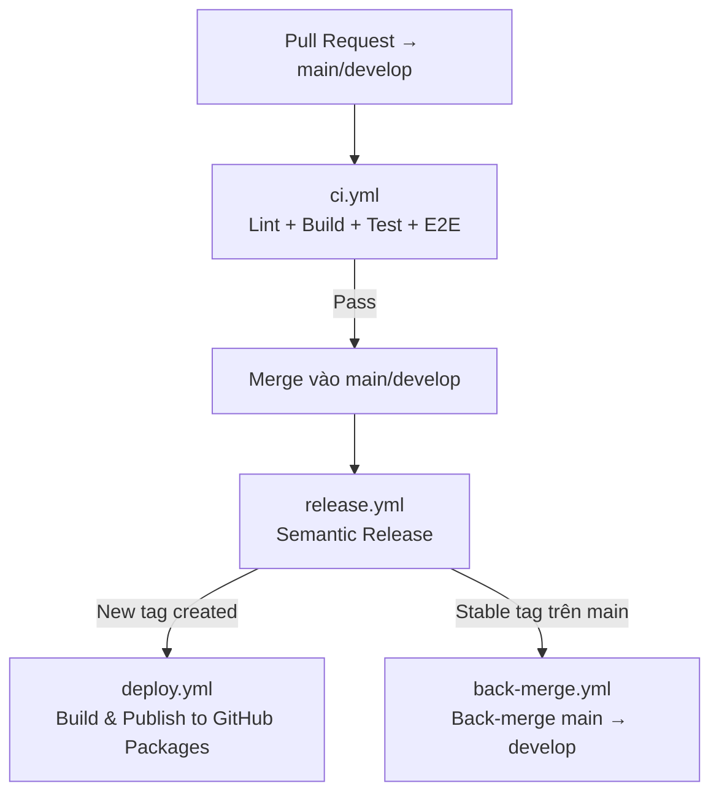

# Deployment & CI/CD

Quy trình deploy thư viện `@duydpdev/style-generator`.

## Mục lục

- [Deployment \& CI/CD](#deployment--cicd)
  - [Mục lục](#mục-lục)
  - [CI/CD Overview](#cicd-overview)
  - [GitHub Actions Workflows](#github-actions-workflows)
    - [`ci.yml` — PR Check](#ciyml--pr-check)
    - [Local (Pre-commit) — Husky](#local-pre-commit--husky)
    - [`release.yml` — Semantic Release Orchestrator](#releaseyml--semantic-release-orchestrator)
    - [`deploy.yml` — Build \& Publish](#deployyml--build--publish)
    - [`back-merge.yml` — Back-merge](#back-mergeyml--back-merge)
  - [Branching Strategy](#branching-strategy)
  - [Release Process](#release-process)
    - [Quy trình đúng](#quy-trình-đúng)
  - [Commit Format](#commit-format)
    - [Config](#config)

---

## CI/CD Overview



---

## GitHub Actions Workflows

### `ci.yml` — PR Check

**Trigger:** Pull Request vào `main` hoặc `develop`

**Các job** (Node 22):

- `check`: `yarn install --immutable` → commitlint các commit của PR → `yarn lint` → `yarn prettier:check` → `yarn tsc --noEmit` → `node --check scripts/*.mjs` → `yarn build:all` → `yarn check:externals` → `yarn check:browser-safe` → `yarn check:sizes` → `yarn test` → `yarn test:types`.
  - Commitlint range: PR vào `develop` lint `base..head`. PR vào `main` chỉ lint các commit mà `develop` chưa có (`merge-base(origin/develop, head)..head`): với promote PR đó là merge commit `[release] …`, với hotfix PR thẳng vào `main` là các commit hotfix. Lịch sử đã nằm trên `develop` không bị lint lại (đã lint lúc vào `develop`, không viết lại được).
- `changes`: `git diff --name-only base...head`; `code=false` khi PR chỉ đổi `documents/**`.
- `e2e`: chỉ chạy khi `changes.code == 'true'`. `yarn build:all` → Playwright browsers (composite action `.github/actions/playwright-browsers`: cache `~/.cache/ms-playwright` theo version `@playwright/test`, hit thì chỉ cài OS deps) → `yarn test:e2e`.
- `tailwind-floor`: chỉ chạy khi `changes.code == 'true'`. Ghi `resolutions` Tailwind `~4.1.0` vào `package.json` của runner (không commit) → `yarn install --no-immutable` → `yarn build:all` → Playwright browsers (cùng composite action) → `yarn test` → `yarn test:e2e`.

### `pr-title.yml` — PR title lint

**Trigger:** Pull Request vào `main` hoặc `develop`, `opened`, `edited`, `synchronize`, `reopened` (`edited` bắt cả lần chỉ sửa tiêu đề).

Chạy `commitlint --config commitlint.pr-title.config.ts` trên tiêu đề PR. Config này dùng lại `commitlint.config.ts` và chỉ tắt `defaultIgnores`, để tiêu đề `Revert "…"` (mặc định của GitHub khi revert PR) hay `Merge …` cũng fail. Range lint trong `ci.yml` vẫn dùng config chung vì ở đó có merge commit thật. Lý do cần lint tiêu đề: feature → `develop` được squash-merge và `squash_merge_commit_title = PR_TITLE`, nên tiêu đề PR **là** commit trên `develop`. Commit `282287b` (`Feat/add example (#67)`) lọt vào vì trước đây không có gì kiểm tra tiêu đề.

### Pull Request & merge convention

GitHub Free + repo private: không có branch protection, mọi check chỉ là cảnh báo. Người merge phải tự dừng khi check đỏ; lưới cuối là `yarn test` + `yarn test:types` trong `release.yml`, chạy trước khi cắt tag.

| PR                         | Merge method                     | Ghi chú                                                                                                                                                        |
| -------------------------- | -------------------------------- | -------------------------------------------------------------------------------------------------------------------------------------------------------------- |
| Feature → `develop`        | **Squash and merge**             | Tiêu đề PR = commit. Body bị bỏ (`squash_merge_commit_message = BLANK`), nên major phải là `[release] …` trên tiêu đề, không dựa vào footer `BREAKING CHANGE`. |
| Promote `develop` → `main` | **Create a merge commit**        | Giữ nguyên lịch sử `develop` làm tổ tiên của `main` để back-merge sạch.                                                                                        |
| Rebase                     | Tắt (`allow_rebase_merge=false`) | Rebase đổi SHA, phá quan hệ tổ tiên giữa `main` và `develop`.                                                                                                  |

`delete_branch_on_merge` giữ `false`: `develop` không được bảo vệ, bật lên thì một PR `develop` → `main` sẽ xoá `develop` sau khi merge.

Template: `.github/pull_request_template.md`. Dependabot (`.github/dependabot.yml`) cập nhật GitHub Actions hàng tháng cho `/` và `/.github/actions/*` (chỉ `/` thì composite action không được quét), với prefix `"[ci] "` (dấu cách cuối để GitHub không chèn `:` sau `]`).

---

### Local (Pre-commit) — Husky

Dự án sử dụng **Husky** và **lint-staged** để chặn các commit không đạt tiêu chuẩn:

- Tự động chạy `lint` và `prettier` cho các file đang thay đổi.
- Chạy `tsc --noEmit` để đảm bảo không lỗi type.
- Chạy `vitest run` cho các unit tests liên quan.
- Hook được cài qua `postinstall: husky` (Yarn Berry không chạy `prepare`); `pinst` tắt `postinstall` trong tarball publish; release CI đặt `HUSKY=0`.

---

### `release.yml` — Semantic Release Orchestrator

**Trigger:** Push vào `main` hoặc `develop`. `concurrency: release-<ref>`, `cancel-in-progress: false`: một run release mỗi nhánh tại một thời điểm, run đang chạy không bao giờ bị huỷ (tránh tag đã push mà chưa publish). GitHub chỉ giữ một run chờ mỗi group, nên push mới thay run chờ cũ; run mới release một tập commit bao trùm.

**Các bước:**

1. `yarn test` + `yarn test:types` trên commit vừa push, trước khi cắt tag
2. Chạy `semantic-release` → tự động tăng version, tạo git tag, cập nhật CHANGELOG
3. So sánh tags trước/sau để phát hiện tag mới
4. Nếu có tag mới → trigger `deploy.yml`
5. Nếu tag stable (không có `-`) và ở `main` → trigger `back-merge.yml`

---

### `deploy.yml` — Build & Publish

**Trigger:** Được gọi từ `release.yml` (workflow_call) khi có release mới

**Các bước:**

1. Checkout tại tag mới
2. Node 22 với `registry-url: https://npm.pkg.github.com`
3. `yarn install --immutable`
4. `yarn build:all`
5. `yarn check:externals`
6. `yarn check:browser-safe`
7. `yarn check:publish-target`
8. `yarn npm publish --dry-run` (assert output chứa `npm.pkg.github.com`)
9. Publish lên **GitHub Packages** với `YARN_NPM_AUTH_TOKEN` = `GITHUB_TOKEN` built-in

Test không chạy lại ở đây: `release.yml` đã test đúng commit này trước khi cắt tag. Chạy lại cùng cây code chỉ thêm khả năng flaky tạo ra tag + GitHub release mà không có package.

---

### `back-merge.yml` — Back-merge

**Trigger:** Được gọi từ `release.yml` sau stable release trên `main`

**Mục đích:** Tự động merge code từ `main` về `develop` sau mỗi stable release, đảm bảo `develop` luôn có đủ commit từ `main`.

Merge thường, **không** `-X theirs` (option đó chọn phía `main` cho mọi hunk conflict và âm thầm bỏ code mới hơn của `develop`). Bình thường `main` chỉ có commit của `develop` cộng commit release, nên merge sạch. Khi conflict (ví dụ `develop` đã cắt một `-DEV.N` trong lúc stable release chạy, hoặc hotfix trên `main` đụng cùng dòng), job liệt kê file conflict, `git merge --abort` và fail. Release và publish đã xong; merge `main` vào `develop` bằng tay theo lệnh in trong log.

---

## Branching Strategy

| Branch      | Mục đích                                         |
| ----------- | ------------------------------------------------ |
| `main`      | Stable releases. Mọi push → trigger release flow |
| `develop`   | Development. Pre-release versions (DEV suffix)   |
| `feature/*` | Feature branches → mở PR vào `develop`           |
| `hotfix/*`  | Hotfix → PR vào cả `main` và `develop`           |

---

## Release Process

> [!IMPORTANT]
> Dự án dùng **semantic-release** — version được tự động tính từ commit messages. **Không cần** tự tay chỉnh `package.json`.
> Major release cần commit `[release] …` (xem bảng Commit Format).

### Quy trình đúng

1. Code thay đổi trên feature branch
2. Commit theo format `[type] subject` (xem bên dưới)
3. Mở Pull Request vào `develop` (pre-release) hoặc `main` (stable release)
4. CI check pass → merge PR
5. `release.yml` tự động:
   - Tính version mới
   - Tạo git tag (`vX.Y.Z`)
   - Cập nhật `CHANGELOG.md`
   - Trigger `deploy.yml` để publish lên GitHub Packages

### Required Secrets

- `CI_WORKER_REPOSITORY_TOKEN`: token có quyền push release commit và tag về GitHub repo. Không còn khai báo ở mức workflow `env`, và `deploy.yml` không nhận token này. Nó được truyền cho checkout + semantic-release trong `release.yml` và checkout trong `back-merge.yml`. Lưu ý: `actions/checkout` với `token:` và `persist-credentials` mặc định `true` ghi token vào `.git/config`, nên các step sau trong cùng job (install, test) vẫn đọc được. Tắt `persist-credentials` sẽ làm hỏng `git fetch --tags` ở bước phát hiện tag mới, nên chưa làm.
- Publish dùng `GITHUB_TOKEN` built-in — không cần secret npm. `release.yml` khai `packages: write` để reusable workflow `deploy.yml` được quyền publish.

---

## Commit Format

Commit message format: `[type] subject`

| Type                                   | Version bump    | Ví dụ                                |
| -------------------------------------- | --------------- | ------------------------------------ |
| `release`                              | Major (`2.0.0`) | `[release] ship public v2 API`       |
| `feat`                                 | Minor (`1.1.0`) | `[feat] add multi-theme support`     |
| `fix`                                  | Patch (`1.0.1`) | `[fix] correct spacing var fallback` |
| `perf`                                 | Patch (`1.0.1`) | `[perf] reduce generated CSS size`   |
| `refactor`, `style`, `revert`          | Patch (`1.0.1`) | `[refactor] simplify registry walk`  |
| `docs`, `chore`, `test`, `build`, `ci` | Không bump      | `[docs] update architecture guide`   |

### Config

Xem: [`commitlint.config.ts`](../commitlint.config.ts) và [`release.config.cjs`](../release.config.cjs)

---

## Site Deployment (GitHub Pages)

Landing site (`site/`) deploy độc lập với package release. Hai pipeline tách biệt:

| Pipeline                      | Workflow                     | Trigger                                                                | Target                                                              |
| ----------------------------- | ---------------------------- | ---------------------------------------------------------------------- | ------------------------------------------------------------------- |
| **Package → GitHub Packages** | `release.yml` → `deploy.yml` | Push `main` / `develop` (qua semantic-release tag)                     | `https://npm.pkg.github.com` (`@duydpdev/style-generator`, private) |
| **Site → GH Pages**           | `deploy-site.yml`            | Push `main` (paths `site/**`, `documents/**`, `examples/**`, `src/**`) | `https://<owner>.github.io/<repo>/`                                 |

### Workflow `deploy-site.yml`

Job `build`:

1. Checkout + setup Node 22 + enable Corepack.
2. `yarn install --immutable`.
3. `yarn build:all` — biên dịch library (cần thiết vì site dogfood qua `workspace:*`).
4. `yarn workspace site build` — chạy `build:examples` (build `examples/react-v4` với `EXAMPLE_BASE`), copy `examples/react-v4/dist` vào `site/public/examples/v4`, rồi Vite build site.
5. Upload `site/dist` qua `actions/upload-pages-artifact@v3`.

Job `deploy`: `actions/deploy-pages@v4` xuất bản artifact.

Env quan trọng: `VITE_BASE=/${{ github.event.repository.name }}/` ensures asset URLs khớp với GH Pages subpath. Cả `site/vite.config.ts` lẫn `site/scripts/build-examples.mjs` đọc biến này.

### Manual deploy

```bash
# Build + deploy site lên gh-pages branch (cần gh-pages package)
VITE_BASE=/style-generator/ yarn site:deploy:manual
```

### Repo settings (one-off)

GitHub repo → Settings → Pages → **Source: GitHub Actions**. Lần đầu workflow chạy thành công sẽ tạo deployment environment `github-pages` tự động.

### Script aliases (root)

| Script                    | Description                                           |
| ------------------------- | ----------------------------------------------------- |
| `yarn site:dev`           | Vite dev server site (port 5174)                      |
| `yarn site:build`         | Library build → site build → dist tại `site/dist/`    |
| `yarn site:preview`       | Vite preview server đọc `site/dist/`                  |
| `yarn site:deploy:manual` | Build + push lên `gh-pages` branch qua `gh-pages` npm |
