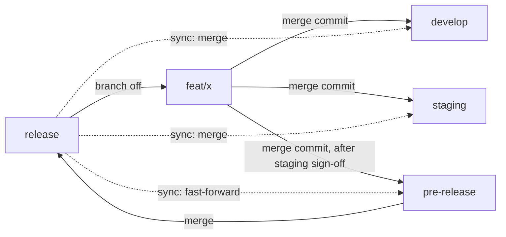

# Git workflow standard for apps with 4 environment branches

This standard is for apps deployed through 4 environment branches: `develop` → `staging` → `pre-release` → `release` (production). The goal is to ship each feature independently: feature A reaches production while feature B is still on staging.

The `@duydpdev/style-generator` library does not use this standard. It has only 2 branches, `develop` and `main`, and applies the same principles; see [`../deploy.md`](../deploy.md).

The git behaviors referred to here (squash creating new SHAs, the revert trap, back-merge) were measured in internal dry runs that are not published.

## Diagram



## What this model guarantees, and what it does not

The model guarantees that feature A does not drag feature B's code along in **git history**, provided the 4 rules below are followed.

The model does not guarantee that what was tested is what will ship. On `develop` and `staging`, A is always tested together with B and C, so B may work only because A is present (helpers, migrations, config added by A). `pre-release` must be exactly `release` + the approved features, and is the only environment that tests the exact combination that will ship.

## The 4 isolation rules

1. Features and hotfixes are always branched from `release`, never from an environment branch.
2. Never merge an environment branch into a feature branch. To update a feature, only merge `release` into it.
3. A temporary branch used to resolve conflicts (`feat/x-dev`, `feat/x-staging`) only goes into its own environment, then is deleted immediately. Never merge a temporary branch into another environment or into `release`, because it already contains that environment's code.
4. Never merge an environment branch "downstream" into the next environment (`develop` → `staging`, `staging` → `pre-release`). Each environment only receives feature branches. The only exception is `pre-release` → `release`, because by definition `pre-release` only contains what has been approved.

A real dependency between two features must be declared: if B needs A, branch B from A, say so in the PR, and A must reach `release` before B.

## Merging and entry thresholds

- **Merge commit (`--no-ff`) in every environment, no squash.** The same feature keeps the same SHA in all 3 environments, so when `release` is synced back, git recognizes that the feature is already present and merges cleanly. Squash creates a different-SHA copy in each environment, leading to conflicts at sync time and conflicts for dependent features.
- **Into `develop`:** when the PR passes CI.
- **Into `staging`:** when the developer has finished testing on `develop`.
- **Into `pre-release`:** only with stakeholders' staging sign-off, recorded in the PR or ticket.
- **Do not use GitHub's "Resolve conflicts" or "Update branch" button** on a PR into an environment branch. Both merge the environment branch into the feature branch, which violates rule 2. Resolve on a temporary branch instead:

  ```bash
  git switch -c feat/x-staging origin/staging
  git merge feat/x          # resolve conflicts here
  git push -u origin feat/x-staging   # PR feat/x-staging → staging, merge commit
  ```

  A resolution done on `pre-release` must be reviewed as new code, because staging has never seen it.

- Enable `git config --global rerere.enabled true` if you often have to resolve the same conflict in several environments: resolve once, git remembers and reapplies it.

## Removing a rejected feature

Removal is done per environment:

- **`develop` / `staging`:** open a PR that reverts the feature's merge commit (`git revert -m 1 <merge-commit>`), with a title that names the feature. Record in the ticket "reverted in <environment>".
- **Revert trap:** the feature's old commits are already ancestors of the branch. If exactly those commits are merged again, git considers them already present, so only the new commits go in and **the old code is lost silently**. Before merging a reverted feature again, do one of two things:
  - revert the revert commit itself (`git revert <revert-sha>`) and then merge the feature, **or**
  - `git rebase --force-rebase origin/release` on the feature branch so the commits get new SHAs.
- **`pre-release`:** do not revert. Rebuild `pre-release` = `release` + the features that are still approved (merge each branch again), force-push and notify the team. `pre-release` is a throwaway branch, so rebuilding is cheaper and cleaner than a chain of reverts.

  ```bash
  git switch -C pre-release origin/release
  git merge --no-ff feat/a feat/c        # only the approved features
  git push --force-with-lease origin pre-release
  ```

- **Periodic reset:** after each release (or each sprint), consider rebuilding `develop` and `staging` from `release` + the active features. This clears accumulated reverts and clutter. Because it is a force-push, announce it beforehand.

## Hotfix

A hotfix goes through the full chain like a feature (a team decision). Steps:

- Branch `hotfix/x` from `release`, then merge it in turn into `develop` → `staging` → `pre-release` → `release`.
- A hotfix is queued with priority and gets abbreviated testing on `develop`/`staging`.
- When a hotfix happens, `pre-release` may already contain approved features that have not shipped. Shipping `pre-release` then ships those features too. If that is not acceptable, rebuild `pre-release` = `release` + the hotfix, ship, then merge the features again.
- **Break-glass:** when an incident is serious and the time to go through the whole chain exceeds the SLA, a hotfix is allowed straight into `release` and then synced downstream, with a written record. This is a documented exception, not the usual path.

## Sync after release

1. `pre-release` fast-forwards to `release`. After `release` merges `pre-release`, the two branches must be equal:

   ```bash
   git switch pre-release && git merge --ff-only origin/release && git push origin pre-release
   ```

2. `develop` and `staging` merge `release` in with a merge commit. No rebase, no `-X theirs`/`-X ours`: those options silently drop code.

## Measuring drift with commands

Run these commands after every sync, and preferably on a schedule:

| Check                                                | Command                                                                                           | Correct result                                                                                |
| ---------------------------------------------------- | ------------------------------------------------------------------------------------------------- | --------------------------------------------------------------------------------------------- |
| `release` is fully contained in every environment    | `git rev-list --count origin/<env>..origin/release`                                               | `0` for `develop`, `staging`, `pre-release`                                                   |
| `pre-release` equals `release` right after a release | `git diff origin/release origin/pre-release`                                                      | empty                                                                                         |
| Features currently present in an environment         | `git log --first-parent --merges --format=%s origin/release..origin/<env>`                        | matches the list of active tickets; a feature without a ticket is clutter and must be removed |
| Temporary branches that live too long                | `git for-each-ref --format='%(committerdate:relative) %(refname)' 'refs/remotes/origin/feat/*-*'` | no branch older than 1 day                                                                    |

The `rev-list` count does not catch the revert trap: a feature that was reverted and then merged again with the exact old SHAs still yields `0`. Only the rule in the "Removing a rejected feature" section prevents it.

## Checklist by role

**Developer**

- [ ] Branch `feat/x` from `origin/release`
- [ ] Squash the branch into one commit with the correct header before the first PR
- [ ] State dependencies (if any) in the PR
- [ ] Conflict: resolve on `feat/x-<env>`, delete the temporary branch after merging
- [ ] A feature that was reverted before: `--force-rebase` or revert the revert before merging again

**Reviewer**

- [ ] PRs into an environment use a merge commit, not squash
- [ ] No environment-branch commits in the feature branch (`git log origin/release..feat/x`)
- [ ] The PR into `pre-release` has staging sign-off

**Release owner**

- [ ] `pre-release` only contains approved features (the `git log --first-parent --merges` command above)
- [ ] Merge `pre-release` → `release`, then sync: fast-forward `pre-release`, merge `release` into `develop` and `staging`
- [ ] The drift commands all give the correct result

## When the model stops being right

- **Most features go straight from `develop` to `release` without being held back:** selective promotion is only cost with no benefit. Go back to promoting the whole branch.
- **The share of features that are held back or removed rises sharply:** the right direction is trunk-based development combined with feature flags, at the price of investing in flag-management infrastructure.

## Rollout (what each app repo must do itself)

This library repo cannot do the following; every app repo that adopts the standard must do it itself:

- CI builds and tests **the feature branch itself** (`release` + feature), not only the environment branches.
- A scheduled job runs the drift commands above and reports an error when the result is wrong.
- Repo configuration: disable squash and rebase merge, keep the feature branch after merging (it is still needed for the next environment).
- Pilot for 1–2 sprints on one repo, learn from it, and only then roll out more widely.
