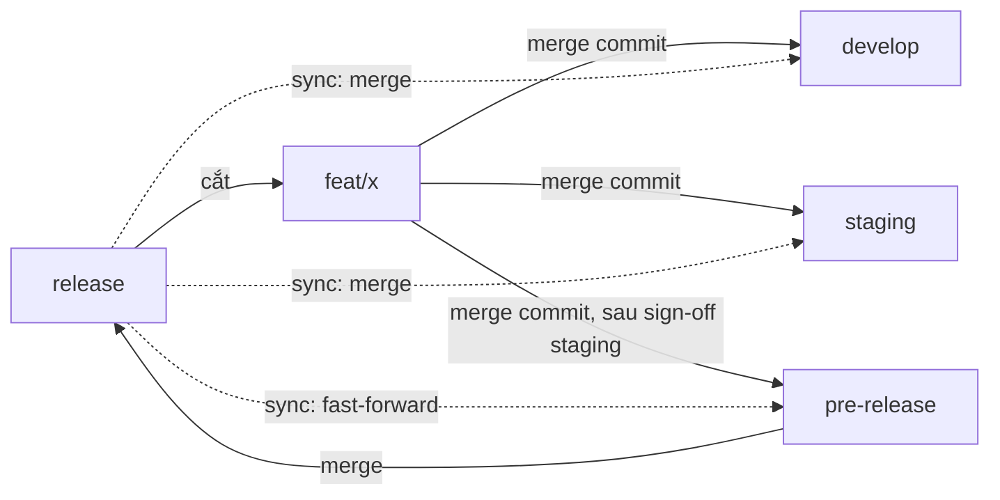

# Chuẩn git workflow cho app có 4 nhánh môi trường

Chuẩn này dành cho app deploy qua 4 nhánh môi trường: `develop` → `staging` → `pre-release` → `release` (production). Mục tiêu là ship được từng feature độc lập: feature A lên production trong khi feature B vẫn nằm ở staging.

Thư viện `@duydpdev/style-generator` không dùng chuẩn này. Nó chỉ có 2 nhánh `develop` và `main` và áp cùng nguyên tắc; xem [`../deploy.md`](../deploy.md).

Nguồn gốc: [`../brainstorm/2026-09-30/advise-git-branch-workflow.md`](../brainstorm/2026-09-30/advise-git-branch-workflow.md). Các hành vi git được viện dẫn (squash tạo SHA mới, revert trap, back-merge) đã đo trong [`../plans/2026-09-30/feature-from-main-flow/reports/phase-01-dry-run.md`](../plans/2026-09-30/feature-from-main-flow/reports/phase-01-dry-run.md).

## Sơ đồ



## Mô hình này bảo đảm gì, không bảo đảm gì

Mô hình bảo đảm feature A không kéo code của feature B theo **lịch sử git**, với điều kiện giữ đủ 4 luật dưới đây.

Mô hình không bảo đảm rằng thứ đã test chính là thứ sẽ ship. Trên `develop` và `staging`, A luôn được test cùng B, C, nên B có thể chạy được chỉ vì A có mặt (helper, migration, config do A thêm vào). `pre-release` phải đúng bằng `release` + các feature đã duyệt, và là môi trường duy nhất test đúng tổ hợp sẽ ship.

## 4 luật cô lập

1. Feature và hotfix luôn cắt từ `release`, không bao giờ cắt từ một nhánh môi trường.
2. Không bao giờ merge nhánh môi trường vào feature branch. Muốn cập nhật feature thì chỉ merge `release` vào.
3. Nhánh tạm dùng để resolve conflict (`feat/x-dev`, `feat/x-staging`) chỉ đi vào đúng môi trường của nó, rồi xoá ngay. Không merge nhánh tạm sang môi trường khác hay vào `release`, vì nó đã chứa code của môi trường đó.
4. Không merge nhánh môi trường "xuôi" sang môi trường kế tiếp (`develop` → `staging`, `staging` → `pre-release`). Mỗi môi trường chỉ nhận feature branch. Ngoại lệ duy nhất là `pre-release` → `release`, vì theo định nghĩa `pre-release` chỉ chứa thứ đã được duyệt.

Phụ thuộc thật giữa hai feature phải được khai báo: nếu B cần A thì cắt B từ A, ghi rõ trong PR, và A phải lên `release` trước B.

## Merge và ngưỡng vào môi trường

- **Merge commit (`--no-ff`) ở mọi môi trường, không squash.** Cùng một feature giữ cùng SHA ở cả 3 môi trường, nên khi sync `release` về, git nhận ra feature đã có và merge sạch. Squash tạo ở mỗi môi trường một bản sao khác SHA, dẫn tới conflict lúc sync và conflict cho các feature phụ thuộc.
- **Vào `develop`:** khi PR pass CI.
- **Vào `staging`:** khi dev đã test xong trên `develop`.
- **Vào `pre-release`:** chỉ khi có sign-off staging của các bên liên quan, ghi trong PR hoặc ticket.
- **Không dùng nút "Resolve conflicts" hay "Update branch" của GitHub** trên PR vào một nhánh môi trường. Cả hai đều merge nhánh môi trường vào feature branch, tức là phạm luật 2. Hãy resolve trên nhánh tạm:

  ```bash
  git switch -c feat/x-staging origin/staging
  git merge feat/x          # resolve conflict tại đây
  git push -u origin feat/x-staging   # PR feat/x-staging → staging, merge commit
  ```

  Phần resolve ở `pre-release` phải được review như code mới, vì staging chưa từng thấy nó.

- Bật `git config --global rerere.enabled true` nếu thường xuyên phải resolve cùng một conflict ở nhiều môi trường: resolve một lần, git nhớ để áp lại.

## Gỡ feature bị reject

Việc gỡ đi theo từng môi trường:

- **`develop` / `staging`:** mở PR revert merge commit của feature (`git revert -m 1 <merge-commit>`), tiêu đề ghi rõ tên feature. Ghi vào ticket "đã revert ở <môi trường>".
- **Revert trap:** các commit cũ của feature đã là tổ tiên của nhánh. Nếu merge lại đúng các commit đó, git coi là đã có, nên chỉ phần commit mới đi vào và **code cũ mất mà không báo gì**. Trước khi merge lại một feature đã bị revert, phải làm một trong hai việc:
  - revert chính commit revert (`git revert <revert-sha>`) rồi mới merge feature, **hoặc**
  - `git rebase --force-rebase origin/release` trên feature branch để các commit có SHA mới.
- **`pre-release`:** không revert. Dựng lại `pre-release` = `release` + các feature còn được duyệt (merge lại từng nhánh), force-push và thông báo cho team. `pre-release` là nhánh dùng xong bỏ, nên dựng lại rẻ hơn và sạch hơn một chuỗi revert.

  ```bash
  git switch -C pre-release origin/release
  git merge --no-ff feat/a feat/c        # chỉ các feature đã duyệt
  git push --force-with-lease origin pre-release
  ```

- **Reset định kỳ:** sau mỗi release (hoặc mỗi sprint), cân nhắc dựng lại `develop` và `staging` từ `release` + các feature đang active. Việc này xoá các revert dồn lại và rác. Vì là force-push nên phải thông báo trước.

## Hotfix

Hotfix đi đủ chuỗi như feature (quyết định của team). Các bước:

- Cắt `hotfix/x` từ `release`, rồi merge lần lượt vào `develop` → `staging` → `pre-release` → `release`.
- Hotfix được ưu tiên xếp hàng và test rút gọn ở `develop`/`staging`.
- Lúc có hotfix, `pre-release` có thể đang chứa feature đã duyệt nhưng chưa ship. Ship `pre-release` khi đó là ship luôn các feature ấy. Nếu không chấp nhận được, dựng lại `pre-release` = `release` + hotfix, ship, rồi merge lại các feature.
- **Break-glass:** khi sự cố nghiêm trọng mà thời gian đi hết chuỗi vượt SLA, cho phép hotfix vào thẳng `release` rồi sync xuống, kèm biên bản. Đây là ngoại lệ có ghi nhận, không phải đường thường dùng.

## Sync sau release

1. `pre-release` fast-forward tới `release`. Sau khi `release` merge `pre-release`, hai nhánh phải bằng nhau:

   ```bash
   git switch pre-release && git merge --ff-only origin/release && git push origin pre-release
   ```

2. `develop` và `staging` merge `release` vào bằng merge commit. Không rebase, không `-X theirs`/`-X ours`: các option đó âm thầm bỏ code.

## Đo drift bằng lệnh

Chạy các lệnh sau sau mỗi lần sync, và nên chạy theo lịch:

| Kiểm tra                                      | Lệnh                                                                                              | Kết quả đúng                                                               |
| --------------------------------------------- | ------------------------------------------------------------------------------------------------- | -------------------------------------------------------------------------- |
| `release` nằm trọn trong mọi môi trường       | `git rev-list --count origin/<env>..origin/release`                                               | `0` cho `develop`, `staging`, `pre-release`                                |
| `pre-release` bằng `release` ngay sau release | `git diff origin/release origin/pre-release`                                                      | rỗng                                                                       |
| Feature đang có ở một môi trường              | `git log --first-parent --merges --format=%s origin/release..origin/<env>`                        | khớp danh sách ticket đang active; feature không có ticket là rác, phải gỡ |
| Nhánh tạm tồn tại quá lâu                     | `git for-each-ref --format='%(committerdate:relative) %(refname)' 'refs/remotes/origin/feat/*-*'` | không có nhánh nào cũ hơn 1 ngày                                           |

Số đếm `rev-list` không bắt được revert trap: một feature đã revert rồi merge lại đúng SHA cũ vẫn cho kết quả `0`. Chỉ luật ở mục "Gỡ feature bị reject" chặn được.

## Checklist theo vai trò

**Developer**

- [ ] Cắt `feat/x` từ `origin/release`
- [ ] Gom nhánh thành một commit mang đúng header trước PR đầu tiên
- [ ] Ghi rõ phụ thuộc (nếu có) trong PR
- [ ] Conflict: resolve trên `feat/x-<env>`, xoá nhánh tạm sau khi merge
- [ ] Feature từng bị revert: `--force-rebase` hoặc revert cái revert trước khi merge lại

**Reviewer**

- [ ] PR vào môi trường dùng merge commit, không squash
- [ ] Không có commit của nhánh môi trường trong feature branch (`git log origin/release..feat/x`)
- [ ] PR vào `pre-release` có sign-off staging

**Release owner**

- [ ] `pre-release` chỉ chứa feature đã duyệt (lệnh `git log --first-parent --merges` ở trên)
- [ ] Merge `pre-release` → `release`, rồi sync: fast-forward `pre-release`, merge `release` vào `develop` và `staging`
- [ ] Các lệnh drift đều ra kết quả đúng

## Khi nào mô hình không còn đúng

- **Hầu hết feature đi thẳng từ `develop` tới `release` mà không bị giữ lại:** selective promotion chỉ còn chi phí mà không có lợi. Quay về promote cả nhánh.
- **Tỷ lệ feature bị giữ lại hoặc bị gỡ tăng cao:** hướng đúng là trunk-based kết hợp feature flag, đổi lại phải đầu tư vào hạ tầng quản lý flag.

## Rollout (việc mỗi repo app phải tự làm)

Repo thư viện này không làm được các việc sau; mỗi repo app áp dụng chuẩn phải tự thực hiện:

- CI build và test **chính feature branch** (`release` + feature), không chỉ các nhánh môi trường.
- Job theo lịch chạy các lệnh drift ở trên, báo lỗi khi kết quả sai.
- Cấu hình repo: tắt squash và rebase merge, giữ nhánh feature sau khi merge (vì còn cần cho môi trường kế tiếp).
- Chạy thử 1–2 sprint trên một repo, rút kinh nghiệm rồi mới nhân rộng.
