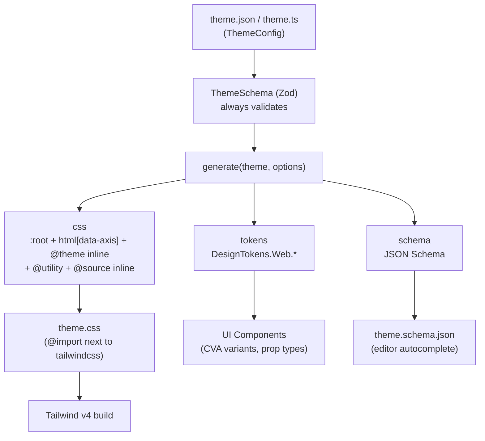
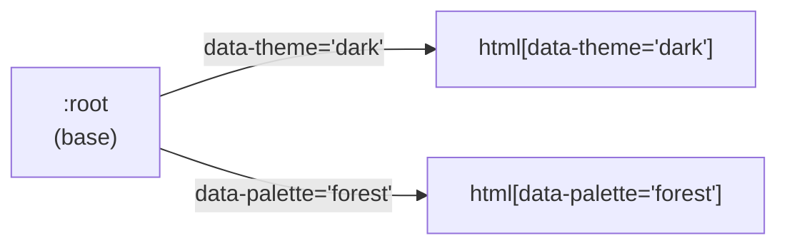

<!-- source: documents/architecture.md sha256: b49ad377098e -->

# Kiến trúc

Tài liệu này mô tả kiến trúc tổng thể của `@duydpdev/style-generator` 4.0.0 (chỉ hỗ trợ Tailwind CSS v4).
Mã nguồn là nguồn chân lý cho việc _hoạt động như thế nào_; tài liệu này chỉ giữ lại phần _vì sao_ và _ở đâu_.

## Mục lục

- [Kiến trúc](#kiến-trúc)
  - [Mục lục](#mục-lục)
  - [Khái niệm cốt lõi](#khái-niệm-cốt-lõi)
  - [Luồng dữ liệu](#luồng-dữ-liệu)
  - [Cấu trúc mã nguồn](#cấu-trúc-mã-nguồn)
  - [Điểm vào](#điểm-vào)
    - [`generate`](#generate)
    - [`createDesignTokens`](#createdesigntokens)
    - [Plugin Vite (chỉ emit)](#plugin-vite-chỉ-emit)
    - [Plugin Next.js (chỉ emit)](#plugin-nextjs-chỉ-emit)
    - [CLI](#cli)
  - [Registry \& `@source inline`](#registry--source-inline)
  - [Theme nhiều trục (`themeAxes`)](#theme-nhiều-trục-themeaxes)
  - [Hệ thống Spacing](#hệ-thống-spacing)
  - [API export](#api-export)
  - [Landing site (`site/`)](#landing-site-site)

---

## Khái niệm cốt lõi

| Khái niệm         | Mô tả                                                                                                                                                                     |
| ----------------- | ------------------------------------------------------------------------------------------------------------------------------------------------------------------------- |
| **Theme Config**  | Đầu vào duy nhất: một JSON/object khai báo `colors` (bắt buộc), `typography`, `shadows`, `backDropBlurs`, `borderRadius`, `fontFamily`, `borderWidth`, `themeAxes`.       |
| **ThemeSchema**   | Một `strictObject` của Zod, là nguồn chân lý cho cả JSON lẫn TypeScript: key lạ, giá trị không an toàn và alias bị hỏng đều bị từ chối trước khi sinh bất kỳ CSS nào.     |
| **Registry**      | Mỗi nhóm token (colors, typography, …) là một descriptor trong `builtInCategories`; mọi bước sinh CSS/`@source inline` đều đi qua registry thay vì lặp lại danh sách key. |
| **`generate()`**  | Hàm duy nhất sinh ra các artifact: `{ css, tokens, schema }`. CLI, `styleGenVite` và `styleGenNext` đều gọi nó.                                                           |
| **Design Tokens** | Một object chứa các mảng key của token (`DesignTokens.Web.*`), dùng trong các UI component (CVA, kiểu của prop).                                                          |
| **Consumer**      | Một dự án dùng thư viện: nó `@import` file CSS được sinh ra cạnh `@import "tailwindcss"`. Không có `@plugin`, không có safelist.                                          |

---

## Luồng dữ liệu



---

## Cấu trúc mã nguồn

```text
src/
├── core/                       # generate(), ThemeSchema (+ tokenGrammar, aliasGraph, themeCollisionChecks), options schema (internal, optionsSchema.ts), resolveOptions, Options, defineTheme, type inference
├── features/
│   ├── registry/               # builtInCategories, flattenByCategory, generateSourceInline
│   ├── theme-css/              # :root / html[data-axis] / @theme inline (incl. --border-width-*), screens
│   ├── typography/             # theme.typography → @utility
│   ├── spacing/                # .sp-* utilities + resolveSpacing helpers
│   ├── tokens/                 # createDesignTokens / buildDesignTokens
│   ├── cva/                    # createVariantMapper
│   ├── recipes/                # ./recipes: createTailwindMergeExtension, splitSpacingProps, themeAxisAttributes
│   ├── ui/                     # ./ui + ./ui-react: recipeFromTables, createCn, splitLayout, mergeStyle, Polymorphic
│   ├── vite/                   # styleGenVite
│   └── next/                   # styleGenNext
├── shared/                     # helpers (kebab/camel), defaults, COLOR_STATES, class prefixes, cssBlock
├── node/                       # shared Node-only runner: loadStyleGenConfig, resolveProjectPath, themeEmitter, watchThemeFile, resolvePluginTarget, writeFileAtomic, errorMessage, isPlainObject
├── cli/                        # commands: init, generate, doctor, schema, tokens, budget
├── exports/                    # one file per public subpath
├── __integration__/            # tests that compile CSS through the real Tailwind engine
└── index.ts                    # root barrel
```

`src/exports/*` quyết định subpath nào an toàn cho trình duyệt (chúng không kéo theo Zod lẫn các built-in của Node): `./tokens`, `./cva`, `./spacing`, `./recipes`, `./types`,
`./ui`, `./ui-react`. Ràng buộc này được kiểm tra bởi `scripts/check-browser-safe.mjs`. `./recipes` chỉ tồn tại dưới dạng subpath (nó không được re-export từ `.`),
giống `./vite`/`./next`, nên ngân sách của `index` không phải gánh các helper phía component. `./ui` import `class-variance-authority`,
`clsx` và `tailwind-merge` (các optional peer); `check:externals` báo lỗi nếu bất kỳ entry nào khác, hoặc bất kỳ chunk nào chúng dùng chung, import chúng.

**Code Node nằm ở đâu:** mọi thứ đụng đến `node:fs`/`node:path`/chokidar đều nằm trong `src/node/` và chỉ được import từ `src/cli/**`, `src/features/vite/**`,
`src/features/next/**` — không bao giờ từ `src/core`, `src/exports/{tokens,cva,spacing,recipes,types,ui,ui-react}` hay root barrel; nếu không,
`dist/index.js` và các subpath an toàn cho trình duyệt sẽ kéo Node vào bundle (`check:browser-safe` và ngân sách `check:sizes` sẽ bắt lỗi này).

---

## Điểm vào

### `generate`

```typescript
import { generate } from "@duydpdev/style-generator";
import theme from "./theme.json";
import { options } from "./style-gen.options";

const { css, tokens, schema } = generate(theme, options);
// css    → written to a file, @import next to tailwindcss
// tokens → DesignTokens (same result as createDesignTokens)
// schema → z.toJSONSchema(ThemeSchema)
```

`generate()` kiểm tra hợp lệ `options` trước (`StyleGeneratorOptionsSchema.parse` → `resolveOptions`),
sau đó luôn kiểm tra hợp lệ lại `theme` với `ThemeSchema` (kể cả khi caller đã gọi `defineTheme()`);
`assertThemeOptions` (`src/core/themeOptionsChecks.ts`) kiểm tra cặp theme × options:
`resetTailwindDefaults: ["colors"|"radius"|"shadow"]` yêu cầu theme có `colors` tương ứng (không rỗng; `ThemeSchema` vẫn chấp nhận `colors: {}`), `borderRadius` hoặc `shadows`.
Sau đó nó ghép các khối theo thứ tự này: breakpoint `@theme` → `:root` + `html[data-<axis>="<variant>"]` + `@theme inline` (các dòng `--color-*: initial;`… của
`resetTailwindDefaults` đứng đầu trong khối này) → `@utility` của typography → `@utility` của spacing → `@source inline`.
Phần kiểm tra hợp lệ nằm trong `prepareGenerate(theme, options)` (`src/core/prepareGenerate.ts`, trả về `{ parsed, resolved }`) và phần ghép **CSS** nằm trong
`generateFromParsed(parsed, resolved)`; `generate()` gọi lần lượt hai hàm này rồi tự dựng `tokens` (`buildDesignTokens`) và `schema`.
Node runner (`src/node/themeEmitter.ts`) gọi chúng từng bước để gắn nhãn cho lỗi (giai đoạn `read` → `parse` → `options` → `theme` → `cross` (chỉ lỗi theme × options) → `generate`
(một lỗi bất ngờ khi dựng CSS: `Failed to generate CSS: …`) → `write`; `config` và `watch` thuộc về watcher).

### `createDesignTokens`

Trả về một object chứa các mảng key lấy từ theme; dùng cho logic của component, các variant CVA và kiểu của prop.

```typescript
import { createDesignTokens } from "@duydpdev/style-generator/tokens";
import theme from "./theme.json";
import { options } from "./style-gen.options";

const { DesignTokens } = createDesignTokens(theme, options);
// Each array is named after the matching ThemeConfig field (since 5.0):
// DesignTokens.Web.colors        → ["primary", "primaryHover", ...]
// DesignTokens.Web.typography    → ["text16Medium", ...]
// DesignTokens.Web.fontFamily    → ["sans", ...]
// DesignTokens.Web.borderWidth   → keys of borderWidth (default 0, 1, 2, 4)
// DesignTokens.Web.breakpoints   → default ["md", "lg"]
// DesignTokens.Web.aliasedColors → color keys whose value is an "$alias" (base record or themeAxes override)
```

**Suy luận kiểu:** các generic `const T extends ThemeConfig` và `const O extends StyleGeneratorOptions`, kết hợp với `KebabCase` và `CamelCase`,
giữ nguyên kiểu literal thay vì nới rộng thành `string`. Mọi mảng đều là `readonly`; `breakpoints`, `spacingProperties` và `screens` lấy các literal của chúng từ `options`
(`BreakpointKeys<O>`, `SpacingKeys<O>`, `ScreenKeys<O>`). Một nhóm tùy chọn mà kiểu theme khai báo là optional (một theme được định kiểu là `ThemeConfig`) cho ra `string`,
vì lúc runtime nó có thể là một key đã khai báo hoặc một giá trị mặc định. `ThemeSchema.parse(theme) as T` chỉ xuất hiện trong `src/core/themeSchema.ts` (`parseTheme`),
được `defineTheme` và `generate` dùng chung.

### Plugin Vite (chỉ emit)

`styleGenVite` emit `theme.css` từ theme JSON, thay thế quy trình predev/prebuild làm thủ công.

```typescript
// vite.config.ts
import { defineConfig } from "vite";
import tailwindcss from "@tailwindcss/vite";
import { styleGenVite } from "@duydpdev/style-generator/vite";

export default defineConfig({
  plugins: [
    styleGenVite({ themePath: "src/theme/theme.json", outDir: "src/theme" }),
    tailwindcss(),
  ],
});
```

- `themePath` — đường dẫn tới theme JSON, tính từ thư mục gốc của dự án; có thể là đường dẫn tuyệt đối hoặc nằm ngoài thư mục gốc (một theme dùng chung trong monorepo)
- `outDir` — thư mục output; BẮT BUỘC nằm trong thư mục gốc của dự án (mặc định là `dirname(themePath)`, và BẮT BUỘC khớp với đường dẫn `@import`)
- `options` — được chuyển tiếp tới `generate()`
- gọi `styleGenVite()` không có đối số: đọc `style-gen.config.json` (hoặc `package.json["style-gen"]`) ở thư mục gốc của Vite qua `loadStyleGenConfig` — `theme`,
  `output` và mọi tùy chọn; một config hỏng sẽ ném `[style-gen-vite] Invalid config (<source>):` thay vì rơi về giá trị mặc định (`src/node/resolvePluginTarget.ts`,
  dùng chung với Next)

**Vòng đời:** `configResolved` chỉ phân giải đường dẫn/config (nó cần `config.root`) và đăng ký `outFile` để cảnh báo khi có đích trùng lặp (đăng ký này được giải phóng khi dev
server đóng — `server.close` được bọc lại; `closeBundle`/`buildEnd` không được dùng); `buildStart` emit `theme.css` qua `emitThemeCss` (Vite chạy `buildStart` khi `listen()`,
ở middleware mode và cho các môi trường SSR; plugin đặt `perEnvironmentStartEndDuringDev: true`, nên từ Vite 6 `buildStart` cũng chạy khi dùng `createServer()` mà không
`listen()` + `ssrLoadModule`) và gọi `this.addWatchFile(theme)` để `vite build --watch` build lại; `configureServer` thêm theme vào `server.watcher`,
debounce việc emit lại và chỉ kích hoạt `full-reload` khi CSS thực sự thay đổi. `closeBundle` đã bị bỏ.
Mọi lần ghi đều đi qua `writeFileAtomic` (một file tạm trong cùng thư mục + `rename`), và chỉ khi nội dung thay đổi,
nhờ đó bundler không bao giờ đọc một file ghi dở và watcher không bị đánh thức vô ích. Một lỗi trong `buildStart` là một `this.error` kèm nhãn giai đoạn (`Invalid JSON in …`,
`Invalid options:`, `Invalid theme (<path>):`, `Invalid theme/options:`, `Failed to generate CSS: …`, `Cannot write …`);
một lỗi trong `configResolved` (Vite 5/6 gọi hook này mà không bind `this`) vẫn là `throw new Error(…, { cause })`;
một `outDir` mặc định (`dirname(themePath)`) nằm ngoài thư mục gốc sẽ báo `outDir (defaults to dirname(themePath); set outDir inside the project root) escapes project root: <dir>`.
Các ví dụ đặt `styleGenVite` trước `tailwindcss()`.

**Bảo mật:** `resolveProjectPath(root, input, label, { allowOutsideRoot })` (`src/node/resolveProjectPath.ts`) chuẩn hóa mọi đường dẫn bằng `resolve(root, input)` (cả đường dẫn
tuyệt đối: `..`, `.` và dấu phân cách lặp đều được gộp lại; không cắt khoảng trắng) rồi giữ `outDir`/`output` bên trong thư mục gốc của dự án (nó so sánh các đường dẫn đã chuẩn
hóa, không dùng `realpath`; lỗi `<label> escapes project root: <input>`); `themePath` có thể nằm ngoài thư mục gốc.
Dấu `/` đứng đầu không còn bị viết lại thành đường dẫn tương đối. Nó cảnh báo khi nhiều instance cùng ghi vào cùng một **file output** (`outFile`,
không chỉ cùng `outDir`) trong một process (monorepo).

### Plugin Next.js (chỉ emit)

`styleGenNext` là một hàm bọc cho `next.config.*`, dành cho Next không dùng Vite. Nó không import `next`, nên hoạt động giống hệt nhau dưới webpack và Turbopack và không thêm peer dependency.

```typescript
import { styleGenNext } from "@duydpdev/style-generator/next";

declare const nextConfig: object;

export default styleGenNext({
  themePath: "app/theme/theme.json",
  outDir: "app/theme",
})(nextConfig);
```

- `styleGenNext(opts)(nextConfig)` trả về một hàm `(phase, ctx) => config`, mà Next chấp nhận cho `next.config.*`;
  có thể bỏ `opts` (nó đọc `style-gen.config.json` tại `process.cwd()`, giống Vite). Chỉ `phase-development-server` và `phase-production-build` đọc theme và ghi `theme.css` (một
  cách atomic); `phase-development-server` còn thêm một watcher qua `watchThemeFile` (debounce 200ms,
  `persistent: false`) — watcher ghi log lỗi và tiếp tục chạy khi theme không hợp lệ, và được đóng khi config được nạp lại với một theme/output khác.
  Các phase còn lại (`next start`, export, info, test) trả về config mà không đụng đến đĩa, nên một production image không cần theme JSON.
  Một `nextConfig` dạng hàm `(phase, { defaultConfig })` được gọi đúng với các đối số mà Next truyền vào.
- **Hạn chế:** bộ bảo vệ đường dẫn không dùng `realpath` (một symlink trỏ ra ngoài thư mục gốc sẽ không bị phát hiện).

### CLI

`style-gen` (được build riêng bằng `tsdown` → `dist/cli/index.mjs`, JSDoc bị loại khỏi bundle qua `outputOptions.comments.jsdoc = false`;
ngân sách gzip trong `scripts/check-sizes.mjs`): `init`, `generate [--watch]`, `doctor`, `schema`, `tokens`, `budget`.
`src/cli/run.ts` chứa một **registry** gồm các `CliCommand` (`name`, `description`, `usage`, `options`, `run`);
`runCli(args, cwd)` phân tích cú pháp qua hai lượt (lượt toàn cục tìm `--help`/`--version` và tên lệnh, lượt của lệnh phân tích các flag của lệnh đó ở chế độ nghiêm ngặt,
nên một flag lạ là lỗi) rồi trả về một **mã thoát** thay vì gọi `process.exit` — `src/cli/index.ts` chỉ gán `process.exitCode`,
nên mọi lệnh đều có thể được kiểm thử trực tiếp mà không cần giả lập `process`. Các mã: `0` thành công / `--help` / `--version` / người dùng hủy prompt, `1` thất bại (`budget`:
`2` cho lỗi cách dùng). Thứ tự phân giải config: flag → `style-gen.config.json` → `package.json["style-gen"]` → giá trị mặc định;
`loadStyleGenConfig`/`readConfigFile` (`src/node/loadStyleGenConfig.ts`, dùng chung với Vite/Next) kiểm tra hợp lệ file config bằng `StyleGenConfigSchema` (Shape và các refinement
của nó dùng chung với `generate()` từ `src/core/optionsSchema.ts`), trả về `issues` khi schema bị vi phạm (không gộp gì cả) và `error` khi file là JSON hỏng (`generate` cảnh báo
rồi dùng giá trị mặc định, `doctor` báo lỗi); các lỗi config khiến `generate` và `doctor` dừng với mã thoát 1 (`src/cli/loadCliConfig.ts` gói việc đọc và in lỗi).
`generate` gọi `emitThemeCss` (`writeFileAtomic`, chỉ ghi khi nội dung thay đổi); một theme/tùy chọn không hợp lệ hoặc một lỗi ghi file trả về mã thoát 1.
`generate --watch` dùng `watchThemeFile` để theo dõi theme **và** file config: mỗi lần config thay đổi nó gọi `reloadTarget` để đọc lại,
và một config không hợp lệ chỉ bị báo (giai đoạn `config`) trong khi **config hợp lệ gần nhất vẫn được dùng**; các lỗi theme/ghi file sau khi bắt đầu theo dõi chỉ được ghi log.
`--version` đọc `package.json` qua `import.meta.url` (`src/cli/version.ts`), vì `__dirname` không tồn tại trong một bundle ESM.
`init` (`src/cli/commands/init.ts`) ghi theme và `theme.schema.json` cạnh nó, nhận diện stack bằng `detectStack` (`src/cli/commands/detectStack.ts`:
file đầu tiên trong số `nuxt.config.*`, `next.config.*`, `vite.config.*` ở thư mục gốc của dự án, theo thứ tự đó) và in đoạn mã bundler từ `src/cli/templates.ts`
(`getBundlerSnippet`: `styleGenVite()`/`styleGenNext()` không đối số, đường dẫn tuyệt đối và `options` cho Nuxt) cùng các dòng CSS `@import`,
hoặc phương án dự phòng `style-gen generate`; mọi đường dẫn được in hay lưu đều là POSIX tương đối so với repo; nó không bao giờ sửa config của bundler và, từ 5.2.0,
không tạo sẵn script generator; nó gộp `theme`/`output` vào một `style-gen.config.json` có sẵn, hoặc vào một bản sao của `package.json["style-gen"]` khi file đó chưa tồn tại (một
file mới được ưu tiên hơn phần đó), giữ lại các key khác (key `plugin` bị bỏ: 6.0 từ chối nó) và đọc config trước khi ghi bất cứ thứ gì;
một `theme.schema.json` có sẵn được coi như một file có sẵn (nó hỏi trước khi ghi đè; ở chế độ không tương tác thì thoát với mã 1).
`schema` không có `--out` đọc config giống `generate` (một config vi phạm schema → mã thoát 1, không ghi gì) rồi ghi `theme.schema.json` vào thư mục của `theme` đã phân giải (qua
`resolveProjectPath`; theme có thể nằm ngoài dự án, file được ghi thì không). `tokens` (`src/cli/commands/tokens.ts`) chạy `readAndPrepareTheme` rồi serialize đúng object
`DesignTokens.Web` từ `buildDesignTokens` thành `export const tokens = {…} as const` — chỉ có key, nên một client bundle không cần ship runtime `./tokens` cùng theme JSON.
`budget` (`src/cli/commands/budget.ts`) cộng kích thước gzip (mặc định của `node:zlib`) của mọi `.css` dưới file/thư mục đích và so sánh với `--max-gzip`;
hai dòng tóm tắt `OK: …`/`OVER BUDGET: …` là một hợp đồng ổn định cho CI của consumer, thay thế script `check-css-budget.mjs` từng phải chép tay.
`doctor` đọc config (không hợp lệ → dừng, mã thoát 1), kiểm tra hợp lệ theme bằng `ThemeSchema`, rồi chạy `prepareGenerate` với các tùy chọn của config để bắt lỗi theme × options
(`❌ Invalid theme/options`), coi một `output` thoát ra ngoài thư mục gốc là lỗi, và in cảnh báo (không đổi mã thoát) khi một key trùng với một utility của Tailwind
(`src/cli/commands/utilityCollisions.ts`, danh sách được đối chiếu với trình biên dịch thật trong `src/__integration__/utility-collisions.test.ts`) hoặc khi một override của
`themeAxes` lặp lại literal của một key khác trong base (gợi ý dùng `$alias`, `src/cli/commands/aliasHints.ts`).

Ngoài việc kiểm tra config/theme, `doctor` còn quét các file nguồn (`.css/.scss/.ts/.tsx/.vue/.svelte/.astro/.html`,
…) dưới thư mục hiện tại để cảnh báo kèm `file:line` về các biến `--sg-<color>` kiểu 4.x còn sót lại (`src/cli/commands/legacyColorVars.ts`): nó bỏ qua `node_modules`, `.git`,
các thư mục build (`dist`, `build`, `out`, `.next`, `.nuxt`, `.output`, …), file output của config và các file > 1 MiB; nó không đi theo symlink; nó không đổi mã thoát.

### Recipe (`./recipes`)

Ba helper phía component, an toàn cho trình duyệt, không import `tailwind-merge` (`.d.ts` trong dist không nhắc tới nó;
ứng dụng tự khai báo `tailwind-merge` 3.x — extension dùng các group id của v3 và key theme `radius`):

- `createTailwindMergeExtension(tokens)` → `{ extend: { classGroups, conflictingClassGroups, theme } }` cho `extendTailwindMerge`.
  Token là các key camelCase, nên chúng đi qua `toKebabCase` trước khi trở thành class. `borderRadius` đi vào `theme.radius` (thang đo mà mọi group `rounded-*` của tailwind-merge
  đều đọc, nhờ đó `rounded-tl-pill` và `rounded-s-pill` cũng được gộp đúng); `shadows`, `backDropBlurs` và `borderWidth` là các class group.
  Bảng tiền tố cho `border`/`divide-*` (→ id `border-w*`), `shadow` và `backdrop-blur` nằm cục bộ trong module để registry không bị kéo vào chunk `./tokens`;
  `extendTailwindMerge.test.ts` ghim bảng này theo `classPrefixes` của registry. `colors` và `fontFamily` không được liệt kê vì các group mặc định của tailwind-merge đã chấp nhận
  mọi giá trị.
- `splitSpacingProps(props, keys, unit)` + `SpacingProps<BKeys, K>` → `{ spacing: { className, style }, rest }`;
  nó gọi `resolveSpacing` một lần cho mỗi key (nên hãy import `./spacing` qua chunk dùng chung) và loại mọi key spacing khỏi `rest`, kể cả khi giá trị là `undefined`.
- `themeAxisAttributes(state)` → các attribute DOM của các trục đang hoạt động, dùng cùng công thức `axisAttributeName` với các selector mà `generate()` emit;
  một trục là `"base"`/`undefined` thì không emit attribute nào.

### UI kit (`./ui`, `./ui-react`)

Bộ kit không có style mà các component ví dụ được xây dựng trên đó, nằm trong `src/features/ui/`: `recipeFromTables(tables)` (cva trên các bảng class thuần),
`pick`/`contrastText` (token → class, ném lỗi khi thiếu token), `createCn(tokens)` (`clsx` + `tailwind-merge` với `createTailwindMergeExtension`),
và `splitSpacing`/`splitLayout`/`mergeStyle` (props → class, inline style và phần còn lại). `splitLayout` nhận tên các prop variant của recipe và tên các prop kích thước làm đối
số, nên bộ kit không biết gì về design system hay kiểu prop bố cục; nó đổi một kích thước số thành px (`320` → `"320px"`, `0` → `"0"`, chuỗi được giữ nguyên).
`class-variance-authority`, `clsx` và `tailwind-merge` là các optional peer dependency: chỉ `./ui` import chúng, được bảo vệ bởi `check:externals`.
`./ui-react` chỉ có kiểu (`Polymorphic`) nên `./ui` không dính kiểu của React. Cả hai đều không được re-export từ `.`.

---

## Registry & `@source inline`

**Vì sao cần registry:** trước 4.0.0, mỗi nhóm token có các danh sách key/tiền tố lặp lại trong plugin, safelist và các token.
Giờ một `TokenCategoryDescriptor` duy nhất (`src/features/registry/builtInCategories.ts`) khai báo `cssVarPrefix`, `themeNamespace`, `classPrefixes`, `responsive`,
`states` và các giá trị mặc định; thêm một nhóm token = 1 dòng trong `ThemeSchema` + 1 descriptor + 1 test.
Dữ liệu của nhóm token được đọc bằng `theme[descriptor.key]`; các union `CategoryKey`/`CssVarCategoryKey`/`RegistryPrefix` và `CategoryTokenKey<T, K>` (kiểu key của token) được suy
luận từ chính mảng `builtInCategories`. Các giá trị mặc định (`defaultValues` của `borderRadius`/`borderWidth`) nằm trong `categoryTokenMeta.ts` — một file nhỏ, tách riêng,
không kéo theo phần CSS của descriptor; descriptor spread nó vào, còn `createDesignTokens` chỉ import file này, nên entry `./tokens` (an toàn cho trình duyệt,
có ngân sách gzip) không phải mang theo toàn bộ registry. Một guard trong `builtInCategories.test.ts` giữ cho hai bên đồng bộ.

**Phân giải tùy chọn một lần:** `generate()` gọi `resolveOptions()` (`src/core/resolveOptions.ts`) ngay sau khi phân tích; `generateScreensCss`, `generateSpacingCss`,
`generateSourceInline` và `buildDesignTokens` đọc `ResolvedOptions` (breakpoint, screens được gộp với `defaultScreens`, breakpoint được sắp theo độ rộng qua `parseFloat`, spacing,
`coverage`) thay vì mỗi nơi tự lặp lại `options.x ?? DEFAULT_X`. Phần mà token cần (`breakpoints`, `screens`, `spacing`,
`opacities`) nằm trong `resolveTokenOptions()` (`src/core/resolveTokenOptions.ts`), được `resolveOptions` spread;
`createDesignTokens(theme, options)` = `buildDesignTokens(theme, resolveTokenOptions(options))`. Hai file này tách riêng vì Rollup nhóm các module theo tập entry dùng chúng:
gộp phần này vào `resolveOptions` sẽ kéo toàn bộ `coverage` vào `./tokens`. Một nhóm token được khai báo là `{}` được coi như vắng mặt ở cả `@source inline` lẫn `DesignTokens` (các
key mặc định được dùng).

**Entry `./tokens` và ngân sách gzip:** `vite.config.ts` đặt `preserveEntrySignatures: "allow-extension"`.
Với giá trị mặc định `strict`, Rollup phải tách ra một facade chỉ chứa các export công khai khi chunk `./tokens` dùng chung mã nội bộ (`buildDesignTokens`, `resolveTokenOptions`,
`categoryTokenMeta`) với `generate`, và facade đó (~290 B gzip) đẩy `./tokens` vượt ngân sách. Hệ quả:
`dist/tokens.js` và `dist/tokens.cjs` export thêm vài alias một chữ cái lúc runtime (`minifyInternalExports: true` áp dụng cả cho CJS);
`dist/tokens.d.ts` không đổi và là hợp đồng duy nhất, các alias này không phải API. Ngân sách của `./tokens` chỉ được nâng khi chính bề mặt token tăng lên (ví dụ `aliasedColors` ở
phase 09), không bao giờ để hấp thụ sự ràng buộc chéo ngoài ý muốn.

**Các chunk dùng chung và `manualChunks`:** thêm một entry (như `./recipes`, dùng `helpers` + `spacingHelpers` nhưng không dùng `colorStates`) làm thay đổi tập entry phụ thuộc vào
mỗi module, nên Rollup tách `helpers`/`colorStates` và tách `spacingHelpers` ra khỏi entry `spacing`, đẩy chi phí import một chunk sang `./tokens`, `./cva`, `./spacing`.
`vite.config.ts` ghim các module đó vào các chunk ổn định bằng `manualChunks`: `helpers` + `colorStates` → `helpers`,
`exports/spacing` + `spacingHelpers` → `spacing` (tên chunk `spacing` BẮT BUỘC bằng tên entry, nếu không chúng không thể gộp), `defaultOption` → `defaultOption`.
Khi thêm một module dùng chung hay một entry mới, hãy chạy lại `yarn build:all && yarn check:sizes`;
`tokens`/`cva`/`spacing`/`index` không được phình lên — hãy ghim module hoặc tái cấu trúc các import, đừng nâng ngân sách.
Vite 8 / Rolldown đánh dấu `manualChunks` là deprecated để chuyển sang `advancedChunks`: hãy xem lại khi nâng cấp.

**Vì sao dùng `@source inline` thay vì safelist:** Tailwind v4 không quét các class được dựng lúc runtime.
`generateSourceInline` emit một dòng `@source inline("…")` cho mỗi nhóm token (và cho mỗi trạng thái có sibling, ví dụ `hover:bg-primary-hover`),
nên các class luôn tồn tại dù không có nguồn nào tham chiếu tới chúng;
các class dựng lúc runtime mà registry không bao phủ được app tự khai báo bằng một directive `@source inline(...)` thuần của Tailwind trong CSS của app.
Đánh đổi: mỗi màu luôn có `bg-/text-/border-/ring-/outline-/divide-/placeholder-*`, nên CSS lớn hơn một chút — `options.coverage` thu hẹp các dòng này theo từng nhóm token
(`false`, `prefixes`, `keys: "aliased"`), và `coverage.colors.opacities` chủ động thêm một dòng modifier độ mờ `/<n>` (xem
[`coverage`](./reference/options.md#coverage-cắt-tỉa-các-dòng-source-inline-theo-từng-nhóm-token)).

**Alias `$key`:** `flattenByCategory` biến `"$blue500"` thành `var(--sg-color-blue-500)` (dùng `cssVarPrefix` riêng của nhóm token).
`ThemeSchema` đã chứng minh rằng đích tồn tại và đồ thị không có chu trình trước khi emit.

**Vì sao `_` bị cấm trong key:** `toKebabCase` giữ nguyên `_` (`primary_active` → `bg-primary_active`) trong khi camelCase trong `createDesignTokens` bỏ `_` (`primaryActive`),
nên `createVariantMapper` sẽ sinh ra `bg-primary-active` — một class không tồn tại. Schema từ chối `_` ở mọi vị trí tên token (color/typography/…, tên trục và tên variant);
nới lỏng sau này không phải thay đổi phá vỡ tương thích, siết chặt sau này thì có. `formatZodError` mở lớp `invalid_key` của Zod để CLI/plugin in gợi ý camelCase/kebab ngay trên
đúng path.

**Trạng thái dạng kebab-case:** tên trạng thái được chuyển sang kebab-case ở cả `createVariantMapper` lẫn `generateSourceInline` (`focusVisible` → `focus-visible:`) vì Tailwind chỉ
chấp nhận tên variant dạng kebab; việc tìm sibling vẫn dùng dạng Pascal (`primary` + `primaryFocusVisible`).

---

## Theme nhiều trục (`themeAxes`)

`themeAxes` là một `Record<axis, Record<variant, ThemeOverride>>`. Mỗi variant emit `html[data-<axis-kebab>="<variant-kebab>"]` sau khối `:root`, theo thứ tự khai báo (trục,
rồi variant). Mỗi variant chỉ cần khai báo các giá trị **khác** với base.



Các quyết định thiết kế:

- **Selector được ghim vào `html`:** `var()` của một alias được phân giải tại phần tử _khai báo_ custom property (`:root`), nên một override trên phần tử con không bao giờ tới được giá trị của alias.
- **Độ ưu tiên = thứ tự khai báo:** hai trục override cùng một token có độ đặc hiệu bằng nhau; trục khai báo sau thắng.
  Đó là lý do tên trục/variant là số nguyên bị từ chối (JS liệt kê các key giống số trước, làm hỏng thứ tự).
- **Một override phải có key trong base:** một key chỉ có trong override sẽ không ánh xạ vào `@theme inline`/`@utility` nên không tạo ra utility nào; nó bị từ chối ngay lúc phân tích.
- **Các override kết hợp giữa nhiều trục** (`[data-theme="dark"][data-palette="forest"]`) và các biến nằm ngoài `--sg-*` vẫn là CSS viết tay (xem bảng trong
  [`examples/design-system/README.md`](../../examples/design-system/README.md)).

---

## Hệ thống Spacing

Spacing **không** dùng safelist theo từng giá trị. `generateSpacingCss` emit mỗi `sp-<key>` đúng một `@utility`, với chuỗi giá trị dự phòng theo breakpoint nằm ngay trong utility,
cùng với `@property --sg-sp-<key>[-<bp>] { syntax: "*"; inherits: false }` (không có `initial-value`). Các component chỉ đặt các biến inline.

```css
@utility sp-p {
  padding: var(--sg-sp-p);
  @media (width >= 768px) {
    padding: var(--sg-sp-p-md, var(--sg-sp-p));
  }
  @media (width >= 1024px) {
    padding: var(--sg-sp-p-lg, var(--sg-sp-p-md, var(--sg-sp-p)));
  }
}
```

**Vì sao `inherits: false`:** các biến không được kế thừa, nên một class `sp-*` chỉ đọc các biến được khai báo trên **cùng phần tử**; nếu không,
giá trị responsive của phần tử cha sẽ rò xuống một phần tử con chưa tự đặt biến (một lỗi ở 3.x). Namespace `--sg-sp-*` cũng tránh chiếm namespace `--tw-*` nội bộ của Tailwind.
Hồi quy này được kiểm thử trên Chromium và WebKit (`e2e/spacing-inheritance.spec.ts`).

```tsx
import { resolveSpacingProps } from "@duydpdev/style-generator/spacing";

const spacing = resolveSpacingProps({ p: 4, mx: { base: 2, md: 4 } });
// classNames: "sp-p sp-mx"                       (a string, not an array)
// style: { "--sg-sp-p": "1rem", "--sg-sp-mx": "0.5rem", "--sg-sp-mx-md": "1rem" }
```

Tắt nó bằng `options.spacing.enabled = false`; tùy biến bằng `options.spacing.properties` (key spacing → mảng các thuộc tính CSS, ví dụ `{ inset: ["top", "bottom"] }`;
giá trị luôn là `var(--sg-sp-<key>)`). Chỉ các breakpoint trong `options.breakpoints` (mặc định `["md","lg"]`) mới có chuỗi giá trị dự phòng.

---

## API export

Danh sách export theo từng subpath, kèm chữ ký và ví dụ, nằm trong [`reference/`](./reference/core.md#toàn-bộ-export-theo-subpath);
`yarn check:doc-exports` đảm bảo mọi export đều có một heading ở đó. Những gì đã bị gỡ ở 4.0.0 nằm trong [`migration/3.x-to-4.0.md`](./migration/3.x-to-4.0.md),
và ở 5.0.0 trong [`migration/4.x-to-5.0.md`](./migration/4.x-to-5.0.md).

---

## Landing site (`site/`)

`site/` ở cấp cao nhất là một landing page riêng (React + Vite + Tailwind v4) dùng chính thư viện này (dogfood) qua dependency `link:..` (xem
[`deploy.md`](./deploy.md#vì-sao-dùng-link-thay-vì-workspace)).

- **Đường dẫn:** `site/`
- **Stack:** React 19, Vite 7, Tailwind v4, `@duydpdev/style-generator` (`link:..`), `styleGenVite()`
- **Theme:** bảng màu Cobalt (`site/src/theme/theme.json`) — `site/src/theme/theme.css` được `styleGenVite` sinh ra; `site/src/theme/theme.schema.json` là một bản sao schema được commit
- **Script:** `yarn workspace site {dev,build,typecheck,lint}`; cổng dev mặc định là 5174 để không đụng độ với các ví dụ
- **Thiết lập workspace:** `package.json` gốc khai báo `workspaces: ["site", "examples/*"]` + `resolutions.vite` để chỉ có một instance Vite
- **UI:** mọi file `site/src/**/*.tsx` đều render qua `site/src/ui.ts`, nơi bind năm trong sáu factory component mẫu của `harness-example/ui` (`examples/harness/src/ui/*.tsx`,
  xem [`components.md`](./components.md)) với các token riêng của site. ESLint từ chối các thẻ trong `BANNED_TAGS` (`examples/ui-registry.mjs`),
  `className` và `style` (ngoài một dòng `eslint-disable-next-line no-restricted-syntax -- <reason>`); chỉ `NavLink` và `ReactMarkdown` được giữ `className`.
  Cùng các quy tắc đó áp dụng cho `examples/harness/src/**` qua `UI_APP_FILES` trong `eslint.config.js`, cũng báo lỗi một `<Grid>` không có `columns` ở đó;
  site được miễn quy tắc này vì các grid của nó dùng template CSS ưu tiên desktop. Các file trong `UI_APP_FILES` nằm dưới giới hạn `max-lines` (150 dòng):
  hãy tách một component dài hơn.
- **Hook CSS:** các hook CSS riêng là class có tiền tố: class `s-` trong `site/src/styles` (`.s-doc-body` cho markdown/highlight, pseudo-element, keyframes,
  phần chrome không có prop) và class `x-` trong ví dụ harness; `data-reveal="up|stagger"` + `data-reveal-state="pending|done"` (do `site/src/lib/use-reveal.ts` đặt) cho hiệu
  ứng reveal; `data-ch` trên mỗi chương. Spacing (`margin*`, `padding*`, `gap`) luôn là một prop của component và không bao giờ nằm trong một rule hook.
- **Ngoại lệ spacing:** các khai báo spacing duy nhất được phép trong một rule `.s-*` nằm bên trong một khối `@media (max-width: …)` có độ rộng mà không prop responsive nào diễn
  đạt được (các prop chỉ chuyển ở `md` và `lg`), mỗi khai báo được đánh dấu `/* spacing-exception: <Id> */` trong CSS: E1 (`terminal.css`, padding của `cta-card` ở 720px),
  E2/E3 (`layout.css`, padding và gap của `topbar-inner` ở 640px), E4 (`hero.css`, `margin-left: auto` của `install-go` ở 480px), E5/E6 (`examples.css`,
  margin của `url-pill` và padding của `view-tab` ở 640px).
- **Component mẫu và các bước kiểm tra:** các component React trong `examples/harness/src/ui/` là mã ví dụ (`Box`, `Text`, `Stack`, `Flex`, `Grid`, `Button`).
  Chúng không có test runner: `yarn workspace harness-example typecheck` biên dịch file kiểm tra kiểu của chúng (xem [`testing.md`](./testing.md#8-kiểm-tra-các-component-mẫu)),
  `yarn lint` áp dụng các quy tắc registry, còn bản build của site render chúng; site cũng được bao phủ bởi `yarn workspace site check:links` và các spec visual và layout
  (`yarn test:visual`).

### Route

- `/` — landing (cuộn kiểu editorial).
- `/docs` — chuyển hướng tới `/docs/introduction` (`README.md` của repo).
- `/docs/:slug` — render các file được liệt kê trong `site/src/lib/docs-meta.json` (`README.md` của repo, `documents/*.md`, `documents/getting-started/*.md`,
  `documents/reference/*.md` và hai hướng dẫn nâng cấp; mỗi mục có slug, nhóm và thứ tự duy nhất) qua `react-markdown`.
  Các chú thích HTML mà các script docs dùng (`<!-- embed: … -->`, `<!-- signature: … -->`, `<!-- snippet: … -->`) bị loại bỏ trước khi render
  (`site/src/lib/strip-html-comments.ts`).
- `/vi/docs`, `/vi/docs/:slug` — bản twin tiếng Việt của cùng trang đó (`documents/vi/<path>`; `README.md` của repo → `documents/vi/README.md`) dưới cùng slug,
  với tiêu đề lấy từ `vi.title` của mục. Các chuỗi chrome của docs lấy từ `UI_TEXT` trong `site/src/lib/locale.ts`,
  breadcrumb liên kết mỗi trang tới twin của nó ở ngôn ngữ còn lại, và `<html lang>` đi theo trang. `yarn check:docs-i18n` giữ mọi twin đồng bộ với file tiếng Anh của nó.
- `/examples/v4` — một iframe nhúng `examples/harness/dist`.

### Tích hợp ví dụ

`site/scripts/build-examples.mjs` chạy trước bản build Vite của site (qua `yarn build:examples`): nó build `harness-example` với base tương đối và chép `examples/harness/dist` vào
`site/public/examples/v4` (bị gitignore). iframe trong `examples-page.tsx` nạp `${BASE}/examples/v4/index.html`.

### Danh mục ví dụ (`examples/*`)

4 workspace trong `examples/*` (chúng liên kết thư viện qua `link:../..`; `design-system-example` được `harness` tham chiếu qua `workspace:*`).
Các ứng dụng plain (`plain-react`, `plain-nuxt`) không phụ thuộc workspace nào khác: mỗi ứng dụng sở hữu một bản sao theme rút gọn,
`src/theme.ts` (Nuxt `app/theme.ts`) và một thư mục cho mỗi component trên `@duydpdev/style-generator/ui`; `yarn check:plain-ui` giữ các file dùng chung của chúng giống hệt nhau.
**`examples/design-system`** chứa mọi thứ dùng chung — `theme.json` (+ schema), `style-gen.options.ts`, `tokens`, `cn`, các recipe headless của sáu component mẫu (`box`, `text`,
`stack`, `grid`, `button`), CSS dùng chung (`palettes.css`, `style-guide.css`) và DX test — nên mỗi ứng dụng chỉ giữ phần nối dây,
mã demo và (ở `harness`) sáu component mẫu trong thư mục `ui/` của nó. `style-gen.options.ts` là `as const satisfies StyleGeneratorOptions` (các kiểu được import từ `./types`,
không phải `defineOptions`, vì hàm đó chỉ có trong `.` và sẽ kéo Zod vào bundle trình duyệt); `harness` import `options` từ `design-system-example/style-gen.options`.

| Ví dụ           | Stack                           | Vai trò / cách nối dây theme                                                                                                                                                                  |
| --------------- | ------------------------------- | --------------------------------------------------------------------------------------------------------------------------------------------------------------------------------------------- |
| `design-system` | TypeScript thuần (không có app) | Theme, options, tokens, `cn`, các recipe headless, CSS dùng chung, DX test (`yarn workspace design-system-example test`); luồng chỉ dùng CLI (`style-gen.config.json` → `style-gen generate`) |
| `harness`       | Vite + React + Tailwind v4      | `styleGenVite({ themePath, outDir, options })` → `@import "./theme/theme.css"`; sáu component mẫu (`src/ui/*.tsx`) bọc các recipe, và `site` import chúng                                     |
| `plain-nuxt`    | Nuxt 4 (Vue 3) + TW v4          | `styleGenVite` trong `nuxt.config.ts` với đường dẫn tuyệt đối tới `app/theme/`; landing page plain từ các SFC `app/ui/<folder>/`                                                              |
| `plain-react`   | Vite + React + Tailwind v4      | `styleGenVite` → `src/theme/theme.css`; landing page plain, các story Storybook và gate đối sánh với `harness`                                                                                |

Mỗi ứng dụng emit `theme.css` vào file gitignore của riêng nó và `@import` CSS dùng chung qua `design-system-example/styles/*`;
`harness` thêm các dòng `@source` quay về `design-system/src` (tương đối so với file CSS), trong khi các component `ui/` của nó nằm bên trong ứng dụng và được quét theo mặc định;
các ứng dụng plain không cần dòng nào, vì mọi class literal đều nằm bên trong ứng dụng. Chạy ứng dụng harness yêu cầu Node >= 22.18 (config bundler của nó import các
module `.ts` qua tính năng type stripping của Node). Chỉ `harness` được nhúng trong landing site; các ứng dụng plain là ứng dụng độc lập.
Xem [`examples/README.md`](../../examples/README.md).

### Pipeline triển khai

| Đích                | Workflow                     | Xem                                  |
| ------------------- | ---------------------------- | ------------------------------------ |
| Package → npmjs.org | `release.yml` + `deploy.yml` | [`documents/deploy.md`](./deploy.md) |
