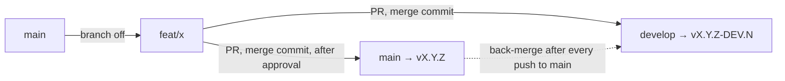

<!-- source: documents/deploy.md sha256: 24fff46b4547 -->

# Triển khai & CI/CD

Quy trình triển khai cho thư viện `@duydpdev/style-generator`.

## Mục lục

- [Triển khai \& CI/CD](#triển-khai--cicd)
  - [Mục lục](#mục-lục)
  - [Tổng quan CI/CD](#tổng-quan-cicd)
  - [Các workflow GitHub Actions](#các-workflow-github-actions)
    - [`ci.yml` — Kiểm tra PR](#ciyml--kiểm-tra-pr)
    - [`ci-matrix.yml` — Tầng nặng](#ci-matrixyml--tầng-nặng)
    - [`pr-title.yml` — Lint tiêu đề PR](#pr-titleyml--lint-tiêu-đề-pr)
    - [Quy ước Pull Request \& merge](#quy-ước-pull-request--merge)
    - [Cục bộ (Pre-commit) — Husky](#cục-bộ-pre-commit--husky)
    - [`release.yml` — Điều phối Semantic Release](#releaseyml--điều-phối-semantic-release)
    - [`deploy.yml` — Build \& Publish](#deployyml--build--publish)
      - [Publish lại một tag đã được push nhưng chưa được publish](#publish-lại-một-tag-đã-được-push-nhưng-chưa-được-publish)
    - [`back-merge.yml` — Back-merge](#back-mergeyml--back-merge)
    - [`drift.yml` — Kiểm tra drift](#driftyml--kiểm-tra-drift)
  - [Chiến lược branch](#chiến-lược-branch)
    - [Quy trình feature](#quy-trình-feature)
    - [Gỡ một feature bị từ chối](#gỡ-một-feature-bị-từ-chối)
  - [Quy trình phát hành](#quy-trình-phát-hành)
    - [Quy trình đúng](#quy-trình-đúng)
    - [Các secret bắt buộc](#các-secret-bắt-buộc)
  - [Định dạng commit](#định-dạng-commit)
    - [Cấu hình](#cấu-hình)
  - [Site (landing + ví dụ)](#site-landing--ví-dụ)
    - [Vì sao dùng `link:` thay vì `workspace:*`](#vì-sao-dùng-link-thay-vì-workspace)
    - [Các alias script (root)](#các-alias-script-root)

---

## Tổng quan CI/CD



Mọi lần merge vào `main`/`develop` đều chạy `release.yml` (semantic-release). Khi có tag mới, `deploy.yml` publish lên npm registry công khai (`registry.npmjs.org`). Mọi lần push vào `main` (có hoặc không có release) đều kết thúc bằng `back-merge.yml`, workflow này merge `main` ngược lại vào `develop`. `drift.yml` chạy hằng ngày (06:17 UTC) và cảnh báo khi `develop` vẫn thiếu các commit từ `main`.

---

## Các workflow GitHub Actions

### `ci.yml` — Kiểm tra PR

**Trigger:** Pull Request vào `main`, `develop` hoặc một branch tích hợp `release/**` (ví dụ `release/5.0` cho chu kỳ 5.0: một PR từ branch làm việc vào `release/5.0` và PR `promote/<x>` → `develop` (được tạo tại đúng SHA của `release/5.0`, xem [Quy ước Pull Request & merge](#quy-ước-pull-request--merge)) đều có CI). `release.yml` **không** chạy trên `release/**`: các bản phát hành chỉ được publish từ `main`/`develop`.

**Draft:** job `check` không có cổng draft và `on.pull_request.types` là `opened`, `synchronize`, `reopened`, `ready_for_review`: một PR draft chạy CI như mọi PR khác (phút Actions miễn phí trên repo công khai này, và một check bắt buộc bị bỏ qua sẽ được tính là đạt, nên một PR draft sẽ không có kết quả thật nào). Job `e2e` là ngoại lệ: nó bỏ qua các PR draft (`if: github.event.pull_request.draft == false`), và `ready_for_review` chạy lại workflow để lần chạy draft đã bị bỏ qua được thay thế khi PR được đánh dấu ready. Hãy mở PR ở dạng draft cho đến khi gate cục bộ xanh; CI sau đó chạy ở mỗi lần push vào nó. `ci.yml` không có bộ lọc path: một PR chỉ đổi `documents/**` vẫn chạy `check`, vì site render `documents/*.md` và `check:links` kiểm tra các liên kết của chúng.

**Job** (Node 22):

- `check`: `yarn install --immutable` → `yarn npm audit --recursive --severity high --environment production` (chặn khi một production dependency có lỗ hổng mức high/critical) → `yarn npm audit --all --recursive || true` (chỉ ghi log, các công cụ dev/example/site không được ship) → commitlint các commit của PR → `yarn build:all` (chạy trước lint: ESLint nhận biết kiểu cũng quét `examples/**`, nơi import thư viện đã build) → `yarn lint` → `yarn prettier:check` → `yarn tsc --noEmit` → `node --check scripts/*.mjs site/scripts/*.mjs` + `yarn typecheck:scripts` → `yarn workspace site build` → `yarn workspace site check:links` → kiểm tra kiểu 4 ví dụ và `site` (`yarn workspaces foreach -A --include '*-example' --include site run typecheck`; cũng biên dịch các file kiểm tra kiểu của component mẫu; `tsconfig.json` gốc không bao gồm `site/`) → `yarn workspace design-system-example test` (DX test, cần `dist/` từ `build:all`) → build `plain-react-example` và `plain-nuxt-example` → `yarn check:externals` → `yarn check:browser-safe` → `yarn check:sizes` → `yarn check:smoke` → `yarn check:types-pack` (tarball + `@arethetypeswrong/cli`, profile node16) → `node scripts/vite-dev-smoke.mjs` → `yarn typecheck:dist` → `yarn test:coverage` (giới hạn `coverage.thresholds`) → `yarn test:types`. Các ví dụ chạy một bản build bundler cần Node >= 22.18 (config import các module `.ts` qua type stripping); Node 22 của CI là 22.23.4.
  - `e2e` (tên check `E2E (Playwright)`, một job riêng để nó báo cáo trên mọi PR, kể cả PR chỉ đổi tài liệu): `yarn build:all` → `yarn playwright install --with-deps chromium webkit` → `yarn test:e2e`. Nó bỏ qua các PR draft.
  - Phạm vi commitlint: `base..head` cho các PR vào cả `develop` lẫn `main`. Một feature được tách từ `main` và vào cả hai branch với cùng các commit (merge commit, không squash), nên phạm vi này chính xác là các commit của feature đó. Header của chúng quyết định loại release, vì vậy mọi commit đều được lint.

### `ci-matrix.yml` — Tầng nặng

**Trigger:** tầng nặng. `schedule` hằng đêm (cron `43 5 * * *`, GitHub chạy trên branch mặc định `main`), `workflow_dispatch` (`gh workflow run ci-matrix.yml --ref main`) và Pull Request vào `main` hoặc `release/**` (`types: [opened, synchronize, reopened, ready_for_review]`), trừ các PR chỉ đổi `documents/**`: `paths-ignore: ["documents/**"]` ở cấp workflow nghĩa là GitHub không tạo một lần chạy, nên không tốn phút nào. Nó không chạy trên PR vào `develop`: tầng theo từng PR nằm trong `ci.yml`. Nó không phải check bắt buộc, nên **mọi leg phải xanh trước khi merge PR vào `main`** (người merge kiểm tra thủ công). Nó có `concurrency: ci-matrix-<ref>` riêng với `cancel-in-progress: true`. Mỗi job đều có `if: github.event_name != 'pull_request' || github.event.pull_request.draft == false`: trên PR, ma trận bỏ qua các PR draft và chạy khi PR được đánh dấu ready; các sự kiện `schedule` và `workflow_dispatch` không có `pull_request.draft`, nên vế đầu cho phép chúng chạy.

**Các job** (Node 22, trừ `node-floor`); mỗi job chạy `yarn install` và `yarn build:all` riêng của nó:

- `tailwind-floor`: ghi `resolutions` Tailwind `~4.1.0` vào `package.json` của runner (không commit) → `yarn install --no-immutable` → `yarn build:all` → `yarn playwright install --with-deps chromium webkit` → `yarn test` → `yarn test:e2e`.
- `node-floor`: Node `20.19.0` (mức sàn của `engines.node`) → `yarn install --immutable` → `yarn build:all` → `yarn check:smoke` (mọi bước, kể cả `init`) → `yarn check:next-build` (tarball đã pack + `next@16.4.5` trong một project nháp, `style-gen init`, `next build` bằng Turbopack; khẳng định `styleGenNext` đã ghi `styles/theme.css` và CSS đã build mang theme).
- `peer-matrix`: 4 nhánh (`vite` 5/6/8, `typescript` 6). `yarn install --immutable` → `yarn build:all` → ghi `resolutions[<peer>] = ^<major>.0.0` (không commit) → `yarn install --no-immutable` → khẳng định phiên bản được resolve ở thư mục gốc và trong `examples/harness` là `<major>.x` → build `examples/harness` → (nhánh `vite`) `node scripts/vite-dev-smoke.mjs` → kiểm tra kiểu ví dụ → `yarn typecheck:dist` → (nhánh `typescript`) `yarn test:types`. Mọi nhánh đều phải xanh (không nhánh nào có `continue-on-error`); nhánh TypeScript 7 đã bị bỏ vì Yarn 4.10 không cài được TypeScript 7 native, nên nhánh đó chưa bao giờ xanh và tốn khoảng 45 phút mỗi tháng. Các nhánh xanh/đỏ quyết định các khoảng `peerDependencies` (được sửa tay).
- `ui-peer-floor`: build thư viện bằng toolchain đã commit, ép bốn optional peer của UI kit (`class-variance-authority`, `clsx`, `tailwind-merge`, `@types/react`) về mức sàn của các khoảng `peerDependencies` qua `resolutions` (không commit), khẳng định các phiên bản được resolve, rồi chạy `yarn typecheck:dist` và `yarn vitest run src/features/ui`. Nó thất bại khi một mức sàn đã ghim không còn là mức tối thiểu của khoảng trong `package.json`. Hai bản ghim chỉ dành cho harness (bộ ví dụ dùng để kiểm thử DX) phản ánh những gì một consumer thực sự nhận được: cva 0.7.0 cần đúng clsx 2.0.0, nên nó giữ một bản sao lồng nhau riêng, và `@types/scheduler` được giữ ở 0.16.8, phiên bản cuối cùng có `scheduler/tracing`, thứ mà `@types/react` <=18.2.71 import.

Các trình duyệt Playwright **không** được cache, và đây là một quyết định đã đo đạc (PR #73). Khi trúng cache, bước cài đặt mất 42 giây; không có cache là 49–52 giây; khi trượt cache là 56–75 giây, cộng thêm 5–8 giây để lưu cache, và mỗi ref của PR tốn 383 MB. Cache không thể bỏ qua bước `install-deps` (apt), bước chiếm phần lớn thời gian. Phép đo được thực hiện khi `e2e` còn chạy trong `ci-matrix.yml`; `e2e` nay nằm trong `ci.yml` và quyết định này không đổi. Kết quả là mỗi PR mới đều chậm hơn. Chỉ đáng xem lại việc dùng container `mcr.microsoft.com/playwright` nếu e2e trở thành nút thắt cổ chai.

### `pr-title.yml` — Lint tiêu đề PR

**Trigger:** Pull Request vào `main`, `develop` hoặc `release/**`, `opened`, `edited`, `reopened` (`edited` cũng bắt được việc chỉ sửa tiêu đề). Nó không chạy ở `synchronize`: push một commit mới không đổi tiêu đề, nên check này chỉ gắn vào head tại thời điểm PR được mở/sửa/mở lại.

Chạy `commitlint --config commitlint.pr-title.config.ts` trên tiêu đề PR. Config này dùng lại `commitlint.config.ts` và chỉ tắt `defaultIgnores`, nên một tiêu đề `Revert "…"` (mặc định của GitHub khi revert một PR) hoặc `Merge …` cũng thất bại. Phạm vi lint trong `ci.yml` vẫn dùng config chung vì ở đó có các merge commit thật. Vì các feature vào `develop` qua merge commit, tiêu đề PR không còn quyết định release: dòng đầu của một merge commit là `Merge pull request #N from …` (bị analyzer bỏ qua), và tiêu đề PR chỉ xuất hiện trong phần body. Check này được giữ lại để tiêu đề PR dễ đọc và khớp với header của commit. Bước `Check branch name` (chạy trước khi cài dependency) kiểm tra `github.head_ref` bằng `scripts/check-branch-name.sh`, cùng quy tắc với hook `pre-push` (xem [Chiến lược branch](#chiến-lược-branch)).

### Quy ước Pull Request & merge

Các ruleset bảo vệ `main`/`develop` (bắt buộc có PR, chỉ dùng merge commit, và bắt buộc có ba check: `Build & Lint Check`, `Plain React (Storybook + parity)` và `E2E (Playwright)`); admin có thể bỏ qua vì `release.yml`/`back-merge.yml` push bằng một PAT. Người merge vẫn phải dừng lại khi một check nằm ngoài danh sách bắt buộc bị đỏ; lưới an toàn cuối cùng là `yarn test` + `yarn test:types` trong `release.yml`, chạy trước khi cắt tag.

| PR                  | Cách merge                                                   | Ghi chú                                                                                                                                                                  |
| ------------------- | ------------------------------------------------------------ | ------------------------------------------------------------------------------------------------------------------------------------------------------------------------ |
| Feature → `develop` | **Create a merge commit**                                    | Feature giữ nguyên các SHA của nó. Khi feature vào `main`, back-merge nhận ra các commit đó đã có trên `develop`, nên merge sạch và DEV không phân tích lại chúng.       |
| Feature → `main`    | **Create a merge commit**                                    | Cùng branch feature, mở PR thứ hai sau khi được duyệt trên `develop`.                                                                                                    |
| `develop` → `main`  | **Không dùng**                                               | `develop` cũng chứa các feature chưa được duyệt; promote cả branch sẽ ship những thứ chưa được duyệt.                                                                    |
| Squash / Rebase     | Tắt (`allow_squash_merge=false`, `allow_rebase_merge=false`) | Squash tạo một bản sao với SHA khác: DEV phân tích lại các feature đã ship và các feature phụ thuộc bị xung đột (được đo trong plan `feature-from-main-flow`, phase 01). |

**Thiết lập mang tính chịu lực:** `merge_commit_title = MERGE_MESSAGE` (dòng đầu `Merge pull request #N …`) và `merge_commit_message = PR_TITLE`. Nếu dòng đầu trở thành tiêu đề PR, merge commit sẽ mang một header `[type]`, và mọi merge commit chỉ tồn tại trên `develop` sẽ bị đếm lại sau mỗi lần back-merge. Đừng đổi nó.

`delete_branch_on_merge=true`: GitHub xóa branch head khi một PR được merge. Branch feature vẫn cần cho PR thứ hai vào `main`. Nếu PR vào `develop` đến thẳng từ `feat/x`, GitHub đã xóa `feat/x`: hãy tạo lại nó trên GitHub tại đúng SHA đã merge, không bao giờ push từ một bản clone cục bộ: `SHA=$(gh pr view <PR into develop> --json headRefOid --jq .headRefOid)`, rồi `gh api -X POST repos/duydpdev/style-generator/git/refs -f ref=refs/heads/feat/x -f sha=$SHA`. Trước khi merge PR vào `main`, `gh pr view <PR into main> --json headRefOid --jq .headRefOid` phải in ra chính xác `$SHA`. Nếu PR vào `develop` đi qua `integrate/x`, `feat/x` không bị xóa. Các commit của một branch đã xóa vẫn nằm trong PR (`refs/pull/<N>/head`), nên việc xóa branch không làm mất lịch sử nào.

`release/*` không bao giờ là head của một PR đã merge: merge một PR `release/5.0` → `develop` sẽ xóa `release/5.0`, và GitHub chuyển mục tiêu của mọi PR đang mở có base là `release/5.0`. Để đưa `release/*` vào `develop` hoặc `main`, hãy tạo một branch `promote/<x>` tại đúng SHA của nó (`gh api -X POST repos/duydpdev/style-generator/git/refs -f ref=refs/heads/promote/<x> -f sha=$(gh api repos/duydpdev/style-generator/git/ref/heads/release/5.0 --jq .object.sha)`) và mở PR từ `promote/<x>`; khi merge, GitHub chỉ xóa `promote/<x>`.

Template: `.github/pull_request_template.md`. Dependabot (`.github/dependabot.yml`) cập nhật GitHub Actions hằng tháng thành **một** PR được gom nhóm (`groups`) nhắm vào `main` (`target-branch`), với tiền tố `"[ci] "` (có dấu cách ở cuối để GitHub không chèn `:` sau `]`). Dependabot tách branch từ branch đích, nên nhắm vào `main` khiến branch của nó là một branch feature sạch. Hãy đưa nó vào `develop` trước bằng một PR thứ hai từ cùng branch đó (`gh pr create --base develop --head <dependabot branch>`), rồi merge PR Dependabot vào `main`. Nếu GitHub đã xóa branch Dependabot khi PR vào `develop` được merge (PR Dependabot vào `main` khi đó bị đóng), hãy tạo lại branch tại `headRefOid` của PR vào `develop` (`gh api -X POST repos/duydpdev/style-generator/git/refs -f ref=refs/heads/<branch> -f sha=<SHA>`) và chạy `gh pr reopen <N>`. Dependabot chỉ đọc file này trên branch mặc định `main`.

Mục `npm` trong cùng file chạy hằng tháng với cùng quy trình (nhắm vào `main`, tiền tố `"[ci] "`, tối đa 2 PR đang mở). Mọi bản nâng minor/patch được gom vào **một** PR (nhóm `npm-minor-patch`); mỗi bản nâng major là một PR riêng. Nó không bao giờ đề xuất major cho `tailwindcss`, `@tailwindcss/*`, `zod`, `vite` và `typescript`: các dòng này (và các khoảng peer) được theo dõi bằng tay, và các job `tailwind-floor` và `peer-matrix` kiểm tra chúng. Một bản nâng làm đổi một khoảng đã publish (`dependencies`/`peerDependencies`) phải đổi header của nó thành `[fix]`/`[feat]` trước khi merge.

Cả hai mục đều đặt `rebase-strategy: disabled`: Dependabot không tự rebase các PR đang mở mỗi khi `main` thay đổi, vì mỗi lần rebase chạy lại toàn bộ CI của PR. Để cập nhật một PR, hãy comment `@dependabot rebase`. Các PR được mở trước khi tắt rebase vẫn được rebase tới 30 ngày sau khi chúng được mở (tài liệu `rebase-strategy` của GitHub). Cảnh báo và cập nhật bảo mật của Dependabot được bật (`gh api repos/duydpdev/style-generator/automated-security-fixes --jq .enabled` in ra `true`): một PR cập nhật bảo mật mở ra ngay khi có advisory, không theo `schedule`, và nhắm vào branch mặc định `main` (hãy đưa nó vào `develop` trước bằng cùng quy trình).

---

### Cục bộ (Pre-commit) — Husky

Dự án dùng **Husky** và **lint-staged** để chặn các commit không đạt chuẩn:

- `.husky/pre-commit` chỉ gọi `yarn lint-staged` (cấu hình duy nhất: `lint-staged.config.js`). lint-staged trước hết stash các thay đổi chưa stage, nên mỗi bước chỉ thấy snapshot đã stage.
- Với các file code đã stage: `eslint --fix` → `prettier --write` trên các file đó → `tsc --noEmit` cho cả dự án → `vitest related --run` (chỉ các test import các file đã stage). Các file `json`/`md`/`yml`/`css` chỉ đi qua `prettier --write`.
- `yarn test` đầy đủ, `yarn test:types` và các gate `check:*` chạy trong CI, không chạy trong hook.
- `.husky/pre-push` chạy `scripts/check-branch-name.sh` cho mọi branch được push (nó bỏ qua `main`, `develop`, tag và việc xóa branch). Bỏ qua một lần bằng `HUSKY=0 git push …`.
- Hook được cài qua `postinstall: husky` (Yarn Berry không chạy `prepare`); `pinst` vô hiệu hóa `postinstall` trong tarball đã publish; CI release đặt `HUSKY=0`.

---

### `release.yml` — Điều phối Semantic Release

**Trigger:** Push vào `main` hoặc `develop`. `concurrency: release-<ref>`, `cancel-in-progress: false`: mỗi branch chỉ có một lần chạy release tại một thời điểm, và một lần chạy đang chạy không bao giờ bị hủy (để tránh một tag đã push mà không publish). GitHub chỉ giữ một lần chạy đang chờ cho mỗi nhóm, nên một lần push mới thay thế lần chạy đang chờ cũ hơn; lần chạy mới phát hành một tập commit bao gồm cả hai.

**Các bước:**

1. `yarn test` + `yarn test:types` trên commit vừa được push, trước khi cắt tag
2. Chạy `semantic-release` → tự động tính phiên bản và tạo một git tag; chỉ trên `main` nó mới commit `package.json` + `CHANGELOG.md`
3. Phát hiện tag của chính lần chạy này: một tag trên `HEAD`, không có trong snapshot chụp trước khi chạy `semantic-release`, và nằm trên kênh riêng của branch (`main`: `vX.Y.Z`; `develop`: `vX.Y.Z-DEV.N`). semantic-release fetch mọi tag từ remote trước khi chạy, nên một tag vừa được push bởi lần chạy của branch khác cũng xuất hiện ở local; so sánh snapshot trước/sau như trước đây có thể chọn nhầm tag đó. Đúng một tag → release; không có tag → không release (in một `::warning` nếu branch remote đã đi tiếp, vì semantic-release bỏ qua một branch đang tụt sau remote); nhiều hơn một tag → job thất bại, hãy publish bằng tay theo [runbook](#publish-lại-một-tag-đã-được-push-nhưng-chưa-được-publish).
4. Nếu có tag mới → kích hoạt `deploy.yml`
5. Trên `main`, sau khi job release thành công (có hoặc không có tag, `deploy` thành công hoặc bị bỏ qua) → kích hoạt `back-merge.yml`

`release.config.cjs` chỉ bật `@semantic-release/changelog` và `@semantic-release/git` khi branch đúng là `main`, và in `[release.config] branch=<b> commitsRelease=<bool>` ra log. Một bản release DEV trên `develop` chỉ tạo một tag và không commit `package.json`/`CHANGELOG.md`: nếu có, `develop` và `main` sẽ sửa cùng các dòng version/changelog và mọi lần back-merge sau một bản stable sẽ bị xung đột.

---

### `deploy.yml` — Build & Publish

**Trigger:** Được gọi từ `release.yml` (workflow_call) khi có một bản release mới, hoặc chạy bằng tay (`workflow_dispatch`, input `tag`) để publish lại một tag. Checkout dùng `persist-credentials: false` (sau đó không có thao tác git nào).

**Các bước:**

1. Checkout tại tag mới
2. Node 22 (Yarn Berry đọc registry từ `.yarnrc.yml`, không phải từ `.npmrc`)
3. `yarn install --immutable`
4. `npm pkg set version=<tag without v>` rồi khẳng định nó khớp với tag (thất bại nếu tag rỗng). Cần thiết cho DEV, vì `package.json` tại một tag DEV vẫn là phiên bản stable mới nhất; trên `main` nó không làm gì. Không commit.
5. `yarn build:all`
6. `yarn check:externals`
7. `yarn check:types-pack` (tarball đã đóng gói + `@arethetypeswrong/cli`, profile node16; cần `dist/*.d.cts` từ `build:all`)
8. `yarn typecheck:dist` (kiểm tra `dist/*.d.ts` và `dist/*.d.cts` với `skipLibCheck: false`; attw không resolve các kiểu peer, nên không thể thay thế bước này)
9. `yarn check:smoke` (bản build của tag chạy được: mọi subpath nạp được ở ESM/CJS, `style-gen --version` in ra đúng phiên bản vừa đặt ở bước 4)
10. `yarn check:browser-safe`
11. `yarn check:publish-target`
12. `yarn npm publish --dry-run` (khẳng định output chứa `Package would be published to https://registry.npmjs.org`)
13. `yarn npm publish --provenance` lên **npmjs.org**, xác thực bằng npm trusted publishing (OIDC token của job, không có secret): một tag có hậu tố (`-DEV.N`) được publish với `--tag DEV`, một tag stable được publish dưới dạng `latest`

Các test không chạy lại ở đây: `release.yml` đã kiểm thử đúng commit này trước khi cắt tag. Chạy lại chúng trên cùng cây mã chỉ thêm sự flaky, thứ sẽ tạo ra một tag + GitHub release mà không có package. `check:smoke` thì khác: nó kiểm tra bản build mang phiên bản của tag, thứ duy nhất được publish.

#### Publish lại một tag đã được push nhưng chưa được publish

semantic-release push tag trước khi chạy các plugin publish (GitHub release), nên một job `release` thất bại sau bước đó sẽ để lại một tag không có package; chạy lại job sẽ không thấy tag mới. Hãy publish tag đó bằng tay:

```bash
gh workflow run deploy.yml --ref main -f tag=v4.0.1   # or v4.0.1-DEV.1
gh run watch "$(gh run list --workflow=deploy.yml --limit 1 --json databaseId --jq '.[0].databaseId')"
```

`workflow_dispatch` chỉ chạy được phiên bản của `deploy.yml` đã tồn tại trên `main`. Với một phiên bản đã được publish, registry từ chối publish lại (409); đừng unpublish.

---

### `back-merge.yml` — Back-merge

**Trigger:** Được gọi từ `release.yml` sau mỗi lần push vào `main` (input `version` rỗng khi lần push đó không tạo release)

**Mục đích:** Merge `main` ngược lại vào `develop` để `develop` luôn chứa mọi commit của `main`: các commit release, và các feature `[ci]`/`[docs]` không tạo release.

Một merge thường, **không phải** `-X theirs` (tùy chọn đó chọn phía `main` cho mọi hunk xung đột và lặng lẽ bỏ mã mới hơn của `develop`). Một feature vào `develop` trước `main` với cùng các commit, và DEV không commit gì, nên một merge bình thường là sạch. Khi có xung đột, job liệt kê các file xung đột, chạy `git merge --abort` và thất bại; hãy merge `main` vào `develop` bằng tay bằng lệnh được in trong log. Nếu push bị từ chối vì `develop` vừa nhận một commit mới, job fetch lại, merge lại từ đầu mới và thử lại tối đa 3 lần. Thông điệp chứa `[skip ci]`, nên nó không tạo một DEV mới.

### `drift.yml` — Kiểm tra drift

**Trigger:** mỗi ngày lúc 06:17 UTC (`schedule`, `cron: "17 6 * * *"`) và `workflow_dispatch`. Một lịch chạy mỗi giờ tốn khoảng 675 phút runner mỗi tháng (mỗi lần chạy ~6 giây được làm tròn lên 1 phút); một back-merge hỏng giờ được báo chậm nhất một ngày.

Thất bại khi `git rev-list --count origin/develop..origin/main` > 0 và đầu của `main` cũ hơn 60 phút (bỏ qua khi một lần chạy release/back-merge đang diễn ra), và in ra các commit còn thiếu. Hạn chế: phép đếm không bắt được "bẫy revert" (xem [Gỡ một feature bị từ chối](#gỡ-một-feature-bị-từ-chối)).

---

## Chiến lược branch

| Branch                       | Mục đích                                                                                                                                                                               |
| ---------------------------- | -------------------------------------------------------------------------------------------------------------------------------------------------------------------------------------- |
| `main`                       | Các bản phát hành stable. Mỗi lần push → luồng release + back-merge                                                                                                                    |
| `develop`                    | Tích hợp và kiểm thử. Các phiên bản pre-release (hậu tố DEV, dist-tag `DEV`)                                                                                                           |
| `<type>/<slug>`              | Tách từ `main`. PR vào `develop`, rồi một PR riêng vào `main` sau khi được duyệt (mọi leg của tầng nặng phải xanh ở đó). Một bản sửa khẩn cấp cũng làm như vậy (`fix/<slug>`)          |
| `integrate/<slug>`           | Branch tạm để giải quyết xung đột của một feature với `develop`; chỉ vào `develop`                                                                                                     |
| `release/*`                  | Branch tích hợp của một chu kỳ major (ví dụ `release/5.0`): các PR từ branch làm việc đi vào đây. Không bao giờ là head của một PR đã merge; nó vào `develop`/`main` qua `promote/<x>` |
| `promote/*`, `dependabot/**` | `promote/<x>`: được tạo tại đúng SHA của một `release/*` để mở PR vào `develop`/`main` (ví dụ trước đây: `promote/4.0.0`); `dependabot/**`: các branch do Dependabot tạo               |

**Quy tắc đặt tên branch** (`scripts/check-branch-name.sh`): `^(feat|fix|docs|chore|ci|build|refactor|test|perf|revert)/[a-z0-9]+(-[a-z0-9]+){0,5}$`, tức `<type>/<slug>`: `type` là một loại commit trừ `style`, `release`, `temp`, `conf`, `wip`; `slug` gồm 1–6 từ là chữ thường hoặc chữ số nối bằng `-` (ví dụ `feat/theme-axes`, `ci/branch-hygiene`). Ngoại lệ: `release/<x>`, `promote/<x>`, `dependabot/**`, `integrate/<slug>`. Quy tắc được kiểm tra ở hai nơi: hook `.husky/pre-push` trên máy cục bộ và bước `Check branch name` của `pr-title.yml` trên branch head của PR (bước đó bị bỏ qua khi head nằm trong một fork, `github.event.pull_request.head.repo.full_name != github.repository`, vì một contributor bên ngoài không thể tuân theo quy tắc đặt tên; check tiêu đề chạy cho tất cả mọi người). Các check bắt buộc của ruleset là `Build & Lint Check`, `Plain React (Storybook + parity)` và `E2E (Playwright)`, nên một check `PR Title` đỏ tự nó không chặn merge: người merge phải dừng lại vì nó.

### Quy trình feature

1. `git fetch origin && git switch -c feat/x origin/main`. Không bao giờ tách từ `develop`.
2. **Một commit, header đúng.** Loại release được quyết định bởi header của các commit trong branch (merge commit bị analyzer bỏ qua). Trước PR đầu tiên, hãy squash branch thành một commit `[type] subject` và dùng đúng header đó làm tiêu đề của cả hai PR. Một commit `[feat] wip` còn sót lại sẽ thành minor ngay cả khi PR được đặt tên `[fix] …`. Major: `[release] …`.
3. PR `feat/x` → `develop`, **Create a merge commit**. Kết quả là `vX.Y.Z-DEV.N` trên dist-tag `DEV`. Consumer kiểm thử bằng phiên bản chính xác (`@duydpdev/style-generator@4.1.0-DEV.3`), không phải một khoảng: `^4.1.0-DEV.3` resolve lên tới bản stable `4.1.0`, bản có thể thiếu một feature khác đang nằm trên `develop`.
4. Sau khi được duyệt: nếu `feat/x` đã bị xóa khi PR vào `develop` được merge (`delete_branch_on_merge=true`), hãy tạo lại nó trên GitHub tại đúng SHA đã merge (xem [Quy ước Pull Request & merge](#quy-ước-pull-request--merge)), không bao giờ push từ một bản clone cục bộ. Sau đó PR `feat/x` → `main`, **Create a merge commit**; trước khi merge, `headRefOid` của PR phải bằng SHA đó. Bản phát hành stable, publish `latest`, back-merge.
5. **Phụ thuộc vào một feature khác:** tách branch từ branch của feature kia, nói rõ trong PR, và feature kia phải vào `main` trước.
6. **Xung đột khi vào `develop`:** **không** dùng nút "Resolve conflicts" hay "Update branch" của GitHub: cả hai đều merge `develop` vào `feat/x`, và PR vào `main` sau đó sẽ mang theo feature chưa được duyệt. Thay vào đó: `git switch -c integrate/x origin/develop && git merge feat/x`, giải quyết xung đột, mở một PR `integrate/x` → `develop` (merge commit); GitHub xóa branch khi merge (`delete_branch_on_merge=true`). `feat/x` giữ sạch cho `main`. Chỉ cập nhật `feat/x` bằng `git merge origin/main`.

### Gỡ một feature bị từ chối

- **Khỏi `develop`:** PR `[revert] <feature>` (`git revert -m 1 <merge-commit>`), tạo một bản patch DEV mới. Không bao giờ force-push `develop`.
- **Bẫy revert:** các commit của feature đã là tổ tiên của `develop`. Nếu chính các commit đó được merge lại sau này (vào `develop` hoặc `main`), git coi chúng đã có sẵn: `develop` thiếu mã trong khi `drift.yml` vẫn báo 0 (được đo trong plan `feature-from-main-flow`, phase 01). Quy tắc: trước khi một feature đã revert vào lại bất kỳ đâu, hãy chạy `git rebase --force-rebase origin/main` trên branch để các commit có SHA mới.
- **Khỏi `main`:** PR `[revert] <feature>` vào `develop` rồi vào `main`, tạo ra một bản phát hành patch. Phiên bản cũ đã publish vẫn còn trên registry.

---

## Quy trình phát hành

> [!IMPORTANT]
> Dự án dùng **semantic-release** — phiên bản được tính tự động từ các thông điệp commit. **Không cần** sửa `package.json` bằng tay.
> Một bản phát hành major cần một commit `[release] …` (xem bảng Định dạng commit).

### Quy trình đúng

1. Tách branch `feat/x` từ `main` (xem [Quy trình feature](#quy-trình-feature))
2. Một commit theo định dạng `[type] subject` (xem bên dưới)
3. PR vào `develop`, CI đạt → **Create a merge commit** → `release.yml` cắt `vX.Y.Z-DEV.N` (chỉ tag, không commit) và publish dist-tag `DEV`
4. Sau khi được duyệt → PR từ cùng branch vào `main`, CI đạt → **Create a merge commit** → `release.yml`:
   - Tính phiên bản mới từ header của các commit của feature
   - Commit `package.json` + `CHANGELOG.md` (`[chore] release x [skip ci]`) và tạo tag `vX.Y.Z`
   - Kích hoạt `deploy.yml` để publish lên npmjs.org
   - Kích hoạt `back-merge.yml` để merge `main` ngược lại vào `develop`

### Các secret bắt buộc

- `CI_WORKER_REPOSITORY_TOKEN`: một PAT có quyền push commit release và tag lên repo GitHub. Nó không được khai báo trong `env` ở cấp workflow; nó chỉ được truyền cho checkout + semantic-release (env `GITHUB_TOKEN`) trong `release.yml` và cho checkout trong `back-merge.yml` (job gọi nó dùng `secrets: inherit`). `deploy.yml` không nhận nó (job `deploy` không dùng `secrets: inherit`). Checkout của job `release` dùng `persist-credentials: false`, nên token không nằm trong `.git/config` trong khi `yarn install`/test chạy: semantic-release tự chèn env `GITHUB_TOKEN` vào URL của mọi lệnh fetch/push, và bước phát hiện tag chỉ đọc các tag cục bộ. `back-merge.yml` giữ giá trị mặc định (`true`) vì nó tự chạy `git fetch`/`git push` sau checkout, và nó không cài dependency nào.
- Việc publish lên npm **không dùng secret**: npm trusted publishing (OIDC). Job `deploy` trong `release.yml` và workflow `deploy.yml` giữ `id-token: write` (quyền của một reusable workflow không thể vượt quá job gọi nó) và `yarn npm publish --provenance` đổi OIDC token đó lấy một credential publish tồn tại ngắn, nên không có `NPM_TOKEN` nào để hết hạn và không có token nào để các job dùng PAT làm lộ. `GITHUB_TOKEN` giữ `contents: read` trong toàn bộ `release.yml`. `release` và `back-merge` push bằng PAT, nên không cần `contents: write` trên `GITHUB_TOKEN`.

### Trusted publisher của npm (thiết lập một lần)

**Trusted Publisher** của package trên npmjs.com là thứ cho phép workflow publish. Package `@duydpdev/style-generator` → Settings → Trusted Publisher → GitHub Actions: user `duydpdev`, repository `style-generator`, tên file workflow `release.yml`, để trống environment, và tick "Allow npm publish" (một publisher tạo ra mà không tick chỉ có thể stage). npm so khớp với workflow **khởi chạy** run, nên lần publish tự động (được gọi từ `release.yml`) cần `release.yml`; chạy tay `deploy.yml` (runbook bên dưới) cần đăng ký thêm `deploy.yml` làm publisher thứ hai. Một publisher không publish gì trong 2 ngày sẽ hết hạn: hãy đăng ký vào đúng ngày merge bản release đầu tiên. Sau lần publish đầu, bật "Require two-factor authentication and disallow tokens" cho package.

Nếu bước `Publish to npm` lỗi `E404`/`ENEEDAUTH`, publisher chưa có hoặc tên workflow không khớp: sửa trên npmjs.com rồi "Re-run failed jobs" trên run đó. Không bao giờ xóa tag.

Bước `Publish to npm` xanh chưa chứng minh phiên bản đã công khai. Một publisher chỉ cho phép `npm stage publish` (mặc định với publisher tạo sau 2026-09-03) làm `yarn npm publish` thoát với mã 0 trong khi phiên bản chỉ nằm trong hàng chờ staging: `npm view @duydpdev/style-generator dist-tags` không đổi cho đến khi một maintainer duyệt trên npmjs.com (Staged Packages → Approve, kèm 2FA). Hoặc duyệt từng bản release ở đó, hoặc tạo lại publisher với action `npm publish` được tick để release lên thẳng. Sau mỗi lần release, hãy kiểm tra `npm view @duydpdev/style-generator dist-tags`.

---

## Định dạng commit

Định dạng thông điệp commit: `[type] subject`, với type viết thường (`[Feat] …` bị commitlint từ chối, vì analyzer chỉ ánh xạ các type viết thường và sẽ không release).

| Type                                                          | Tăng phiên bản  | Ví dụ                                |
| ------------------------------------------------------------- | --------------- | ------------------------------------ |
| `release`                                                     | Major (`2.0.0`) | `[release] ship public v2 API`       |
| `feat`                                                        | Minor (`1.1.0`) | `[feat] add multi-theme support`     |
| `fix`                                                         | Patch (`1.0.1`) | `[fix] correct spacing var fallback` |
| `perf`                                                        | Patch (`1.0.1`) | `[perf] reduce generated CSS size`   |
| `refactor`, `style`, `revert`                                 | Patch (`1.0.1`) | `[refactor] simplify registry walk`  |
| `docs`, `chore`, `test`, `build`, `ci`, `conf`, `temp`, `wip` | Không tăng      | `[docs] update architecture guide`   |

Ghi chú release dùng preset `conventionalcommits` (khai báo trong `devDependencies`) với template `changelog-template.hbs`; các mục theo thứ tự này: `Release`, `Features`, `Bug Fixes`, `Performance Improvements`, `Refactor`, `Style`, `Reverts`. Các type không tăng phiên bản không xuất hiện trong ghi chú. Phần body của các commit `[feat]` và `[fix]` được in thụt lề ngay dưới mục tương ứng (`finalizeContext` trong `release.config.cjs`). Vì `[fix]` thường siết chặt việc kiểm tra hợp lệ, hãy viết một body nói rõ điều gì giờ bị từ chối và cách nâng cấp; body của một `[feat]` liệt kê các thay đổi hành vi mà người dùng cần biết (giá trị mặc định mới, ngữ nghĩa mới). Body của các type khác không xuất hiện trong ghi chú.

### Cấu hình

Xem: [`commitlint.config.ts`](../../commitlint.config.ts) và [`release.config.cjs`](../../release.config.cjs)

---

## Site (landing + ví dụ)

Landing site (`site/`) và các ví dụ (`examples/design-system`, `harness`, `plain-react`, `plain-nuxt`) dùng thư viện qua một dependency `link:`. Site **không được triển khai** (chưa có kế hoạch hosting). `deploy-site.yml` và `site:deploy:manual` đã bị gỡ (2026-09-30). Bật lại nó cần một plan riêng.

Site vẫn được build trong mọi PR: job `check` của `ci.yml` chạy `yarn workspace site build` ngay sau `yarn build:all`, kể cả với các PR chỉ đổi `documents/**`, vì site render `documents/*.md`. `yarn workspace site build` chạy `build:examples` (build `examples/harness` với base `./`, chép `examples/harness/dist` vào `site/public/examples/v4`), rồi build Vite của site. `harness` import theme, options và recipe của nó từ workspace `design-system-example` (`workspace:*`, một symlink thật), nên bản build của site không cần bước nào thêm; trình khám phá mã nguồn của site cũng đọc `examples/design-system`.

### Vì sao dùng `link:` thay vì `workspace:*`

Package gốc chính là thư viện `@duydpdev/style-generator`.
Với `nodeLinker: node-modules`, Yarn hoist một dependency `workspace:*` trỏ ngược về gốc lên `node_modules` gốc, coi nó là một self-reference và bỏ nó đi.
Kết quả là sau một lần `yarn install` sạch, không có `node_modules/@duydpdev/style-generator` ở đâu cả (`nmSelfReferences` không áp dụng cho trường hợp này).
`link:..` (site) và `link:../..` (các ví dụ) tạo symlink trong `node_modules` của từng workspace.
Đừng đặt alias cho package trong Vite: ví dụ phải đi qua `exports` thật của package.
Quy tắc này chỉ áp dụng cho thư viện gốc: `design-system-example` là một workspace riêng, nên hai ứng dụng dùng nó (`harness` và `plain-react`) tham chiếu nó bằng `workspace:*`.

### Các alias script (root)

| Script              | Mô tả                                                   |
| ------------------- | ------------------------------------------------------- |
| `yarn site:dev`     | Vite dev server cho site (cổng 5174)                    |
| `yarn site:build`   | Build thư viện → build site → output trong `site/dist/` |
| `yarn site:preview` | Vite preview server đọc `site/dist/`                    |
